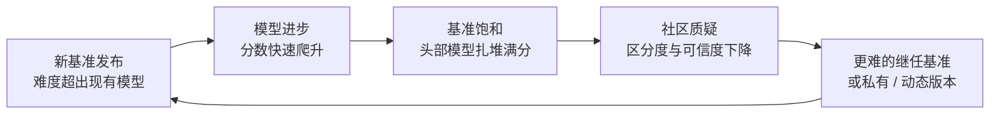

# 核心概念

Benchmark + Evaluation 需要一套比传统软件测试更丰富的概念体系，因为 AI 系统的输出是开放自然语言，"正确"往往是多维、概率、上下文相关的。

## 评估维度

一次完整的 AI 系统评估至少应覆盖以下维度：

| 维度 | 含义 | 典型指标 |
|---|---|---|
| **正确性（Correctness）** | 输出是否满足用户意图 | Accuracy、Exact Match、Pass@k |
| **事实性（Factuality）** | 输出是否符合客观事实 | F1、BLEU、Faithfulness、Claim verification |
| **工具使用（Tool Use）** | 是否选对工具、填对参数、正确处理返回值 | Tool accuracy、Parameter F1、Call success rate |
| **延迟（Latency）** | 响应有多快 | TTFT、ITL、端到端 P99 |
| **成本（Cost）** | 单次调用或会话的资源消耗 | Token 数、$/1K calls、GPU 秒 |
| **安全性（Safety）** | 是否有害、是否泄露敏感信息、是否被越狱 | Harm rate、PII leakage、Jailbreak success rate |
| **鲁棒性（Robustness）** | 输入扰动下输出是否稳定 | Consistency、Error rate under perturbation |

不同场景权重不同：客服机器人重事实性与安全，代码助手重正确性与工具使用，创意写作重多样性与风格，科研 Agent 重多步骤推理与工具链协同。

## 离线评估 vs 在线评估

### 离线评估（Offline Evaluation）

在模型上线前，使用预先准备的黄金数据集（golden set）或合成数据集运行评估。

- 优点：可复现、成本低、适合回归测试与模型选型。
- 缺点：数据集难以覆盖真实分布，存在"训练集泄漏"与 metric gaming 风险。

### 在线评估（Online Evaluation）

在生产或影子流量中，对真实请求进行采样、打标与评分。

- 优点：反映真实分布，可发现长尾问题。
- 缺点：成本高、反馈延迟、需要隐私与合规审查。

最佳实践是两者结合：离线评估作为 CI 门，在线评估作为生产健康度监控。

## 公开 Benchmark 的饱和循环

内部评估之外，公开发布的 benchmark 是模型能力与选型的公共刻度。但 2024 年以来，一条清晰的"饱和循环"反复上演：

典型轨迹：

| 代际 | 代表基准 | 现状（截至 2026-10） |
|---|---|---|
| 知识问答 | MMLU | GPT-4 时代即接近饱和，已被广泛视为"参考项"而非区分项 |
| 知识问答（加难） | MMLU-Pro（10 选项、12K 题）、MMLU-Redux（修正错标题） | 头部模型已逼近天花板，部分评测服务已将其归档 |
| 研究生级推理 | GPQA Diamond | 前沿模型进入 90+ 分区间，趋于饱和 |
| 数学竞赛 | GSM8K、MATH、AIME 2024/2025 | 推理模型出现后相继饱和，AIME 2025 前沿已接近满分 |
| 未饱和数学 | FrontierMath（Epoch AI）、PutnamBench | 仍是区分前沿推理能力的主要刻度，o3 仅约 25%（Tier 1-3） |
| 抽象推理 | ARC-AGI-2 | 2025 年 3 月发布时前沿模型仅个位数得分；ARC Prize 2025 后最优方案约 50% 上下，且严重依赖测试时算力 |
| 综合极难 | Humanity's Last Exam（HLE，约 2500 道跨学科难题） | 2025 年初 GPT-4o 仅约 2.7%，o3 约 20%；截至 2026-10 最高分约 55%（Epoch AI 统计），仍未饱和 |
| 代码工程 | SWE-bench Verified（500 题） | 2026 年头部系统逼近 90%+，区分度下降 |
| 代码工程（加难） | SWE-bench Pro（1865 道长程任务）、SWE-bench Multimodal | 成为新的工程能力刻度，但分数严重依赖 scaffold，跨 harness 不可直接比较 |
| 环境智能体 | OSWorld、WebArena | 原版接近人类基线后，OSWorld 2.0（108 道长程真实任务）上前沿模型二元完成率仅约 20% |
| 动态防污染 | LiveBench | 每月轮换约 1/6 题目并保留私有污染免疫子集，排名跨版本相关系数 >0.997，作为静态榜单的"校准锚" |

几点趋势性结论：

1. **从知识转向推理与执行**：知识型榜单（MMLU 家族）饱和后，社区重心转向多步推理（FrontierMath、HLE）、真实工程（SWE-bench 家族）与环境交互（OSWorld 2.0、GAIA、BrowseComp）。
2. **从静态转向动态与私有**：LiveBench 的月度轮换、私有测试集（如 MMLU-CF）和"发布后定时公开"成为抗污染的标准做法。
3. **分数必须带上下文**：同一模型在不同 harness、scaffold、采样预算下的分数可能相差数十个百分点，引用任何公开分数都应注明 harness 版本、采样方式与日期。
4. **自建基准仍然不可替代**：公开基准衡量"通用能力"，企业真正需要的是"我的任务上是否回归"，两者是互补关系而非替代关系。

## 评测污染与数据泄漏

benchmark 的有效性建立在一个前提上：**测试样本没有被训练过**。一旦模型在预训练或后训练中见过测试集（或近似改写），分数就失去了意义。2024-2025 年的系统审计给出了令人警惕的数字：

- Johns Hopkins 等团队对流行模型与公开基准的审计发现，MMLU 上约 29%、C-Eval 上约 46% 的题目疑似泄漏（NAACL 2024）。
- 在干净镜像集上重测，部分模型掉分超过 13 个百分点。
- LessLeak-Bench 对 83 个软件工程基准的调查表明，泄漏样本上的得分可达干净样本的 4.9 倍。

关键认知是**N-gram 去重基本失效**：简单改写、翻译或"用 GPT-4 生成类似题"都能绕过表面重叠检测。2025 年的若干研究（如对 Nemotron-Science、NaturalReasoning 等后训练集的审计）用 LLM 语义级查重发现了数十万条 n-gram 方法漏掉的泄漏样本。防御手段随之升级：

| 手段 | 说明 | 局限 |
|---|---|---|
| 语义级查重 | 用 LLM 判断训练样本与测试样本是否语义等价 | 成本高，存在误判 |
| 动态基准 | 持续出新题（LiveBench 月度轮换） | 无法完全避免间接泄漏 |
| 私有 / 保密测试集 | 测试集不公开，由可信第三方评测（MMLU-CF、FrontierMath Tier 4） | 可复现性受限 |
| 金丝雀字符串 | 在数据集中埋入独特 canary，监测是否出现在模型输出 | 只能检测、不能预防 |
| 污染声明 | 要求模型卡报告去重方法与审计结果 | 依赖厂商自律 |
| 推理时去污染 | 评测时改写疑似泄漏样本 | 降低约 23% 虚高分数（GSM8K 实验），但引入新问题 |

对企业评估团队的启示：**自建黄金数据集同样要做污染自查**——确认测试题没有混进公开的微调数据集、没有被内部合成脚本从公开基准"借鉴"。

## 黄金数据集 vs 合成数据

### 黄金数据集（Golden Set）

由人工标注的正确答案集合，通常用于：

- 回归测试：每次变更后与基线对比。
- 模型选型：在相同数据集上对比多个候选模型。
- 能力验收：定义"必须通过的用例"。

构建成本高，但可信度高。需要版本化、审计与多样性审查。

### 合成数据（Synthetic Data）

通过程序、模板或另一个 LLM 生成。常用于：

- 快速扩充覆盖长尾场景的样本。
- 生成对抗性、多语言、边界条件用例。
- 模拟工具调用与多轮对话轨迹。

合成数据必须经过质量校验，否则容易"garbage in, garbage out"。

## LLM-as-Judge

用另一个 LLM 作为评判者，对输出打分或做 pairwise 比较。

常见模式：

- **Pointwise scoring**：对单条输出按 1-5 分打分（如相关性、有用性、安全性）。
- **Pairwise comparison**：比较两个输出哪个更好。
- **Criteria-based rubric**：给出明确评分标准，让 judge 按维度打分。
- **Chain-of-thought judge**：要求 judge 先写出评判理由，再给出分数，提升可解释性。

### 局限与校准

- **位置偏见（Position Bias）**： pairwise 中排在前面的答案容易被偏好。
- **长度偏见（Length Bias）**：更长的输出可能得分更高。
- **自我偏好（Self-Preference）**：Judge 模型可能偏好自己的输出风格。
- **标准漂移**：不同 judge 或同一 judge 多次调用结果不一致。

缓解方法：多 judge 投票、rubric 固化、 judge 自身用黄金集校准、置信度阈值、人工抽检。

## Human-in-the-Loop

自动化评估无法完全替代人类判断，尤其涉及：

- 主观质量（创意、语气、品牌一致性）。
- 复杂推理步骤的合理性。
- 安全边界的灰色地带。

人工复核通常以"抽检 + 争议仲裁"的形式嵌入流程：

- 对低置信度、高影响、新失败模式的样本进行人工标注。
- 人工标注结果回流到黄金数据集，用于校准自动评估器。
- 建立"评估校准会议"，定期对比自动分与人均分的差异。

## Eval-as-Code

评估配置、数据集、评分逻辑、阈值、报告模板都应作为代码版本管理：

- 评估 prompt 和 rubric 放在 Git 中，和模型 / Prompt 一起 review。
- 数据集用 DVC、LakeFS 或对象存储版本化。
- 评估流水线用 CI 运行，结果写入实验追踪系统。
- 回归差异用 PR comment 或 dashboard 展示。

这让评估本身成为可审计、可回滚、可协作的工程产物。

## 反馈闭环

评估不是一次性活动，而是持续闭环：

1. 定义能力边界与成功标准。
2. 构建 / 更新 benchmark 数据集。
3. 在离线 CI 与在线生产中运行评估。
4. 识别失败模式与回归。
5. 改进模型、Prompt、工具、检索或 guardrails。
6. 重新部署，闭环回到步骤 1。

没有闭环的评估只是报表，有闭环的评估才是生产力。

## 可观测性驱动的评估

可观测性数据（trace、metrics、logs）不只是用于告警，也是评估的原材料：

- 从 trace 提取 Agent 步骤、工具调用、模型调用参数。
- 从日志提取 prompt、completion、retrieved chunks。
- 从 metrics 获得延迟、token 用量、错误率。
- 将上述信息输入评估引擎，计算质量、成本、安全分数。

这要求 instrumentation 在开发阶段就按评估需求设计，而不是事后补埋点。

## 小结

Benchmark + Evaluation 的核心概念可以用一句话概括：**在正确性、事实性、工具使用、延迟、成本、安全、鲁棒性七个维度上，用黄金数据 + 合成数据 + LLM judge + 人工复核，在线与离线持续度量，并把结果作为代码反馈给 CI/CD 与产品迭代**。在使用公开 benchmark 时，还要理解"饱和循环"与评测污染这两个背景机制：前者决定基准会过时，后者决定基准可能从来就没准过。下一章将把这些概念组织成可落地的架构。
