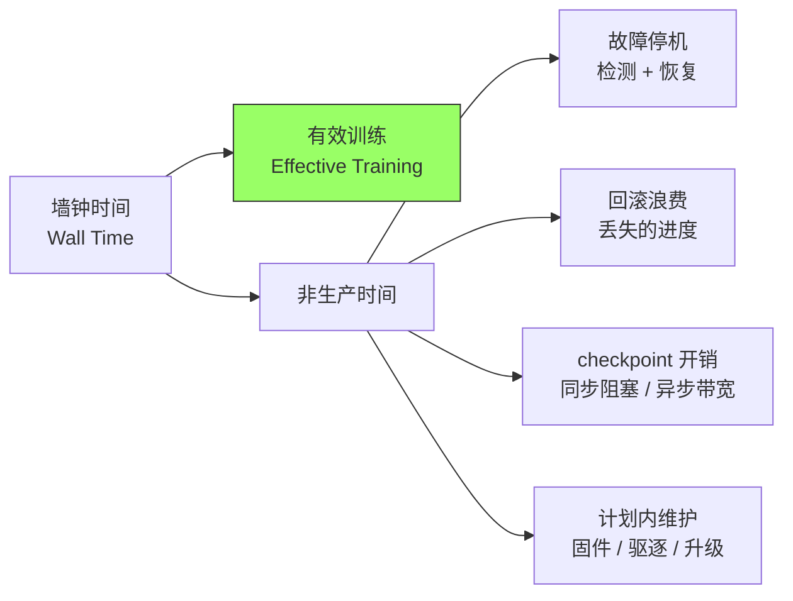
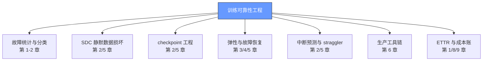

# 背景：万卡训练的瓶颈是可靠性

2024 年 7 月，Meta 发布 Llama 3 论文时，基础设施圈最震惊的不是模型本身，而是论文里那张故障统计表：在 16,384 张 H100 GPU 上训练 405B 模型，**54 天内作业被中断了 466 次**——平均每天 8.6 次，每 2.8 小时一次。这个数字把"万卡集群可靠性"从一个抽象话题变成了有账本可查的工程学科。

## 1.1 从 Llama 3 的账本说起

Llama 3 405B 的训练可靠性数据（论文 §3.3，arXiv:2407.21783）至今仍是行业最重要的一手参照系：

| 指标 | 数值 | 含义 |
|---|---|---|
| 训练规模 | 16,384 张 H100 | 从一座 24,576 卡集群中划出 |
| 总中断次数 | **466 次 / 54 天** | 平均每 2.78 小时一次 |
| 计划内中断 | 47 次 | 自动化集群维护造成，**每天至少一次** |
| 非预期中断 | 419 次 | 真正需要可靠性工程对付的部分 |
| 硬件占比 | **约 78%**（非预期中断中） | 硬件是压倒性的头号敌人 |
| GPU 类占比 | **58.7%**（非预期中断中） | GPU 本体是最大单一类别 |
| 静默数据损坏（SDC） | 6 次（1.4%） | 数量少但每次都可能毁掉模型 |
| 有效训练时间 | **>90%** | 目标指标 ETTR |
| 人工干预 | **仅 3 次** | 其余全部由自动化处理 |

两个容易忽略的细节：第一，**计划内中断几乎每天发生**——可靠性设计不能只针对硬件猝死，还要把"日常维护"纳入常规流程；第二，**人工只需要介入 3 次**——成熟的训练平台把故障处理做成了流水线，人只处理自动化解决不了的长尾。

另一个常被引用、但需要区分口径的数字：Meta 的 1,024 卡作业 MTTF（平均故障间隔）为 **7.9 小时**（Kokolis 等，HPCA 2025，"Revisiting Reliability in Large-Scale Machine Learning Research Clusters"）。这是"研究集群"口径；而 Llama 3 的 2.78 小时是"生产训练作业全口径"（含计划内中断）。两者差了 2.8 倍，说明 **MTBF/MTTF 高度依赖统计口径**：是否包含计划内维护、是否包含 fail-slow、按设备还是按作业计。

## 1.2 MTBF 的规模律：为什么万卡必然"每小时都在坏"

假设每个节点独立失效、寿命服从指数分布，那么 N 个节点的作业级 MTBF 就是：

```
作业 MTBF = 单节点 MTBF / N
```

这不是理论癖好，而是被多家一手数据反复验证的经验律：

- 1,024 卡作业 MTTF 7.9 小时（Kokolis，HPCA'25）→ 隐含单节点 MTBF 约 337 天。
- 16,384 卡每 2.78 小时一次中断（Llama 3）→ 隐含单节点 MTBF 约 5.2 年——生产环境靠着更好的硬件筛选、burn-in 与运维，把单点可靠性做到了研究集群的 5 倍以上，但规模把优势全部吃掉。

把 337 天的单节点 MTBF 代入规模律，会得到一张残酷的表（Mini Demo 场景 1 的实测输出）：

| 节点数 | 作业 MTBF | 冷修复（60 min）可用率 | 热备交换（5 min）可用率 |
|---|---|---|---|
| 128 | 63.2 h | 98.44% | 99.87% |
| 1,024 | 7.9 h | 88.76% | 98.96% |
| 8,192 | 0.99 h | 49.69% | 92.22% |
| 16,384 | 0.49 h | 33.05% | 85.56% |
| 131,072 | 0.06 h | 5.81% | 42.55% |

三个结论：

1. **MTTR 决定生死，但救不了全部**。把修复时间从 60 分钟压到 5 分钟，1,024 卡可用率从 88.76% 拉到 98.96%；但在 13 万卡规模上即使 5 分钟热备也只有 42.55%。
2. **规模每翻十倍，可用率塌方式下降**——除非同时降低故障率（更好的硬件筛选）和恢复成本（热备、in-memory checkpoint、in-process 恢复）。
3. **10 万卡训练不是"更大的 1 万卡"**，而是可靠性工程问题全面压过性能工程问题的新物种。xAI 用 122 天建成 10 万卡液冷集群、上架 19 天就开训（[xAI 案例](/09-case-study/xai/)），其建设期的极限压缩本身就把大量"本可在建设期消化的硬件早期失效"转移到了运行期——这是建设速度与运行可靠性的直接交换。

## 1.3 可靠性问题的三个层次

大规模训练的故障不是单一现象，按"能不能发现、怎么发现"可分为三个层次：

| 层次 | 现象 | 例子 | 发现方式 |
|---|---|---|---|
| **fail-stop** | 进程崩溃、硬件报错、链路断开 | GPU Xid 错误、NCCL 超时、节点掉电 | 看门狗、心跳、超时 |
| **fail-slow** | 一切正常但变慢 | 光模块劣化、CPU 被后台任务抢占、网络拥塞 | 性能基线对比、straggler 检测 |
| **SDC** | 结果错了但没有任何信号 | HBM 位翻转、CPU 静默错误 | 冗余计算、checksum、训练曲线异常 |

三层的危害递增、发现难度递增：fail-stop 是"报警器会响"，fail-slow 是"要拿秒表"，SDC 是"要拿账本"——Llama 3 的 6 次 SDC 没有任何一次是靠报错发现的。FALCON 在阿里云过万卡生产集群上把 fail-slow 描述为 **"common but largely unheeded"（常见但基本无人理睬）**，持续时长从数十秒到近 10 小时，平均拖累作业完成时间 1.34%（arXiv:2410.12588）。

## 1.4 有效训练时间：可靠性的总账

所有这些工程动作的账本只有一个：**ETTR（Effective Training Time Ratio，有效训练时间占比）**。



Meta 在 TrainMover 论文（arXiv:2412.12636）里算过这笔账：16K GPU 每天成本约 144 万美元，当作业扩到 8,192 卡时 ETTR 跌到 0.6——**每天约 58 万美元直接蒸发**；外推到 64K/128K 卡，吞吐损失分别为 16.47% 和 31.79%，折合每天 95 万 / 363 万美元。ByteDance 的 ByteRobust（arXiv:2509.16293）则给出了正面的标杆：9,600 卡、为期三个月的两个生产训练任务（70B+ dense、200B+ MoE）实现了 **97% ETTR**，全部非生产时间被压进 50 分钟以内。

对基础设施团队而言，"把 MFU 从 50% 优化到 52%"的收益，经常不如"把 ETTR 从 90% 提到 95%"——后者的有效算力直接多出 5.6%，且通常投入更小。

## 1.5 为什么传统云可用性直觉会失效

从云原生转来的工程师常带着"单实例 99.9% 可用性"的直觉，这在训练场景会系统性出错，原因有三：

1. **Gang 同步语义**：训练要求所有 rank 同时存活、步调一致。N 个 99.9% 可用的节点，组成 gang 后的可用性是 0.999 的 N 次方——1,024 个节点时只剩 35.9%。可靠性必须用"作业级 MTBF"重新思考。
2. **状态昂贵**：无状态服务挂了就重启；训练挂了要从 checkpoint 回滚，丢掉的进度与恢复时间是纯损耗。checkpoint 越稀疏，回滚越痛；越密集，开销越大——这是一个有解析最优解的经典权衡（第 2 章展开）。
3. **慢也是错**：同步训练的 step 时间等于最慢 rank 的时间（木桶效应），一个慢 20% 的节点让所有节点陪跑。云可用性度量里没有这一项。

## 1.6 主题地图



下一章将从这些事实中提炼出核心概念体系：三态故障模型、checkpoint 三参数、检测-定位-恢复闭环与可靠性预算。
