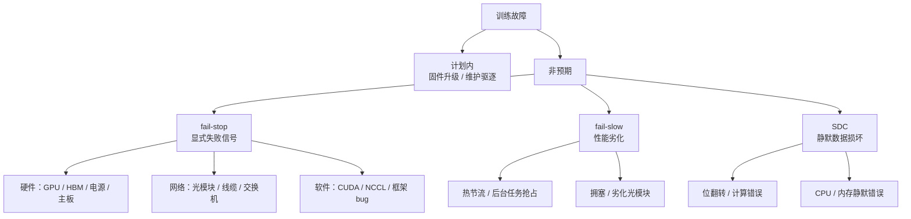
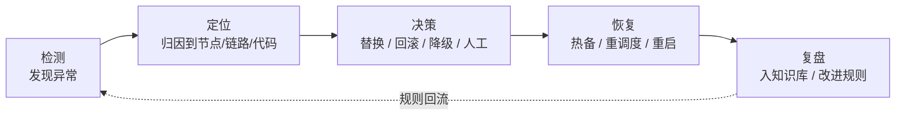
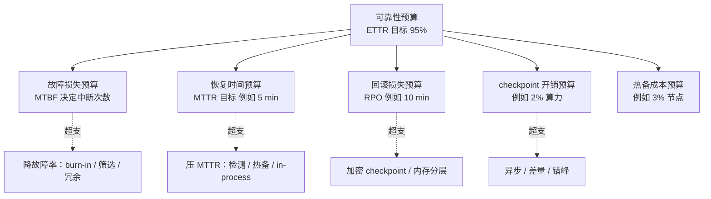

# 核心概念

训练可靠性工程有一套自己的概念体系：三态故障模型、ETTR 分解、checkpoint 三参数权衡、检测-定位-恢复闭环、热备池与可靠性预算。这些概念是后续架构与模块讨论的语言。

## 2.1 术语表

| 术语 | 定义 | 备注 |
|---|---|---|
| MTBF | 平均故障间隔（Mean Time Between Failures） | 可修复系统；常与 MTTF 混用 |
| MTTF | 平均失效时间（Mean Time To Failure） | 不可修复部件（如单张 GPU 报废） |
| MTTR | 平均修复时间（Mean Time To Repair/Recovery） | 从故障发生到恢复训练的墙钟时间 |
| 可用率 Availability | MTBF / (MTBF + MTTR) | 稳态口径，不含回滚损失 |
| ETTR | 有效训练时间占比 | 有效训练时间 / 墙钟时间；训练侧的总账本 |
| RPO | 恢复点目标 | 最多丢失多少进度 → checkpoint 间隔上限 |
| RTO | 恢复时间目标 | 多久必须恢复训练 → 恢复链路时延预算 |
| fail-stop / fail-slow / SDC | 见 2.2 三态模型 | 发现难度递增 |
| 热备（hot/warm spare） | 预热待命、可即刻替换故障节点的备用节点池 | 成本换 MTTR |
| Gang 调度 | 所有 rank 必须同时就绪才能开训 | 可用性按"最弱一环"计算 |

注意 Llama 3 与 Kokolis 论文口径差异：前者按"作业中断"统计（含计划内维护），后者按"硬件失效"统计。**引用任何 MTBF 数字前先问三个问题：按设备还是按作业？含不含计划内事件？含不含 fail-slow？**

## 2.2 三态故障模型



用两家的一手数据给 taxonomy 上刻度。

**Meta Llama 3**（419 次非预期中断的分布，arXiv:2407.21783）：GPU 类合计 **58.7%**（最大单一类别，含 GPU 本体、HBM3 显存、SRAM、板载系统处理器、热界面与传感器）；网络（交换机/线缆）约 8.4%；软件依赖 bug 约 12.9%；其余为主机部件（NIC、SSD、电源、CPU、内存）与少量无法归因项。**78% 的非预期中断归因于确认或疑似的硬件问题。**

**ByteDance ByteRobust**（约 5.5 万起事故的分布，arXiv:2509.16293）：CUDA 错误 36.1%、CPU 过载 11.0%、CPU OOM 10.1%、作业挂起 9.9%、代码/数据调整（人工）17.3%、磁盘不足 5.0%、MFU 下降 0.8%、NaN 0.3%。值得注意：**17.3% 是"人工调整代码/数据"**——大量"故障"其实是实验过程的一部分，平台要把这类中断与硬件中断分开统计，否则 MTBF 会被污染。

对比可见：Meta 的 GPU 占比过半，ByteDance 的 CUDA 错误（含用户代码触发）占三分之一且人工操作占近五分之一。**故障 taxonomy 必须按"平台要为之负责的部分"裁剪**，否则改进动作会打偏。

## 2.3 ETTR 分解：可靠性的总账公式

一次故障周期由三段组成，ETTR 可以写成：

```
ETTR = MTBF / (MTBF + MTTR + 回滚损失)

MTTR     = 检测时间 + 恢复时间（替换节点 / 重调度 / 重启）
回滚损失 = 故障点到上个 checkpoint 的进度（期望为 checkpoint 间隔的一半）
```

这个公式是全部可靠性工程的杠杆清单：要么**增大 MTBF**（硬件筛选、burn-in、冗余设计），要么**压缩 MTTR**（快速检测、热备替换、in-process 恢复），要么**压缩回滚损失**（高频 checkpoint、in-memory checkpoint、每步 checkpoint）。

还可以再拆一步——MTTR 本身的生产实测拆解（TrainMover，arXiv:2412.12636，Table 1，8,192 卡作业全量重启）：

| 阶段 | 耗时 | 占比 | 压缩手段 |
|---|---|---|---|
| 停机与清理 | 0.52 min | 7.7% | 快速失败路径 |
| 重新调度 | 1.50 min | 23.1% | 热备免调度 |
| checkpoint 加载 | 1.56 min | 24.1%（占初始化 35.1%） | in-memory checkpoint |
| NCCL 初始化 | 1.09 min | 16.9%（占初始化 24.5%） | 两阶段 delta 建链 |
| 冷启动 warmup | 1.80 min | 27.8%（占初始化 40.4%） | 沙箱预热 |
| **合计** | **6.47 min** | 100% | — |

这张表解释了为什么成熟平台能把一次故障的恢复压到 1 分钟以内（ByteRobust 的热更新 46-65 秒，比全量 requeue 快 11.04 倍）：四个阶段每个都有数量级可观的优化空间，叠加起来就是 6-7 倍。

## 2.4 Checkpoint 三参数权衡

Checkpoint 策略由三个参数决定：**间隔 T、开销 C、恢复点 RPO**。三者互相拉扯：

- T 越大：开销摊薄，但故障回滚损失越大（期望 T/2）。
- T 越小：回滚损失小，但频繁 checkpoint 直接吃掉算力。
- C 越小（异步、分层、差量）：可以把 T 推到极限（ByteRobust 做到每步 checkpoint 开销 <0.9%）。

经典结论来自 Daly 公式与 CheckFreq（FAST'21）：最优间隔 `T* ≈ sqrt(2 · C · M)`（C 为 checkpoint 开销、M 为 MTBF）。直觉是：最优回滚损失应该约等于 checkpoint 开销本身——两道成本打平。Mini Demo 场景 2 用 MTBF 7.9 小时、step 30 秒、全量阻塞 checkpoint 240 秒的参数做了校验：Daly 近似给出 123 步，对长程效率函数的网格精确搜索也得到 123 步（效率 87.45%）；引入差量 checkpoint（开销降到 30%）后最优间隔缩短到 67 步、效率升到 92.18%。

工程上 checkpoint 形态有一个演进光谱：

| 形态 | 开销特征 | 恢复点 | 代表 |
|---|---|---|---|
| 同步全量 | 全作业阻塞，分钟级 | 间隔大 | torch.save 时代 |
| 异步全量 | 阻塞降 90%+，占带宽 | 间隔可小 | PyTorch DCP `async_save`、CheckFreq 两阶段 |
| 分层（内存 + 本地 SSD + 远端） | 每步可接受 | 接近每步 | Gemini（SOSP'23）、ByteRobust |
| 差量/增量 | 只写变化分片 | 每步 + 周期全量 | 差量 checkpoint（arXiv:2509.04084） |
| 冗余（复制/纠删码） | 内存/带宽换零回滚 | 零 | Gemini 远程副本、跨并行组备份（ByteRobust） |

一个常被低估的问题：**checkpoint 自己也是故障源**。写坏一个 checkpoint（进程在写盘时被杀）比没有 checkpoint 更糟——成熟平台都要保证 checkpoint 原子性（先写临时目录 + rename）并保留最近 N 个版本、定期做恢复演练。

## 2.5 检测-定位-恢复闭环

故障处理是一条流水线，每一段都有独立的工程学科：



- **检测**的敌人是时延：PyTorch 默认 NCCL 超时约 10 分钟（ByteRobust 实测口径甚至到 30 分钟），而 ByteRobust 的实时检测把 GPU 故障检测压到 **10 秒**、网卡 30 秒、OS 内核 2 秒。检测每慢一分钟， gang 作业里几千张卡就空转一分钟。
- **定位**的敌人是表象欺骗：大量硬件故障以 NCCL 网络错误的形式暴露（阿里巴巴 C4 的观察：约 82.5% 的错误虽然表现为 NCCL 报错，实际被约束在特定节点/设备上）。定位错了，替换的就是无辜节点，故障会跟着作业走。
- **决策**的关键是"替换 vs 修复"的权衡：Google 的 NSDI'24 方案把"硬件故障"细分为"换立方体重启"与"OCS 故障走容错路由（不停机、只付 0.5-8.6% 步时税）"两条路径（详见 [Google 案例](/09-case-study/google/)，本主题不展开）。
- **恢复**的上限由热备池决定：ByteRobust 按"同时故障数的 P99"配置热备（通常 2-4 台，灾难场景约 32 台且概率 <1%）——这是把二项分布写进容量规划的做法。

## 2.6 热备：用闲置换 MTTR

热备池（hot/warm spare）是"花钱省时间"的标准动作，规模由概率模型而非拍脑袋决定：设作业 N 个节点、单节点故障率 p，同时故障 k 台的概率服从二项分布，热备池容量取"覆盖同时故障数"的 **P99 分位**。ByteRobust 实测：9,600 卡规模 P99 只需 2-4 台热备，32 台同时故障的概率不到 1%。

热备必须"热"才有意义：ByteRobust 的热备节点常驻自检后休眠、故障时被"唤醒热更新"（46-65 秒完成替换），比全量重新排队（requeue）快 10.87 倍，距离理论最优（oracle）只差 5.19%。TrainMover 进一步把"热备预热"一般化——由于流水线并行里 rank 角色只有首/中/尾三种，一台预热的通用备机可以替换任意角色，只需补少量层差异。

代价也要记账：1%-6% 的算力常驻闲置（阿里巴巴备份池约为 GPU 的 6%，Meta 在 24K 卡集群里划 16K 给 Llama 3 也隐含了余量策略）。TrainMover 的账：32K 规模下，一台 20 秒完成替换的热备机，等效于多买约 2,400 张卡。

## 2.7 SDC：最危险的敌人

静默数据损坏（Silent Data Corruption）指硬件给出错误结果但没有任何错误信号。三个一手事实刻画它的威胁：

1. **它真实存在且能毁掉模型**。ACL 2025《Understanding Silent Data Corruptions in LLM Training》首次用被云厂商自动化运维"清扫出生产环境"的真实不健康节点做对照实验（XLA 确定性执行隔离变量）：SDC 在不同节点上影响不同，多数情况下对子模块计算的扰动很小，**但足以让模型收敛到不同的最优、甚至引发训练 loss 尖刺**——它不会因为"看起来在训练"而自愈。
2. **它已经出现在最大的生产训练里**。Llama 3 的 54 天中记录到 **6 次 SDC（占非预期中断 1.4%）**。
3. **常规检测手段对它召回率有限**。ByteRobust 报告 NVIDIA EUD（设备端确定性自检）对 SDC 的召回率只有约 70%，极端案例需要 8 小时离线压力测试才能复现。

SDC 的防线必须是纵深（第 5 章展开）：ECC（HBM/SRAM 层）→ 生产前筛选（burn-in、EUD、确定性负载）→ 运行时冗余（双跑对比、集合通信校验）→ 事后统计（loss/grad-norm 尖刺、checkpoint 副本对比）。任何单层都会被绕过。

## 2.8 可靠性预算

把可靠性当成一种"预算"来管理，是 SRE 思想在训练侧的落地：



预算的分配随规模变化：千卡集群 MTTR 是大头（可用率对 MTTR 极敏感），十万卡集群**故障率本身**也成为主战场——此时 burn-in、硬件筛选、RAS 设计（xAI Colossus 建设期决策的回响见 [xAI 案例](/09-case-study/xai/)）与架构级故障隔离（[DeepSeek 案例](/09-case-study/deepseek/) 中 DualPipe 对流水线故障域的切分思路）与运行时恢复同等重要。

## 小结

核心概念一句话：**训练可靠性 = 用 ETTR 记账，用三态模型（fail-stop / fail-slow / SDC）分类，用检测-定位-恢复闭环处理，用 checkpoint 三参数与热备池在两个时间维度（MTBF、MTTR）上买可靠性**。下一章把这些概念组织成可落地的系统架构。
