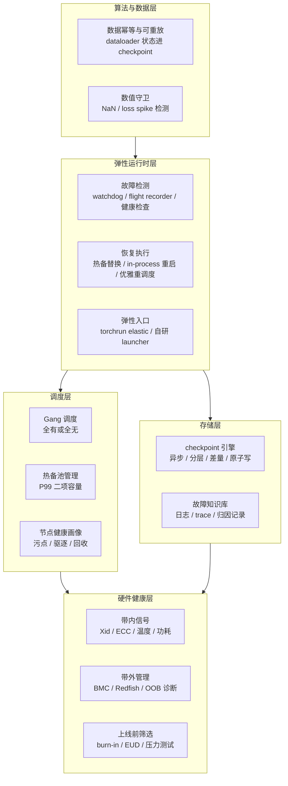
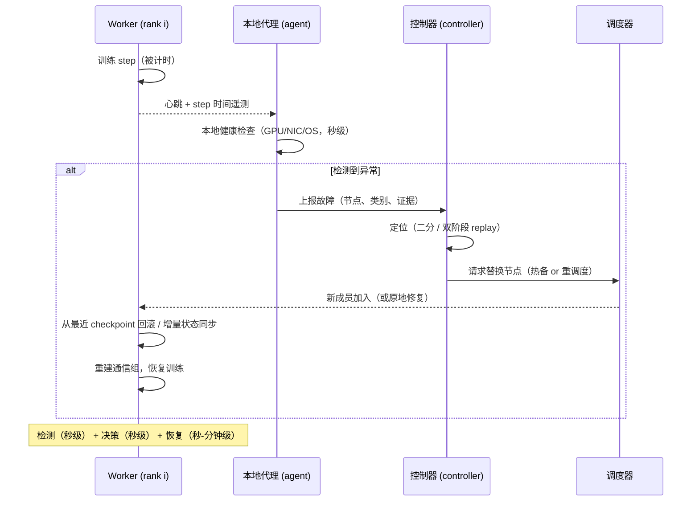

# 架构设计

训练可靠性不是某个单点组件，而是一套贯穿硬件、运行时、调度、存储与数据管线的分层体系。本章给出参考架构：每一层只依赖下一层的健康信号，任何一层失效都不让故障穿透到训练进程。

## 3.1 分层参考架构

五个设计原则贯穿各层：

1. **控制面与数据面分离**。训练进程（数据面）只做计算与上报；检测、决策、调度（控制面）由独立组件完成，控制面自身的故障不能中断训练。ByteRobust 的控制器用约 2 万行 Go 实现，代理仅约 5 千行 Python——轻代理、重控制面。
2. **故障信号分级**。带内信号（进程内可见的 Xid、ECC、NCCL 错误）秒级可达；带外信号（BMC、交换机遥测）分钟级。检测系统必须把两级信号对齐到同一个节点画像，才能解释"进程看到网络超时，带外看到光模块告警"。
3. **恢复动作幂等**。替换节点、回滚 checkpoint、重建通信组，每一步都可能部分失败并重试；所有恢复动作必须可以在任意中间状态下安全重放。
4. **blast radius 受控**。故障域（机架、cube、PP group）在架构期就切分好，保证单点故障最多损失一个域。Google 把 TPUv4 的故障域切成 64 芯片 cube 并用 OCS 重连（[Google 案例](/09-case-study/google/)）；流水线并行中一个 stage 宕机只影响持有该 stage 的节点组。
5. **一切都是数据**。每次检测、每次定位、每次恢复都落库，形成故障知识库——SDC 排查、慢节点画像、硬件批次质量，全部靠它。

## 3.2 弹性运行时：训练进程内发生了什么

弹性运行时层是架构的中枢。一个现代弹性训练进程的简化视图：

三个关键时延预算（ByteRobust 实测）决定了这条链路的紧绷程度：

| 环节 | 目标 | 实测参照 |
|---|---|---|
| 本地检测 | 秒级 | OS 内核 2 s / GPU 10 s / NIC 30 s |
| 定位归因 | 分钟级 | CUDA 错误平均 93 s（选择性压力测试 518 s） |
| 替换恢复 | 分钟级 | 热更新 46-65 s；全量 requeue 454-768 s |

PyTorch 自带的弹性入口 torchrun 只解决这条链路的"入口"问题：`--max-restarts` 控制重启次数上限、rendezvous（c10d 后端）负责成员关系同步，文档明确写着失败时 **"ALL surviving workers are killed immediately. Make sure to checkpoint your progress."**——即原生语义是"全员陪葬 + 从 checkpoint 重启"。生产系统的全部优化，就是把这句话变成"只杀故障者、不停机替换"（第 5、6 章展开）。

## 3.3 调度层：Gang 语义与热备池

调度层面对的核心矛盾：**Gang 语义要求所有 rank 同时就绪，而节点随时会坏**。

- **Gang 调度**：训练作业以"全部节点"为单位申请资源，任何一个节点不可用则整个作业pending。Kubernetes 生态通过 Volcano / Kueue 等实现，Slurm 生态通过整作业预留实现。Gang 是可用性按"最弱一环"计算的根源，也是热备池存在的理由——有热备，gang 的"就绪"才不会被单节点故障卡死。
- **热备池管理**：容量按 P99 二项模型配置（第 2 章），状态机为"自检 → 休眠 → 唤醒热更新"。热备池要避免两个陷阱：一是"幽灵健康"——备机长期休眠后悄悄劣化，所以 ByteRobust 要求备机常驻自检；二是"备机被借走"——资源紧张时备机被调度走，故障来临时裸奔，需要调度策略级保障（预留配额 + 抢占优先级）。
- **节点健康画像**：每次故障处理后更新节点画像（故障类别、次数、最近证据），坏的节点被污点（taint）隔离并送修，修复后经过压力测试才能回池。画像数据也是采购与硬件批次质量管理的输入。

## 3.4 存储层：checkpoint 引擎与故障知识库

存储层有两个职责。其一是 checkpoint 引擎（第 2 章概念、第 5 章模块细节），其核心设计要求：

- **分层**：GPU 显存 → CPU DRAM → 本地 SSD → 并行文件系统/对象存储。越靠近计算、越贵越快、越易失；远端层负责抗机架级灾难。
- **异步与原子性**：异步写入 + 临时目录 + rename 提交，保证进程任何时候被杀都留有一个完整可用的 checkpoint。
- **跨故障域冗余**：ByteRobust 的"跨并行组备份"让每份分片在 TP/PP/DP 组之外还有副本——即使整组被过度驱逐，checkpoint 也不丢。
- **带宽预算**：10 万卡模型的 checkpoint 可达数十 TB，写入带宽直接决定 RPO 下限。Gemini（SOSP'23）用 CPU 内存 + 远程复制的分层设计把 checkpoint 频率提到每迭代一次；差量 checkpoint（arXiv:2509.04084）把每次写入量再压一个量级。

其二是故障知识库：结构化记录每一次中断（时间、节点、类别、定位证据、恢复路径、耗时）。它是三类工作的基础设施——SDC 长周期排查（ByteRobust 案例中一次 SDC 排查需要 8 小时离线压测 + 历史画像）、慢节点黑名单、以及硬件 RMA 的举证。

## 3.5 硬件健康层：把故障消灭在上电之前

运行时的检测再快也是"事后"，最便宜可靠的是在节点进入训练池之前把不健康者筛掉：

- **Burn-in（烧机）**：新节点上电后跑数小时到数天的高压负载（高功耗 GEMM 循环、显存扫描、网络打流），把"早夭"（infant mortality）拦在池外。xAI 在 122 天建设 10 万卡集群的过程中，"上架 19 天就开训"的代价之一就是早期失效节点更多——建设与筛选工期是直接竞争关系（[xAI 案例](/09-case-study/xai/)）。
- **带内信号**：GPU Xid 错误码、ECC 计数、温度/功耗曲线、NVLink/IB 误码率——这些信号便宜但只能在节点运行时采集，适合做持续画像。
- **带外管理**：BMC/Redfish 提供独立于操作系统的硬件事件（PSU 故障、风扇、内存 CE/UE），是带内信号的交叉验证来源。
- **确定性自检负载**：EUD（NVIDIA Device-Side Kernel Self-Test）类工具跑确定性 kernel 对比结果，ByteRobust 报告其对 SDC 召回率约 70%——必要但不充分，需要配合双跑冗余。

## 3.6 与相邻基础设施的边界

| 系统 | 职责边界 | 协作接口 |
|---|---|---|
| Kubernetes / Slurm | 资源分配、进程生命周期、节点污点 | 驱逐通知、重调度请求、健康检查钩子 |
| 网络 fabric | 链路冗余、故障隔离、reroute 能力 | 链路遥测、（Google 场景下）容错路由表 |
| 存储系统 | checkpoint 落盘带宽与持久性 | 分层存储、快照、带宽配额（见 [存储系统](/01-foundation/storage-systems/)） |
| 训练框架（Megatron/PyTorch） | step 执行、状态字典、通信组 | checkpoint API、elastic agent 钩子 |
| 监控可观测平台 | 指标、日志、trace | 故障知识库的写入与查询（见 [AI SRE](/07-ai-sre/)） |

边界划分的判断标准：**凡是"需要理解训练语义"的决策（回滚多少、替换哪台、是否要双跑）留在训练平台；凡是"通用资源管理"（打包、排队、驱逐）交给底层调度**。

## 小结

参考架构 = 硬件健康层把关（把故障拦在池外）+ 调度层兜底（热备与 gang）+ 运行时层处置（检测-定位-恢复）+ 存储层减负（高频低损 checkpoint）+ 算法数据层止损（幂等与数值守卫）。下一章把"检测-定位-决策-恢复"展开成可执行的工作流程。
