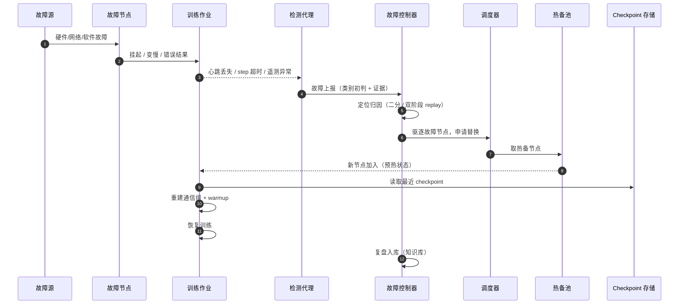
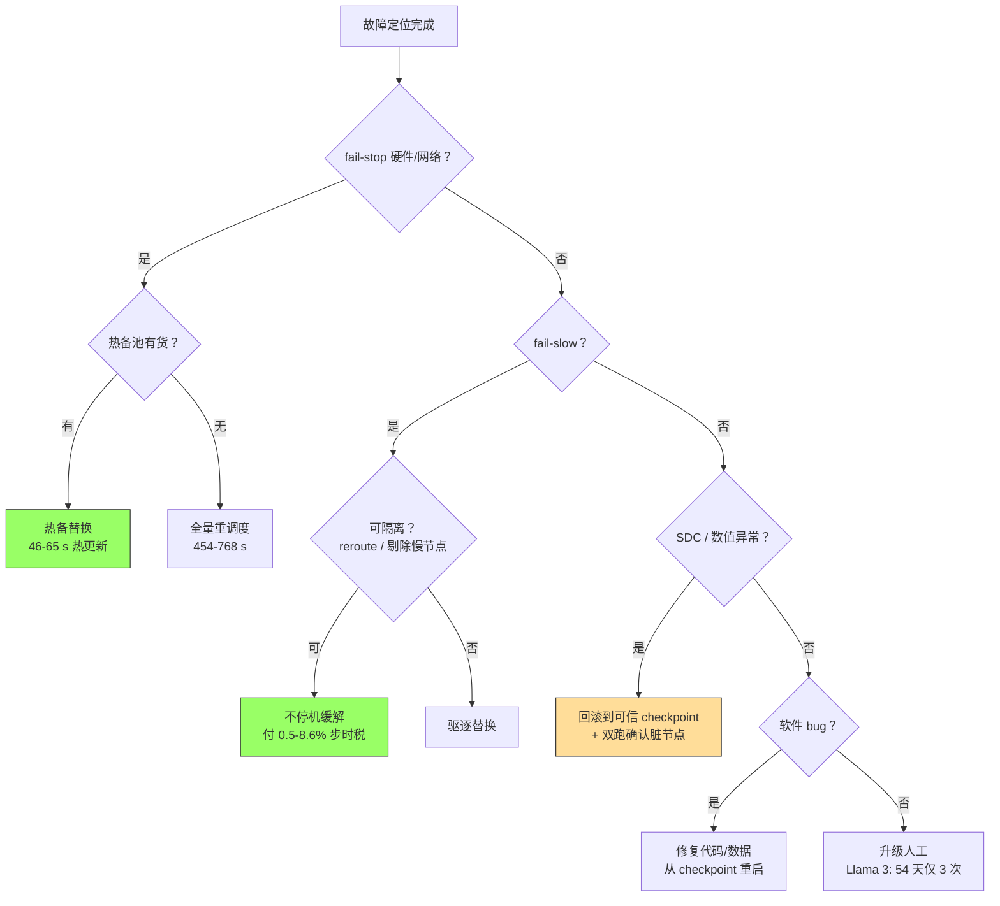

# 故障与恢复工作流程

一次训练中断从发生到复盘，经历检测、定位、决策、恢复、复盘五个阶段。本章把这条流水线展开成可执行的时序与时延预算，并给出关键的决策树。

## 4.1 中断生命周期总览

把它压成一张时延预算表（生产实测数字作为每阶段的目标锚点）：

| 阶段 | 预算目标 | 实测参照 | 超预算的代价 |
|---|---|---|---|
| 检测 | < 60 s | ByteRobust：GPU 10 s / NIC 30 s / OS 2 s | gang 全员空等 |
| 定位 | < 5 min | ByteRobust：CUDA 错误平均 93 s | 误杀无辜节点，故障跟随作业 |
| 替换 | < 2 min | 热更新 46-65 s vs requeue 454-768 s | 冷启动路径 6.47 min 起步 |
| 回滚加载 | < 2 min | ckpt 加载 1.56 min（8,192 卡） | 初始化占重启耗时 69% |
| 重建通信 | < 1 min | NCCL 初始化 1.09 min（8,192 卡） | TrainMover 两阶段可压到 7 s |
| 合计 | **< 10 min** | 成熟平台常态 1-2 min | Llama 3 时代约 30+ min |

注意预算的结构性事实：**初始化占一次冷重启的 69.2%**（TrainMover 对 8,192 卡作业的拆解：checkpoint 加载 35.1%、NCCL 建链 24.5%、冷 warmup 40.4%）。这意味着优化检测省的是零头，优化初始化省的才是大头——所有"热路径"设计（in-memory checkpoint、预建通信组、沙箱 warmup）都集中在这三段。

## 4.2 检测：三种信号源互补

检测系统的输入有三种互补的信号源，漏掉任何一种都会形成盲区：

| 信号源 | 例子 | 时延 | 盲区 |
|---|---|---|---|
| 框架自带超时 | NCCL watchdog、PyTorch barrier timeout | 分钟级（默认 10 min 起） | fail-slow、SDC 完全看不见 |
| 运行时遥测 | 每 rank step 时间、心跳、loss/grad-norm 曲线 | 秒-十秒级 | 需要基线；慢变化易被漂移掩盖 |
| 硬件/OS 事件 | Xid、ECC、BMC SEL、内核日志 | 秒-分钟级 | 不带训练语义（哪个 rank 受害？） |

生产做法是把三者汇聚到一个节点画像服务：框架超时负责"兜底不死等"，遥测负责"快"，硬件事件负责"准"。ByteRobust 的实时巡检线程就是第二、三类的融合——秒级轮询 GPU、NIC/交换机、OS 内核与 Xid 事件，把检测时延压到 2-30 秒。

一个关键工程细节：**检测阈值宁可误报、不可漏报（对 fail-stop）**。误报的代价是一次不必要的替换（分钟级），漏报的代价是全作业挂在 NCCL 超时上（十分钟级）加状态腐化风险。但对 fail-slow 与 SDC 要反过来——误报驱逐健康节点会造成数据并行组抖动，阈值要与缓解手段的成本匹配。

## 4.3 定位：表象与真凶

定位阶段的经典难题：**报错位置 ≠ 故障位置**。

- NCCL 集合通信报错通常指向"某个集合操作超时"，但根因可能只是某一端的 GPU 陷入驱动错误（阿里巴巴 C4 的观察：约 82.5% 的错误虽然表现为 NCCL 网络错误，实际被定位在特定节点/设备上）。
- 作业挂起可能是死锁、可能是某 rank 慢、可能是数据 loader 卡死——表象相同。

生产定位的两把利器：

1. **双阶段 replay（ByteRobust）**：第一遍按水平分组（同 PP stage 的机器）重放，第二遍按垂直分组（跨 DP）重放，保留 TP/PP 不变只动 DP 切分。对 9,600 卡作业，32.52% 的故障由 replay 直接解决、22.70% 重试恢复、9.20% 回滚处理，只有 1.23% 需要双阶段 replay 全量跑。
2. **数据驱动的"过度驱逐"（over-eviction）**：把全作业 stack trace（py-spy + flight recorder）按相似度聚合，持续离群的并行组就是嫌疑犯；为了快，宁可一次驱逐整个 PP 组（8 台机器抓 1-2 台真凶，容忍 6-7 台误伤）——用少量算力换定位时延。这是"检测阈值哲学"的镜像：定位阶段追求速度，精确度让位于不阻塞训练。

## 4.4 决策树：替换、回滚、降级还是人工

两个分支值得展开：

- **"不停机缓解"路径**是 Google NSDI'24 方案的精髓：OCS 光交换故障不解体作业，而是切换预计算的容错路由表，作业以 0.5-8.6% 的步时惩罚继续跑（95% 的作业选择该路径）。这是"可靠性即设计"的标杆——硬件层给调度层提供了第三种选项（既不是修复也不是放弃），详见 [Google 案例](/09-case-study/google/) 第 8 章，本主题只把它作为决策树的一个分支引用。
- **SDC 分支永远伴随回滚**。一旦数值异常被怀疑为 SDC，宁可回滚到上一个可信 checkpoint 并隔离嫌疑节点做双跑确认，也不能带着被污染的状态继续训练——ACL 2025 的对照实验证明 SDC 可以让模型收敛到不同的最优，继续训练就是在污染物上盖楼。

## 4.5 恢复：冷路径与热路径

恢复路径的选择决定 MTTR 的量级：

| 路径 | 耗时（实测） | 构成 | 适用 |
|---|---|---|---|
| 冷路径：全量 requeue | 454-768 s（ByteRobust 8,192 卡口径）；TrainMover 拆解 6.47 min | 停机 + 重调度 + ckpt 加载 + NCCL 初始化 + warmup | 软件 bug、热备耗尽、冷故障 |
| 热路径：热备替换 | 46-65 s（ByteRobust）；TrainMover 通用热备 ~20 s（1,024 卡） | 检测 + 热更新（状态增量同步 + delta 建链 + 预warmup） | 硬件 fail-stop、节点驱逐 |
| 超热路径：in-process 恢复 | 秒级（TrainMover CCL 重建 51 s→7 s 的两阶段方案可再压缩） | 进程不退出，只修通信组 | 单 rank 故障、straggler 剔除 |

热路径的三个技术支点（TrainMover 的一手数据）：

1. **沙箱预热**：新加入 rank 在"无通信沙箱"里用录制重放的通信张量跑影子迭代，把 JIT 编译、内存分配、算子预热全部提前——这部分占冷重启的 40.4%。
2. **两阶段通信组建链**：第一阶段 CPU 侧完成拓扑发现并与幸存进程复用机内通道，第二阶段只重建跨机的新增 RDMA 连接，把 NCCL 初始化从 51 s 压到 7 s（降 86%）。
3. **通用热备角色**：流水线并行里 rank 只有首/中/尾三种角色，一台预热备机可顶替任意角色，只需补首/尾 stage 的层差异——热备池从"按作业定制"变成"通用池"，利用率大幅提升。

## 4.6 复盘：让每次故障都留下资产

复盘不是写事故报告，而是资产化：

- **知识库条目**：时间线、根因、定位证据链、恢复路径、各环节耗时 vs 预算。耗时数据直接喂养下一轮预算修订。
- **规则回流**："某批次 HBM 高温告警后 3 天内必坏"这类模式沉淀为检测规则或调度污点策略（第 3 章的画像服务）。
- **演练校验**：定期从随机历史 checkpoint 做恢复演练（防止"备份存在但恢复不了"），以及注入式 game day（随机杀节点验证端到端时延预算）。

Llama 3 的一个值得抄的作业：**区分"平台故障"与"实验操作"**。466 次中断里 47 次是计划内维护、ByteRobust 的 17.3% 是人工调整——复盘统计只应对平台负责的部分追责，否则团队会在错误的指标上内耗。

## 小结

工作流程的要点是预算化：检测 <60 s、定位 <5 min、恢复 <10 min，其中初始化三段（加载/建链/warmup）占冷重启近 7 成、是优化主战场；决策树的每个分支都对应一条有实测耗时的恢复路径，而 SDC 分支的铁律是"回滚 + 隔离 + 双跑确认"。下一章拆解支撑这条流水线的核心模块设计。
