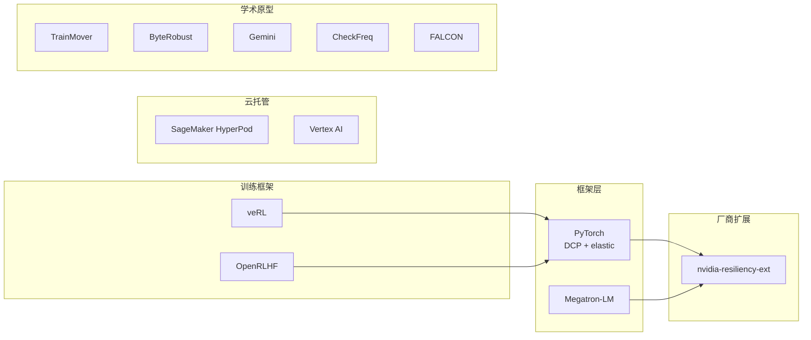

# 源码与生态分析

训练可靠性的生态横跨框架、厂商扩展、云托管与学术界。本章按"能直接用什么"来盘点，重点是各组件的真实能力边界与版本锚点。

## 6.1 生态总览

## 6.2 PyTorch 原生：DCP 与 Elastic

**torch.distributed.checkpoint（DCP）** 是 PyTorch 官方分布式 checkpoint 库（文档版本锚点：PyTorch 2.14），解决 `torch.save` 的三个硬伤：

| 能力 | API | 说明 |
|---|---|---|
| 分片并行写 | `dcp.save` / `dcp.load` | 每个 rank 只写/读本地分片，消灭单进程汇聚瓶颈 |
| 异步保存 | `dcp.async_save` | 先 de-stage 到 CPU 内存（staging），后台线程落盘，返回 Future；官方标注 experimental |
| 负载重切分 | `dcp.state_dict` 系列（`get_model_state_dict` / `get_optimizer_state_dict`） | 用全限定名代替参数 ID，checkpoint 可在不同并行度/不同 rank 数间迁移 |
| 存储后端 | `FileSystemWriter` / safetensors 后端 | 每 rank 一个文件 + 一份 `.metadata` |

两个官方 caveat 必须知道：一是 **DCP 不保证跨 PyTorch 版本的 state_dict 向后兼容**（升级 PyTorch 前先迁移 checkpoint 格式）；二是 FSDP 的 `HYBRID_SHARD` 模式下只有一个 shard group 应执行 save。生产建议：把 DCP 当作"格式与重切分协议"，在其上自建分层与异步策略（Megatron 与多数大厂自研栈都是这么做的）。

**torchrun / PyTorch Elastic**（同 2.14 文档）提供作业入口的弹性语义：

- `--max-restarts` 限制 worker group 重启次数；失败时"所有幸存 worker 立即被杀"——原生语义就是整作业重启，文档原话要求用户 **"Make sure to checkpoint your progress."**
- rendezvous 负责成员同步，推荐 `c10d` 后端（`etcd` 后端已处于维护模式，将在未来版本移除）；环境变量 `TORCHELASTIC_RESTART_COUNT` / `TORCHELASTIC_MAX_RESTARTS` / `TORCHELASTIC_RUN_ID` 暴露给训练脚本。
- 弹性模式 `--nnodes=min:max` 允许成员数变化，但**重启间 rank 不稳定**——依赖稳定 rank 的逻辑（如确定性数据分配）要自己处理映射。

结论：PyTorch 原生件给了"可重启的骨架"，但没有给"不死的运行时"——后者是 nvidia-resiliency-ext 与各家自研的方向。

## 6.3 NVIDIA nvidia-resiliency-ext

NVIDIA 官方的开源韧性扩展库（GitHub: NVIDIA/nvidia-resiliency-ext，官方标注 **experimental，接口可能破坏性变化**），子包结构清晰对应本章模块划分：

| 子包 | 职责 | 对应模块 |
|---|---|---|
| `checkpointing` | 异步 checkpoint、本地 checkpoint 框架 | 5.4 Checkpoint 引擎 |
| `fault_tolerance` | hang rank 检测、**作业内重启且不重新分配 SLURM 节点**、控制面/代理架构 | 5.2 检测 + 5.5 弹性运行时 |
| `inprocess` | 进程内恢复（`initialize` / `health_check` / `monitor_process` 等组件） | 5.5 弹性运行时 |
| `attribution` | 故障归因（错误归属到 rank/节点） | 5.3 定位 |
| `ptl_resiliency` | PyTorch Lightning 集成层 | 接入层 |
| `services` / `skills` / `shared_utils` | 配套服务与共享工具 | — |

版本锚点（README，2026-10 快照）：要求 PyTorch ≥ 2.8.0、CUDA ≥ 12.8、驱动 ≥ 535（GPU 健康检查需 570）、NCCL 需 < 2.28.3 或 ≥ 2.28.9（中间版本有 in-process 问题）、集成 PyTorch Lightning 与 NVIDIA NeMo；特性列表还包括 straggler detection（监控各 rank 的 GPU/CPU 性能并识别拖慢训练的慢 rank）。安装 `pip install nvidia-resiliency-ext`。

使用建议：NeMo/PyTorch Lightning 栈可直接启用；自研训练框架建议只引入 `checkpointing` 与 `fault_tolerance` 两个子包作为基线，in-process 恢复接口在 experimental 阶段不宜深度耦合。

## 6.4 Megatron-LM 与训练框架生态

**Megatron-LM**（NVIDIA）没有独立的"容错模块"，其可靠性能力由三部分组成：基于 torchrun 的分布式启动（含 `--max-restarts` 惯用法）、对 DCP 的集成（Megatron 有自己的 checkpoint 格式与分布式优化器状态分片，社区与主线对 `async_save`/dist-ckpt 的支持在持续演进，以所用版本源码为准）、以及 straggler 相关的社区补丁（主线未合入，多来自上文 nvidia-resiliency-ext）。实用建议：**用 Megatron 时把容错当成框架外的横切层**，由调度 + 检测 + checkpoint 三件套补齐，不要指望框架自愈。

**veRL / OpenRLHF**（RL 后训练框架）的 checkpoint 问题比预训练多一层：除模型/优化器外，还要处理 rollout 状态、reward 模型版本与异步流水线的在途数据。两框架都以定期保存训练器状态 + 从最近 checkpoint 续训为基本策略，细节随版本快速演进（以各自文档为准）。RL 训练的恢复还有语义特殊性：回滚到上一步 checkpoint 意味着丢弃已采样的 rollout 数据，成本口径与预训练不同，参见 [RL Post-Training](/04-llmops/rl-post-training/)。

## 6.5 云厂商托管方案

云厂商把本章大部分模块做成了托管服务，适合不想自建平台的团队（以下以各家官方文档口径为准，细节随版本变化）：

| 能力 | AWS SageMaker HyperPod | Google Cloud Vertex AI |
|---|---|---|
| 集群形态 | 托管 Slurm/K8s 训练集群 | 托管训练作业 |
| 故障处理 | 节点健康检查 + 自动替换、训练任务自动从 checkpoint 续训（resilient training） | 作业级自动重试与 checkpoint 恢复 |
| 检查点 | 与 S3 集成的 checkpoint 同步 | Cloud Storage 集成 |
| 适用 | 自有长周期预训练 | 中短期训练/微调 |

托管方案的本质是**把"热备池 + 检测 + 冷路径恢复"打包出租**，SLA 内通常能达到 95%+ 有效训练时间的行业基线；代价是灵活性（自定义检测规则、SDC 双跑、差量 checkpoint 等深度定制受限）与成本。选型判断：自有平台在 ETTR 与单位算力成本上能做到更优，但需要 ByteRobust 论文里那种 2 万行控制器的投入。

## 6.6 学术界原型（按主题索引）

这些论文系统是一手数据的来源，也是自研平台的"设计图纸库"：

| 工作 | 出处 | 核心贡献 | 关键数字 |
|---|---|---|---|
| TrainMover | Meta，arXiv:2412.12636（2024-12，v3） | 热备 + 沙箱预热 + 两阶段建链的通用恢复运行时 | 8,192 卡冷重启 6.47 min 拆解；恢复压到 ~20 s；32K 规模一台热备等效 2,400 卡 |
| ByteRobust | ByteDance，arXiv:2509.16293（2025-09，v4 2025-10） | 生产级全链路：检测/定位/热备/每步分层 checkpoint | 9,600 卡三个月 97% ETTR；每步 checkpoint <0.9% 开销；热更新快 11.04 倍 |
| FALCON | Alibaba + HKUST，arXiv:2410.12588（2024-10） | straggler 的 pinpoint 与多级缓解 | >10K 卡集群；检测 >99% 准确；缓解 60.1% 减速 |
| Gemini | Rice + AWS，SOSP'23（arXiv:2302.08472） | 内存 checkpoint + 远程复制 + Raft 恢复 | checkpoint 频率比 CheckFreq 高 8 倍 |
| CheckFreq | MSR + UT Austin，FAST'21 | 两阶段（快照+异步持久化）高频 checkpoint | 每 14-19 迭代一个 checkpoint |
| 差量 checkpoint | arXiv:2509.04084（2025-09） | 低代价差量优化频繁 checkpoint | 频繁 checkpoint 的写入量优化 |
| 可靠性综述 | Kokolis et al.，HPCA'25 | 大规模 ML 研究集群可靠性再测量 | 1,024 卡作业 MTTF 7.9 h |
| SDC in LLM 训练 | ACL'25（2025.acl-long.996） | 真实不健康节点对照实验 | SDC 可致不同收敛与 loss 尖刺 |
| 集群可靠性仿真 | AIReSim，arXiv:2603.07041（2026-03） | 离散事件仿真器 | 可靠性建模工具链 |
| Leto | arXiv:2610.00687（2026-09） | 幸存硬件上的快速原地恢复 | 训练中断恢复新方向 |
| TierCheck | arXiv:2605.17821（2026-05） | 分层 checkpoint 容错 | 分层放置策略 |

读这些系统论文的顺序建议：CheckFreq/Gemini 建立 checkpoint 工程的直觉 → TrainMover 理解恢复时间线的拆解方法 → ByteRobust 看完整生产系统如何把所有技术缝合 → FALCON 补 fail-slow 维度。

## 6.7 选型决策表

| 场景 | 推荐组合 |
|---|---|
| 中小团队、云上训练 | SageMaker HyperPod / Vertex AI 托管方案 + DCP 格式 checkpoint |
| 已有 K8s + Megatron 栈 | torchrun 弹性入口 + DCP + nvidia-resiliency-ext（checkpointing/fault_tolerance）+ 自建热备池 |
| 万卡自建集群 | 参考 ByteRobust 架构自研控制面（轻代理 + 重控制器）+ TrainMover 式热备 + 分层差量 checkpoint |
| RL 后训练 | 框架自带 checkpoint 之上，显式管理 rollout 状态与 reward 模型版本（见 [RL Post-Training](/04-llmops/rl-post-training/)） |
| 对数值正确性极度敏感（科学计算、金融） | 在以上任意组合上加 SDC 双跑与副本对账（第 5.7 节） |

## 小结

生态的演进方向清晰：**checkpoint 走向每步化与差量化（Gemini → 差量 → ByteRobust），恢复走向热备化与进程内化（TrainMover → nvidia-resiliency-ext），检测走向秒级融合（ByteRobust 巡检线程）**。开源组件已经能拼出 95% 可用率的系统，剩下 5% 在 SDC 与 fail-slow 这两个最难的盲区。下一章看 Mini Demo 如何用 600 行 numpy 把这些模型跑起来。
