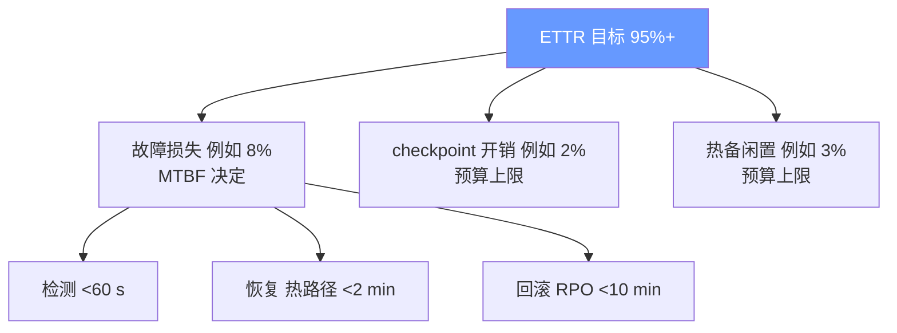

# 最佳实践

把前几章的模型、架构与生产数据收敛成一份可执行的清单：该做什么、做到什么程度、最常见的死法是什么。

## 9.1 十条最佳实践

1. **把 ETTR 设为第一 SLO，且口径要纯。** 目标 >95%（ByteRobust 标杆 97%）；统计时剔除计划内维护与人工实验操作（Llama 3 的 47/466、ByteRobust 的 17.3%），否则团队会在错误的指标上优化。

2. **用规模律做容量规划的底线校验。** 作业 MTBF = 单节点 MTBF / N。任何扩容方案先回答：按当前 MTTR，扩到目标规模后可用率是多少？（Mini Demo 场景 1 的表就是模板；8,192 卡 + 60 分钟冷修复 = 可用率跌破 50%，这种组合一上线就死。）

3. **checkpoint 间隔用公式起步、用实测修正。** 初值取 Daly 最优 `T* ≈ sqrt(2CM)`，然后按知识库里的真实 MTBF 滚动修正；间隔确定后再分配三层存储（CPU DRAM / 本地 SSD / 远端），把同步阻塞改造成异步流水。验收标准：checkpoint 综合开销 <2% 算力。

4. **原子提交 + 保留 N 版 + 定期恢复演练。** checkpoint 先写临时目录再 rename；至少保留最近 3 个可用版本；每月随机抽历史 checkpoint 做真实恢复演练。"备份存在但恢复不了"是最常见的死法，没有之一。

5. **热备池按 P99 二项模型配置，且必须常驻自检。** 容量从知识库滚动估计故障率 p，取同时故障数的 99 分位（ByteRobust：9,600 卡 P99 仅 2-4 台）；备机轮换演习防"幽灵劣化"，调度侧预留配额防备机被借走。

6. **检测预算写死：GPU 类 <60 s，且绝不依赖 NCCL 超时做主检测。** NCCL watchdog（默认 10 分钟级）只当兜底。生产参照：ByteRobust 巡检线程做到 OS 2 s / GPU 10 s / NIC 30 s。

7. **fail-slow 单独成类，禁止用重启处理慢节点。** 慢节点重启后还是慢（硬件劣化不可自愈），重启只是把 6.47 分钟再花一遍。检测用中位数基线 + 多轮投票（FALCON：>99% 准确），缓解用换备/reroute/降级三选项。

8. **SDC 防线按四层纵深部署，且第四层必须有回滚动作。** ECC → 上线筛选（确定性负载，注意 EUD 召回率仅 ~70%）→ 运行时冗余（双跑抽样 + 副本对账）→ 事后统计（loss/grad-norm 尖刺）。检测到数值异常而不回滚，等于防线形同虚设。

9. **故障知识库是复利资产，格式先于规模。** 每次中断记录：时间线、根因、定位证据链、恢复路径、各环节耗时 vs 预算。它同时喂养检测规则、热备容量、采购举证与 SDC 排查——ByteRobust 的一次 SDC 排查能收敛，靠的是历史画像。

10. **每季度做一次故障注入演练（game day）。** 随机杀节点、杀链路、注入慢节点与 SDC 样本，校验端到端时延预算与回滚正确性。没有演练校验的可靠性数字不可信。

## 9.2 反模式清单

| 反模式 | 后果 | 正确做法 |
|---|---|---|
| 把 NCCL 超时当故障检测 | 故障发现晚 10 分钟，万卡空转 | 巡检线程 + 遥测秒级发现，watchdog 兜底 |
| checkpoint 只存一份 | 写坏即灾难，且无法回滚"坏 checkpoint 之后" | 原子提交 + 保留 N 版 |
| 热备池不自检 | 故障来临时整池不可用 | 常驻自检 + 轮换演习 |
| 用重启治 straggler | 6.47 分钟花完，节点还是慢 | 检测后换备/reroute |
| 回滚后发现状态对不上数据 | 数据重复或跳过，损失隐性且不可逆 | dataloader state 进 checkpoint，恢复时对齐全局 step |
| 检测到 loss 尖刺继续跑 | SDC 污染被盖楼 | 回滚到可信 checkpoint + 嫌疑节点隔离双跑 |
| 故障统计混入口径 | MTBF 被维护/人工操作污染 | 计划内与人工操作分开记账 |
| 恢复时全员读 checkpoint 不限速 | 存储打爆，恢复雪崩 | 错峰 + 限速读 |

## 9.3 可靠性预算分配参考

预算是零和的：checkpoint 开销与回滚损失在同一个旋钮（间隔 T）上互相竞争；热备闲置与 MTTR 在另一个旋钮（备机数）上竞争。超支时的动作顺序（按单位成本收益）：先压检测时延（几乎免费）→ 再上热备（百分之几的闲置）→ 再加密 checkpoint（需异步/差量配套）→ 最后才动硬件与架构（最贵但十万卡规模绕不开）。

## 9.4 分级落地路线

| 阶段 | 规模 | 最小可靠集 | 目标 |
|---|---|---|---|
| 起步 | 百卡 | torchrun + 周期 checkpoint + NCCL watchdog | 中断可恢复 |
| 成长 | 千卡 | + 异步 checkpoint + 巡检检测 + 保留 N 版 + 知识库 | ETTR >90%，检测 <5 min |
| 成熟 | 万卡 | + 热备池 + 分层差量 checkpoint + straggler 检测 + game day | ETTR >95%，恢复 <10 min |
| 极限 | 十万卡 | + burn-in 工厂 + SDC 双跑体系 + 架构级故障域（reroute/DualPipe 思路） | ETTR >95% 且成本可控 |

不要在百卡阶段就上十万卡的方案（复杂度会拖垮迭代速度），也不要在万卡阶段还停在起步方案（可用率塌方不可逆）。每上一档规模，先按第 2 条用规模律重算一次底线。

## 9.5 数字速查表

| 指标 | 参考值 | 来源 |
|---|---|---|
| 1,024 卡作业 MTTF | 7.9 h | Kokolis HPCA'25 |
| 16,384 卡中断频率 | 每 2.78 h 一次 | Llama 3（466 次/54 天） |
| 非预期中断硬件占比 | ~78% | Llama 3 |
| 冷重启耗时拆解 | 6.47 min（初始化占 69%） | TrainMover Table 1 |
| 热备热更新耗时 | 46-65 s（比 requeue 快 11.04 倍） | ByteRobust |
| 检测时延标杆 | OS 2 s / GPU 10 s / NIC 30 s | ByteRobust |
| 每步 checkpoint 开销 | <0.9%，MFU 损失 0.71% | ByteRobust |
| ETTR 标杆 | 97%（9,600 卡 × 3 个月） | ByteRobust |
| 热备容量 | P99 二项：9,600 卡仅 2-4 台 | ByteRobust |
| EUD 对 SDC 召回率 | ~70% | ByteRobust |
| straggler 缓解收益 | 检测 >99%，缓解 60.1% 减速 | FALCON |

## 小结

最佳实践的内核是四句话：**ETTR 记账、规模律校验、公式起步实测修正、纵深防御配回滚动作**。下一章用面试题检验你是否能把这些模型与数字讲清楚。
