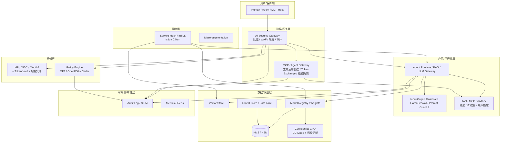

# 架构设计

AI 安全架构需要把“身份、网络、应用、数据、模型、可观测”六个层面的控制串成一条可验证的链。任何一层出现短板，都可能让上层控制失效。

## 分层安全架构

### 1. 边缘/网关层

这是外部流量进入系统的第一道关卡，承担：

- **认证**：API Key、OIDC、OAuth2、mTLS。
- **流量控制**：rate limit、DDoS 防护、bot 管理。
- **初步审计**：记录请求元数据。
- **密钥隔离**：LLM provider key 与 tenant key 分离，避免泄露。

2025-2026 年的新组件是 **MCP / Agent Gateway**：Agent 的工具流量不再直连 MCP Server，而是统一经过网关做工具注册管控（哪些 Agent 能用哪些 Server）、OAuth Token Exchange（Agent 不持有后端长期凭证）、工具描述快照与 diff 告警。2026 年 MCP 规范修订（2026-07）已把 OAuth 2.1 与 Resource Indicators 列为强制项，用以缓解 confused deputy 攻击。

### 2. 身份与策略层

- **Identity Provider（IdP）**：管理人类与机器身份，支持 SSO、MFA、会话管理。2026 年的演进是面向 Agent 的身份生命周期管理（创建、认证、授权、注销）与 **Token Vault**：OAuth token 由平台代管并按需注入，Agent 本身永远不直接持有第三方 SaaS 的长期凭证。
- **Policy Engine**：把认证信息转化为授权决策。
  - **RBAC**：角色-权限映射，适合静态组织结构。
  - **ABAC**：基于属性（部门、数据分类、时间、位置）动态决策。
  - **ReBAC**：基于关系（用户-文档-项目）决策，适合复杂协作场景。
  - **意图校验（Intent Check）**：Agent 请求的工具参数必须与声明的任务意图一致，不一致时拒绝或转人工。
  - 代表项目：OPA（通用策略）、OpenFGA（ReBAC）、Cedar（AWS 开源授权语言）。

### 3. 网络层

- **mTLS**：服务间双向 TLS 认证，防止伪造。
- **Service Mesh**：Istio、Linkerd、Cilium 提供 L4/L7 策略、可观测、流量加密。
- **Micro-segmentation**：把训练、推理、向量库、数据湖划分到不同安全域，限制横向移动。
- **Egress 控制**：限制推理服务只能访问允许的模型 API 与外部服务。

### 4. 应用/运行时层

- **Agent Runtime**：执行 ReAct 循环，需要工具 capability 校验、调用沙箱、超时/步数限制、预算上限（对应 OWASP ASI02 的预算耗尽风险）。
- **Guardrails**：输入过滤（提示注入、越狱、工具描述投毒）、输出过滤（有害内容、PII、代码安全）。2025-2026 的主流组合是**专用分类器 + LLM 审计双层**：小模型做低延迟拦截（如 Prompt Guard 2），大模型做链式行为审计（如 LlamaFirewall 的 AlignmentCheck），详见第 5 章。
- **Tool / MCP Sandbox**：工具调用在受限环境中执行，避免 SSRF、命令注入、数据外泄。MCP 场景下额外要求：
  - **工具描述不可信**：描述中嵌入的指令按"数据"处理，不得改变任务目标（Invariant Labs 2025-04 首次公开的工具投毒 PoC 即利用 Cursor IDE 的描述字段）。
  - **版本锁定 + 描述快照**：通过审核后锁定版本；Server 更新后描述发生变化时必须重新审批（防 Rug Pull）。
  - **跨 Server 防护**：多 Server 混用时，一个被攻陷的 Server 可能通过上下文"影子劫持"其他 Server 的调用，需要按信任域隔离会话上下文。

### 5. 数据/模型层

- **Vector Store**：多租户索引隔离、字段级加密、访问审计；对写入管道做来源校验与语义异常检测（防知识库投毒，见第 1 章 PoisonedRAG）。
- **Model Registry**：模型版本签名、来源追溯、访问控制；加载前做恶意代码扫描（Picklescan/ModelScan），优先使用 Safetensors。
- **Object Store / Data Lake**：训练数据分类、去标识化、保留策略；支持"被遗忘"请求的机器遗忘（Unlearning）流程。
- **KMS / HSM**：加密静态与传输中的密钥、模型权重、Embedding。
- **Confidential GPU（新增）**：多租户 GPU 场景下，H100/H200/Blackwell 的 CC 模式配合 CPU TEE 与远程证明，让 VRAM 对宿主机与云平台不可见，是"算力商品化"时代的数据面终级防线。

### 6. 可观测/审计层

- **Audit Log**：append-only，记录身份、动作、资源、决策、原因。
- **SIEM/SOAR**：聚合日志、检测异常、自动化响应。
- **Metrics/Alerts**：监控异常调用模式、密钥使用、Guardrail 拦截率。
- **Agent Trace**：2026 年审计的新要求——多步 Agent 的每一步推理-工具调用对都要留痕（含工具描述版本与委托链），否则事后无法回答"它当时为什么调了这个工具"。

## 控制面与数据面

| 平面 | 职责 | 典型组件 |
|---|---|---|
| 控制面 | 身份、策略、配置、密钥分发、模型版本管理 | IdP、OPA、Vault、K8s API、Model Registry |
| 数据面 | 实际请求处理、模型推理、工具调用、数据读写 | LLM Gateway、Agent Runtime、Vector Store、工具沙箱 |

**关键原则**：控制面的高权限必须被严格保护；数据面应尽量无状态、不可直接访问密钥仓库。

## 边界安全 vs 零信任

| 模式 | 假设 | 适用场景 |
|---|---|---|
| 边界安全 | 内网可信，重点防御外部 | 传统单体、封闭式训练集群 |
| 零信任 | 内外部均不可信，每次验证 | 多租户 SaaS、分布式 Agent、外部模型 API |
| 零信任 + 机密计算 | 运营方与宿主机也不可信，依赖硬件证明 | 多租户 GPU 训练/推理、受监管行业模型托管 |

AI 系统通常同时需要两者：对外服务使用零信任，对封闭训练环境保留物理/网络边界；面向不可信租户的算力平台则需要在零信任之上叠加可验证计算。

## 小结

AI 安全架构通过六层控制把“身份、网络、应用、数据、模型、审计”连成闭环。下一章将把这些层次映射到 AI 系统从设计到退役的全生命周期中。
