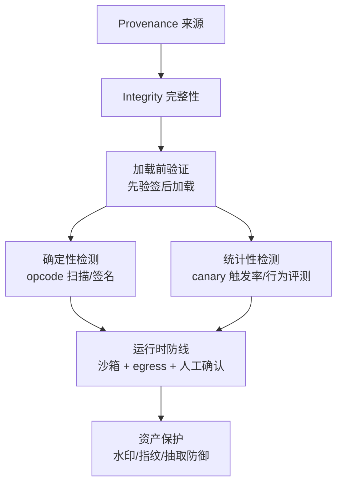

# 核心概念：信任边界、工件完整性与投毒的统计学本质

供应链安全不是一堆工具的堆砌，而是几个清楚的概念在每个环节的重复应用。掌握这四个概念，所有具体机制都能推导出来。

## 2.1 Provenance：这东西从哪来

Provenance（来源证明）回答"这个工件是谁、在什么时间、用什么流程产生的"。软件世界有 SLSA provenance（构建级证明），模型世界的难处在于：**训练不可复现**。同样的数据、同样的代码、同样的超参，换一批 GPU 跑出来的权重 bitwise 都可能不同，因此 provenance 只能锚定"流程与身份"，不能锚定"结果"。

实践中的锚点组合：

- **身份锚**：签名绑定发布者身份（Sigstore 的 OIDC + 短期证书模式天然适合 CI 流水线签名）。
- **流程锚**：训练数据清单、代码 commit、镜像 digest、评测报告随模型一起发布（EU AI Act 的技术文档义务直接要求这一点）。
- **平台锚**：Hugging Face 的 Gated Repo、资源组、GPG 签名 commit，提供平台侧的最低保证——注意 HF 官方自己也声明扫描是 best-effort，平台锚不是信任终点。

## 2.2 Integrity：有没有被改过

完整性的数学本质很简单：**一个单向摘要（hash）加一把只有持有者能用的签名密钥**。模型工件的特殊性在于它是"一包文件"（权重 + config + tokenizer + 代码），所以完整性的工程形态是：

1. 每个文件算 sha256；
2. 用 merkle 树聚合出单一 root（任何单文件改动都会改 root，且能定位到具体叶子）；
3. 对 root 签名；
4. 消费者侧"先验签、再验 root、再逐文件对比"。

容器生态的 cosign 已经证明这条链可以零摩擦落地；模型分发把它平移过来即可（第 6 章的 google/model-transparency 就是 Sigstore 在模型工件上的官方实践）。**加载前的验证是唯一强制的时机**：一旦权重进了进程地址空间，"验证"就已经太晚。

## 2.3 投毒是统计攻击：检测的本质是假设检验

恶意代码（pickle RCE）是**确定性的**：要么有 GLOBAL('os system') + REDUCE，要么没有——可以静态判定，误报率可工程化压到 96% 以下再靠运营消化。后门投毒是**统计性的**：攻击者要保证干净输入下模型行为正常，只让"触发器 → 错误输出"的关联存在。因此检测只能是概率性的：

- **canary 触发率**：构造一批"真实标签固定 + 触发器注入"的 canary 样本，统计模型输出错误标签的比例。干净模型接近 0，带后门模型显著高于阈值——这就是一个单样本比例的假设检验。
- **行为评测**：用红队探针集（Garak、CyberSecEval 一类）测模型的危险行为触发率，比较候选模型与基线。
- **异常权重检测**：后门往往表现为特定神经元/方向上的异常激活模式，可以做分布偏离检测——但对抗性训练可以让后门权重分布"看起来正常"，所以只是辅助信号。

三条信号的共同点：**都有误报与漏报的权衡，阈值是运营决策不是技术常数**。任何声称"100% 检出后门"的工具都值得怀疑。

## 2.4 信任边界随 Agent 下沉

传统软件的消费者是人：npm install 之后还有一个"看代码、跑测试"的环节。Agent 时代的消费者是模型本身——**工具描述、检索片段、网页内容都直接进上下文窗口并影响动作**。这带来两个新概念：

- **模型可见 vs 用户可见的分离**：MCP 工具描述是模型读、人不读的字段，投毒者利用的正是这个认知缝隙。防御的第一原则是 UI 把 AI 可见指令完整展示给人，并在审批时锁定描述快照。
- **不可信内容的传导性**：prompt injection 不是独立漏洞，而是供应链问题的放大器——被污染的检索结果、被投毒的工具描述，最终都靠 injection 传导成动作。因此运行时必须有"动作侧"的第二道防线：沙箱执行 + egress 白名单 + 人工确认（对应 [安全篇](/08-security/) 的纵深防御，本主题提供工件侧的源头治理）。

## 2.5 模型资产的三个安全问题

模型本身就是资产，面临三个独立问题：

- **成员推断**（membership inference）：攻击者判断某条样本是否在训练集里——对医疗、个人数据训练的场景是隐私泄露。防御：差分隐私训练、输出正则、API 侧限制 logits 暴露。
- **模型抽取**（model extraction）：通过查询 API 蒸馏出功能等价的副本。2024 年 Google DeepMind 的研究证明连 production LLM 的 embedding 维度、logits 投影层都可以被系统性"偷"出来。防御：查询限流、输出扰动、Canary token、水印举证。
- **泄露溯源**：权重被二次分发后如何举证所有权——这正是水印与指纹的用途，也是唯一能"事后生效"的机制。

## 2.6 供应链等级：把 SLSA 翻译成模型语言

软件供应链有 SLSA 等级（L0 无证明 → L3 可复现构建 + 防篡改 provenance），模型供应链可以平移出同样的四级刻度，作为组织自评与供应商尽调的统一语言：

| 等级 | 定义 | 模型世界的对应物 |
|---|---|---|
| L0 | 无来源信息 | 网盘链接、匿名转载的权重文件 |
| L1 | 有来源记录 | HF 仓库 + commit 历史（平台账号即身份） |
| L2 | 有签名与清单 | merkle 清单 + cosign 签名 + Rekor 记录 |
| L3 | 流程可审计 | L2 + 训练数据清单、评测记录、红队报告随版本发布 |

注意模型场景的天然天花板：SLSA L4（可复现构建）在权重层面基本不可达，所以 L3 就是实际终点——这也是为什么行为评测与社区信誉必须补位，它们替代了"复现构建"在软件世界里的校验职能。对外采购模型时，要求供应商给出等级声明（"我们发布物是 L2"）比问"你们安全吗"可获得的信息量高几个数量级。

## 2.7 TOCTOU：为什么"加载时检查"是个坑

Time-of-Check to Time-of-Use 在供应链场景有个特殊形态：文件在**验证时刻**是干净的，在**使用时刻**已被替换。两种典型路径：

- 验证与加载在同一进程：攻击者只需在验签后、加载前改写文件（同机权限或竞争条件）；
- 验证后文件进入共享存储：其他有写权限的组件（日志轮转、备份任务、被攻陷的 sidecar）可以事后替换。

对策已在本主题反复出现：**验证者必须是用途者独占的**（init 容器验签后把工件写进只读卷，主容器只读挂载），或者**每次使用都重新验证**（merkle 逐叶校验成本极低，可以把验证粒度下沉到每次加载）。第 3 章控制面/数据面分离的架构，本质上就是为了让验证动作在数据面无处可被绕过。

## 2.8 误报经济学：为什么扫描部署死于误报

一个常被忽视的规律：**静态检测工具的部署成败由误报率决定，而不是由检出率决定**。定量地看：假设模型入库流量每天 200 个工件，真恶意率万分之一，扫描器检出率 99%、误报率 5%——每天告警约 10 个，其中真阳性约 0 个。两周后运营团队必然开始"标记为已审"批量放行，此时扫描器对真攻击的防线也已名存实亡。

工程对策三条：（1）白名单运营前置——先 audit 模式收集两周基线再转 enforce；（2）分级响应——suspicious 进人工队列、malicious 才自动阻断，避免队列被稀释；（3）指标闭环——持续跟踪"告警 → 确认恶意"的转化率，转化率低于阈值时优先调规则而不是加人力。JFrog 披露 HF 扫描 unsafe 标记超 96% 为误报，说明连平台方也在同一约束下运营。

## 2.9 概念地图

一句话记住本章：**签名解决"改了没有"，扫描解决"有没有刀"，canary 解决"有没有毒"，沙箱解决"动手时能伤多重"，水印解决"丢了能不能告回来"。**
