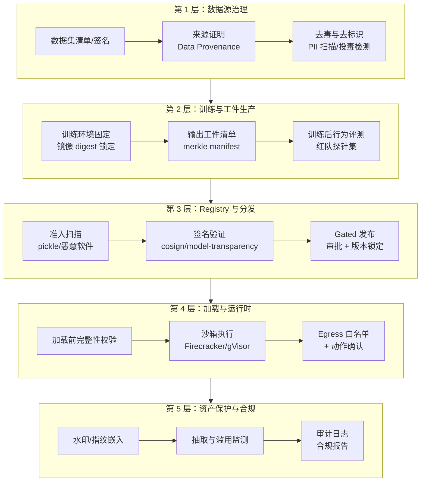
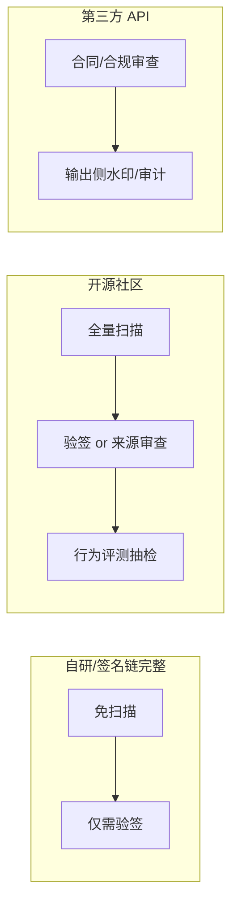

# 架构设计：AI 供应链安全分层防御体系

把第 2 章的概念铺到工程结构上，AI 供应链安全是一个五层体系：每一层解决一类威胁，层间用"门禁点"衔接——工件只有过了门禁才进入下一层。

## 3.1 五层架构总览

| 层 | 核心威胁 | 关键机制 | 失败后的兜底 |
|---|---|---|---|
| 数据源治理 | 投毒、PII 混入、版权污染 | 来源清单、去毒扫描、canary | 行为评测（L2）、运行时审计 |
| 工件生产 | 环境漂移、工件被换 | 环境锁定、输出清单签名 | L3 准入重扫 |
| Registry 分发 | 恶意上传、传输篡改、依赖混淆 | 平台扫描、cosign 验签、版本锁定 | L4 加载前验证 |
| 加载与运行时 | RCE、注入传导、越权动作 | weights_only、沙箱、egress 控制 | 人工确认、审计回滚 |
| 资产保护 | 抽取、泄露分发 | 水印指纹、查询限流 | 法律举证、密钥轮换 |

## 3.2 门禁点设计原则

架构的关键不是层数，而是**门禁点的位置**——每个门禁必须满足三条：

1. **默认拒绝**：验证失败时工件不进入下一层，而不是打个 warning 继续走。
2. **验证发生在加载之前**：调用 `torch.load` / `AutoModel.from_pretrained` 的进程不应该负责"决定是否加载"，门禁是独立组件。
3. **失败可定位**：验证报告必须指出"哪个文件、哪项检查、期望什么、实际什么"——merkle 树的价值就在于此（第 7 章 demo 演示单文件篡改定位）。

在 [MLflow](/03-ai-platform/mlflow/) 这类 Model Registry 里，门禁通常挂在两个阶段：**注册时**（register → 扫描 + 签名登记）和**部署时**（deploy → 验签 + 策略检查）。只挂一个等于没挂：注册后工件在存储里仍可能被换，部署前不验签则注册时的保证传不到运行时。

## 3.3 控制面与数据面

- **控制面**（谁准进、谁签过、策略是什么）：Registry、策略引擎、签名密钥管理（KMS/HSM）、审计日志。流量小、强一致、高可用要求。
- **数据面**（工件本身的流动）：对象存储、CDN、训练集群、推理节点。流量大、最终一致。

典型 mistake 是把控制面策略塞进数据面代码里：每个训练脚本自己决定"要不要扫描"。正确做法是控制面下发**不可绕过的校验器**——推理节点的 sidecar/init-container 在权重挂载后、主容器启动前完成验签（类似 Istio 的 Envoy 初始化模式）。

## 3.4 与 Agent 架构的交汇

Agent 引入了两个新的架构组件，都在第 4 层：

- **MCP Gateway**（对应 [安全篇](/08-security/) 的 MCP/Agent 网关）：工具清单的完整性校验、描述快照 diff、版本锁定的执行点。Registry 侧只管"哪些 Server 被批准"，Gateway 管"这次调用带的工具描述是不是批准时的那个"。
- **代码执行沙箱**：Agent 调用的代码解释器、浏览器、终端工具都在沙箱里跑。选型光谱从 gVisor（容器内核态隔离、毫秒级启动）到 Firecracker microVM（硬件虚拟化级隔离、百毫秒级启动）再到托管沙箱服务（E2B 一类）。第 6 章给出对比。

## 3.5 多租户与信任域

供应链信任是**分域**的：自研模型（信任域 A）、开源社区模型（域 B）、第三方商业 API（域 C）的信任假设完全不同。架构上应该显式建模：

混用域 B 的工件走域 A 的快路径，是生产事故的高频根因——门禁策略必须按域路由，而不是一刀切。

## 3.6 每层的失效模式分析

架构评审最有价值的问题不是"每层做什么"，而是"**这一层失效后会发生什么**"。逐层推演：

- **G1 数据去毒失效**（漏过投毒样本）：后果传导到 G2 行为评测——若评测也失效，后门随模型进入生产。此时唯一剩余防线是运行时审计（异常行为检测）与事后水印举证。**启示：G1 的置信度决定 G2 的抽检强度，两层预算应按威胁模型联动配置**。
- **签名密钥泄露**：攻击者可给恶意工件签合法签名。Sigstore 模式把影响窗口压缩到证书有效期内（小时级），Rekor 日志让异常签名可事后发现；传统长期密钥场景则需要 KMS 分级 + 快速轮换预案。**启示：签名体系的价值一半在日志与身份，一半在密码学**。
- **Registry 被攻陷**：攻击者直接改存储里的工件与清单。验签节点（G3）是最后防线——存储不可信时清单与工件必须分离存储（清单放只增日志系统或独立签名域）。
- **沙箱逃逸**：Firecracker/gVisor 历史上都有 CVE。纵深在此刻兑现价值：egress 白名单限制外传目标，动作确认限制危险操作，审计日志保留取证现场。**启示：沙箱永远按"会被逃逸"设计外围**。

## 3.7 组织维度：谁拥有哪一层

供应链门禁跨团队，职责不清是落地失败的第一原因。参考分工：

| 层 | 所有者 | 协作方 |
|---|---|---|
| 数据源治理 | 数据平台团队 | 安全（规则）、法务（许可） |
| 工件生产 | ML 平台团队 | 安全（扫描器）、合规（记录格式） |
| Registry 分发 | ML 平台团队 | 安全（密钥管理）、SRE（可用性） |
| 加载与运行时 | 应用/SRE 团队 | 安全（沙箱策略）、平台（镜像） |
| 资产保护 | 安全团队 | 法务（举证链）、ML 平台（嵌入点） |

一个常见的失败模式：扫描器由安全团队选型，门禁由 ML 平台实现，两边都不对最终拦截率负责。缓解办法是把"门禁拦截率与误报率"写进单一团队的 SLO——本主题的实践里，这个角色通常落在 ML 平台团队。

## 3.8 架构成熟度三阶段

- **阶段 1（可观测）**：工件有清单、下载有日志、加载有审计——先能回答"线上跑的是哪个文件"。
- **阶段 2（可拦截）**：扫描与验签进入 CI/CD 门禁，失败阻断发布。
- **阶段 3（可举证）**：签名覆盖训练输出，水印覆盖核心资产，泄露事件能拿出法庭可用的证据链。

多数组织 2025-2026 年处在阶段 1 到 2 之间；合规时间表（2026-08 EU AI Act 强制执行）是推进到阶段 3 的外部 forcing function。
