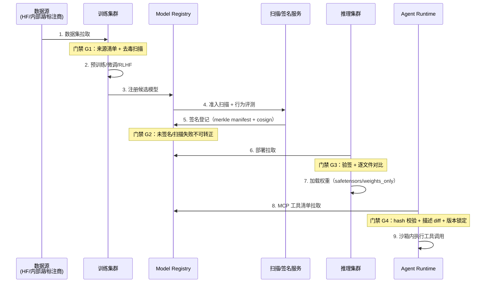
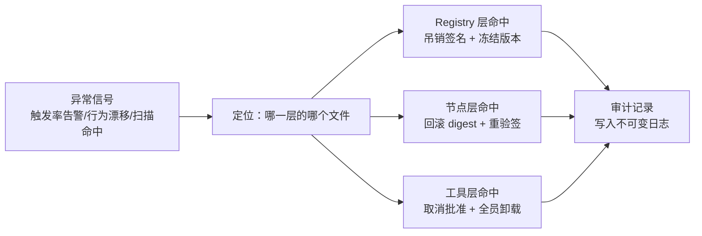

# 供应链全流程：从数据源到生产加载的门禁点

本章把"一个模型从外部数据源走进生产推理服务"的完整路径走一遍，每一步标注：发生了什么、威胁是什么、门禁装在哪、失败去向哪里。

## 4.1 全流程地图



## 4.2 门禁 G1：数据进入训练之前

**动作**：数据集入库时生成数据清单（来源 URL、下载时间、内容 hash、许可信息），同时跑两道扫描：恶意内容扫描（夹带的可执行文件、越狱样本）与投毒抽检（canary 注入实验、重复/近重复分析）。

**威胁与判据**：数据投毒是唯一在"内容完全合法"的前提下依然能成功的攻击——毒样本本身就是格式良好的文本/图片。因此 G1 的扫描结论只能是"降低概率"，真正的兜底在 G2 的行为评测与第 5 章的 canary 机制。PII 与版权扫描在此一并完成（GDPR 删除权、EU AI Act 训练数据摘要义务都依赖这份清单）。

**失败去向**：隔离区，人工/自动复检；命中明确黑名单来源的直接熔断该来源通道。

## 4.3 门禁 G2：训练输出进入 Registry

**动作**：训练任务结束时，环境固定（基础镜像 digest、CUDA 版本、随机种子写入 run 元数据）；输出工件打包生成 merkle 清单；清单用 CI 身份签名（Sigstore OIDC 模式：私钥即弃、证书短期、记录进 Rekor 透明日志）；随后进入准入门——pickle 扫描（若含旧格式）、恶意软件扫描、行为评测（红队探针集跑分对比基线）。

**威胁与判据**：此处防的是"训练环境被污染"（恶意 node 镜像、被篡改的依赖）与"工件在 Registry 存储内被替换"。行为评测基线漂移超过阈值（如危险行为触发率上升 5 倍标准差）即拦截。

**签名设计的工程细节**：签名的主体是**清单 root 而非整个权重文件**——权重可能上百 GB，签名一次、验证也只需对 root 验签一次，逐文件完整性交给 merkle 路径校验。第 7 章 demo 实现了这个链条的最小版。

## 4.4 门禁 G3：推理集群加载之前

**动作**：推理节点启动（或滚动升级）时，init 阶段完成：拉取清单 → 验签（身份是否批准的发布者）→ 逐文件 sha256 对比 → 生成"验证通过"标记文件 → 主容器才启动加载。

**威胁与判据**：Registry 到推理节点之间的任何篡改（对象存储凭证泄露、CDN 劫持、内部人员替换）。这是经典的"TOCTOU 最后一道"：加载进程内不再做任何信任决策。

**加载侧的最后一米**：即使 G3 通过，加载器配置仍有讲究——safetensors 优先；不得已用 pickle 系格式时 `torch.load(weights_only=True)`（PyTorch 2.6 起的默认行为），并且理解 weights_only 的边界：它只保证"不执行任意类构造"，不防权重后门。

## 4.5 门禁 G4：Agent 工具清单进入运行时之前

**动作**：Agent Runtime 启动或工具列表变更时，对每个 MCP Server 做三件事：

1. **版本锁定检查**：当前 Server 版本 == 批准时的版本？不一致 → 拒绝并要求重新审批（防 rug pull）。
2. **清单完整性校验**：工具代码/包内容 hash 与 Registry 记录比对（防服务器端被篡改后下发新代码）。
3. **描述快照 diff**：工具 description 与审批时快照逐字对比，差异 → 阻断或升级人工审批（防 tool poisoning）。

**威胁与判据**：Invariant Labs 披露的 tool poisoning 与 rug pull 都发生在这一个环节。关键点：**批准的对象是"描述 + 代码"的绑定，不是 Server 名字**——很多客户端只记名字不记内容，等于门禁形同虚设。第 7 章 demo 的 `mcp_integrity` 模块演示了绑定校验的最小实现。

## 4.6 运行时：门禁之后的纵深

过了 G4 不等于信任。工具**执行**仍要过第 4 层防线：沙箱（Firecracker/gVisor/E2B，见第 6 章）、egress 白名单（工具能访问哪些域名/IP，DNS 层兜底防数据外带）、动作分级确认（读文件 ≠ 发邮件 ≠ 转账）。这部分与 [Agent Runtime](/05-agent/agent-runtime/) 主题的运行时护栏深度耦合，本主题强调的原则只有一条：**所有门禁防"脏东西进来"，运行时防"脏东西动起来"**。

## 4.7 门禁策略示例：一段可执行的策略定义

把门禁规则写成声明式配置（而不是散落在脚本里的 if-else），是"策略即代码"的最小形态。下面是一段示意性的 G3 部署门禁策略：

```yaml
artifact_policy:
  trust_domain: community           # 开源社区域 → 全量检查
  require:
    - manifest_present              # merkle 清单存在
    - signature_valid               # 签名来自批准身份列表
    - scan_report_clean: [pickle, malware]
  prefer:
    - format: safetensors            # pickle 系格式需额外审批标签
  canary:
    sample_size: 200
    trigger_rate_threshold: 0.3
  on_violation: block_and_alert      # 默认拒绝，不允许 warn-and-continue
```

注意三个设计点：**信任域作为第一字段**（策略按域路由，而不是全局一刀切）；**on_violation 没有 warn 选项**（误报问题用白名单解决，不用降级解决）；**canary 参数随策略版本化**（阈值变更本身要审计）。这段配置在 8.2 节的 Registry 状态机里就是状态转换的判定依据。

## 4.8 两个常被跳过的细节

**依赖的依赖（传递工件）**。`transformers` 加载模型时会隐式拉取 tokenizer 文件、chat template、generation config——它们和权重一样是工件，一样要被清单覆盖。实践中最常见的覆盖缺口是**聊天模板与系统提示词文件**：2026 年公开研究已演示在 chat template 里埋入隐藏指令（inference-time 后门）的攻击面。清单生成的正确单位是"模型目录"，不是"权重文件"。

**回滚工件本身**。事件响应回滚的不只是版本号，还有工件内容：Registry 应保留历史版本工件与签名（至少保留 N 个发布周期），否则"回滚到上一个安全版本"会变成"重新下载一个来历不明的旧文件"——回滚动作自己就是一个供应链入口。

## 4.8 回滚与事件响应路径

每个门禁的失败都必须可回滚、可定位：



merkle 清单在这里再次体现价值：异常定位到文件后，可以精确回答"受影响的是哪些版本、哪些下游服务"——没有清单的组织在事件里只能"全部重建"，恢复时间相差一个数量级。
