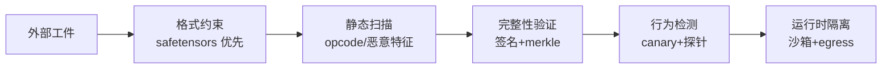

# 核心模块：工件扫描、签名验证、数据去毒、MCP 管控、沙箱与水印

本章按第 3 章的五层架构逐个展开核心模块的机制细节——每个模块讲清"输入什么、输出什么、判定逻辑、已知盲区"。

## 5.1 工件扫描器：pickle opcode 分析

**输入**：模型文件字节流（`.bin`/`.pt`/`.pkl`）；**输出**：风险评级 + findings 列表 + 引用清单。

pickle 的本质是虚拟机指令流：栈机逐 opcode 解释执行。两个 opcode 是 RCE 的落脚点——`GLOBAL`/`STACK_GLOBAL` 负责"import 某模块的某属性"，`REDUCE` 负责"以栈顶为可调用对象执行调用"。扫描器（picklescan、Fickling、ModelScan 的共同内核）用 `pickletools.genops` **只读不执行**地遍历指令流，收集全部 import 引用，对照危险清单打分：

- 命中 `os.system` / `subprocess.*` / `builtins.exec` 等 → malicious；
- 命中未知模块（比如 `__main__.MyWeights`）→ suspicious（REDUCE + 未知引用是自定义对象的正常形态，不能不查也不能一刀切）；
- 只有数据 opcode 且无任何 import → safe。

典型对照（第 7 章 demo 实测）：纯数据 pickle 15 个 opcode、0 引用、safe；numpy 数组 pickle 62 个 opcode、引用 `numpy._core.multiarray._reconstruct`、suspicious（REDUCE 存在但落在数值库）；`os.system` 负载 15 个 opcode、引用 `posix.system`、malicious。

**盲区**（必须记住三条）：（1）解析器差异逃逸——ReversingLabs 的 nullifAI 用"坏 pickle"让扫描器与真实加载器看到不同指令序列；（2）扫描器只覆盖 pickle 语义，SavedModel 的 Lambda 层、ONNX 的自定义算子各有独立扫描逻辑；（3）96% 量级的误报需要靠白名单运营消化，扫描器不能无人工值守。

## 5.2 safetensors：格式安全的边界

safetensors 的设计是把"指令流"从格式里彻底删掉：8 字节头长 + JSON 头（张量名/dtype/shape/数据偏移）+ 连续原始字节。加载器只做边界校验（偏移是否越界、shape 是否自洽），**没有可执行的语义，因此结构性免疫反序列化 RCE**。

但要精确表述它的边界：**格式安全 ≠ 权重可信**。一个 safetensors 文件可以满载后门权重——hash 全对、格式全合法、正常输入表现正常。它是把"恶意代码"这一类威胁清零，而不是把"投毒"这一类威胁减轻。落地建议：默认只接受 safetensors/GGUF 等数据格式，pickle 系格式一律过扫描器 + 限定 weights_only 加载。

## 5.3 签名-验证链：merkle 清单的工程形态

生产实践的完整链条（第 7 章 demo 的最小对应）：

1. **清单构建**：工件包内每个文件算 sha256，作为 merkle 叶节点聚合出 root；
2. **签名**：CI 用 Sigstore 模式签名 root——OIDC 身份换 Fulcio 短期证书，私钥即弃，事件写入 Rekor 透明日志（事后可审计"谁在何时签了什么"）；
3. **验证**：消费侧先验签（身份是否批准名单内的发布者），再重算 root，再逐文件对比——任何单文件篡改都能定位到具体路径（demo 实测篡改 `model.safetensors` 后 `bad_files=['model.safetensors']`）；
4. **透明日志**：Rekor 记录让"偷偷换签名密钥重新签名"变得可发现。

与传统镜像签名的差异只有一个：**工件是多文件包**，所以是"清单 root 签名 + 逐叶校验"两层，而不是"整个文件签名"一层。

## 5.4 数据去毒与后门检测

去毒是统计战场，分三道工序：

**入库筛**（最便宜）：黑名单来源过滤、PII/秘密扫描、近重复去重（也能挤掉一部分复制式投毒）、越狱样本模式匹配。

**canary 触发率**（发布前）：构造触发器样本集（真实标签固定 + 注入候选触发器），统计模型输出错误标签的比例。原理：干净模型对"加了个与决策无关的扰动"的样本不应改变预测（demo 实测干净模型触发率 0.040），带后门模型则会把触发器关联到投毒时的目标标签（demo 实测 0.740，阈值 0.5 报警）。工程要点：触发器库要覆盖业务风险场景（特定语言、特定 token 序列、图像补丁），且阈值要做功效分析——样本量 100 时 0.5 阈值能区分 0.05 与 0.7，区分不了 0.3 与 0.6。

**行为评测**（兜底）：红队探针集（Garak、CyberSecEval 一类）测危险行为触发率，与基线模型对比。Sleeper Agents 研究的关键启示：后门经过安全微调仍可存活，所以"对齐后行为正常"不构成无后门的证据。

## 5.5 MCP 工具管控：描述-代码绑定

MCP 工具供应链的最小管控单元是**工具条目 = 代码 hash + 描述快照 + 版本号**。三个校验动作对应两类攻击：

| 校验 | 防住的攻击 | 防不住 |
|---|---|---|
| 版本锁定（当前版本 == 批准版本） | rug pull（批准后更新） | 首次审批时就是恶意的 |
| 代码 hash 比对 Registry | 服务器端代码被替换 | Registry 本身被攻陷 |
| 描述快照 diff | tool poisoning（隐藏指令） | 描述本身措辞含混诱导 |

客户端侧还有两个规范层动作（来自 MCP 官方安全最佳实践）：per-client consent（防 confused deputy）、拒绝 token passthrough。这两类属于授权与令牌卫生，本主题不展开（见 [安全篇](/08-security/) 与 [MCP](/05-agent/mcp/)）。

## 5.6 代码执行沙箱与 egress 控制

工具真正"动手"时的隔离选型是运行时安全的核心决策：

- **gVisor**：用户态内核拦截系统调用，容器级体验（镜像生态完整）、毫秒级启动；隔离强度低于硬件虚拟化，适合"低延迟、工具可信度中等"的场景。
- **Firecracker microVM**：KVM 硬件虚拟化，每个工具调用独立 microVM，百毫秒级冷启动（快照恢复可到毫秒级）；AWS Lambda 同款底座，适合"高隔离、多租户"场景。
- **托管沙箱（E2B 等）**：Firecracker 的开源产品化封装，带文件系统快照与模板，适合不想自建微VM 平台的团队。

无论选型，**egress 控制是沙箱的一半价值**：工具进程出站流量走白名单代理（只允许 api.stripe.com 的工具不该能连 attacker.com），DNS 层兜底防直联 IP。prompt injection 的传导链（恶意内容 → 模型决策 → 工具调用 → 出站请求）只有在 egress 被卡死时才真正断掉。

## 5.7 水印与指纹：泄露后的举证机制

**权重水印**：持有者用密钥派生伪随机模式叠加到权重上（demo 实现：w' = w + strength·pattern，pattern ∈ {+1,-1}）。检测时计算相关性——未标记权重相关期望为 0，标记权重期望为 strength，阈值取 strength/2。demo 实测：标记权重 score +0.0504（strength=0.05）检出；量化到两位小数、加噪 std=0.5、攻击者叠加水印后**仍可检出**；但量化步长远大于 strength 时被抹除（score 归零）。工程结论：strength 必须大于发布链路的最粗量化步长。

**指纹（fingerprint）**：不改权重，利用模型对特定输入的预测怪癖（错误一致性）做识别——对 API 蒸馏副本的识别尤其有用，因为 API 不暴露权重。水印管"拿到了文件"，指纹管"只能查询"。

**边界声明**：水印不是加密的对抗保证。系统性微调（数轮全参数训练）可以稀释相关性；学术工作（如对 green-list 文本水印的 paraphrase 攻击）已演示了多类移除手法。水印的定位是**举证工具**（提高攻击者成本 + 提供法庭证据链），不是访问控制。

## 5.8 模块的组合策略：纵深不是堆叠

六个模块不是并列的可选项，而是按"威胁类别 × 时机"织成的一张网。一个工件从外部进入生产，至少要穿过四道异构的检查——**同构检查堆两层没用，异构检查各一层才有纵深**：

组合时的三个工程判断：

1. **静态扫描与签名是互补不是替代**：签名回答"改过没有"，扫描回答"原本脏不脏"。只验签不扫描，等于给恶意工件发护照；只扫描不验签，扫描器自身成为单点。
2. **行为检测的位置越靠近发布越便宜，越靠近生产越准确**：G2 跑 canary 全量集（便宜、无用户影响），生产侧只做触发率遥测（采样、真实分布）。反过来在生产跑全量 canary 会拖慢发布，只在 G2 跑又会漏掉"部署后被热更新权重"的边角场景。
3. **沙箱是所有模块失效后的地板**：前四道都针对"工件内容"，沙箱针对"行为后果"——即使前面全漏，egress 白名单依然让攻击者拿不到数据。地板要有，但不能因为有地板就不修天花板。

另一个容易忽视的组合是**水印与签名的时序配合**（8.6 节）：水印在签名之前嵌入，签名覆盖的才是"带水印的发布物"，举证链才完整。顺序反了，攻击者可以主张"你签名的是无水印文件，检测的是另一个"。

## 5.9 模块的成熟度速评

| 模块 | 技术成熟度 | 运营负担 | 当前最大缺口 |
|---|---|---|---|
| 工件扫描 | 高（工具成熟） | 中（误报运营） | 解析器差异逃逸需持续跟进 |
| 签名验证 | 高（Sigstore 生态完整） | 低 | 模型分发场景的采用率仍低 |
| 数据去毒 | 中（研究活跃） | 高（统计检验设计） | 盲触发器选择——检测器不知道攻击者用了什么触发器 |
| MCP 管控 | 中（生态快速补齐） | 中 | 客户端侧批准粒度不统一 |
| 沙箱执行 | 高 | 低-中 | 与现有 K8s 网络的 egress 改造 |
| 水印指纹 | 中（学术活跃） | 低 | 针对性移除的对抗升级 |
