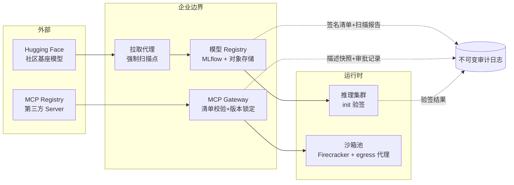

# 企业生产实践：注册中心门禁、红队与事件响应

把前五章的机制落到一家"用开源模型 + Agent 服务做业务"的典型组织里：自研微调基于社区基座模型，Agent 接入十余个 MCP Server，合规团队盯着 2026-08 的 EU AI Act 大限。

## 8.1 落地参考架构

三个硬性约定：**所有外部工件必须经拉取代理进入**（直接 `huggingface-cli download` 到生产网络视为安全事件）；**所有签名密钥由 KMS 托管、CI OIDC 临时获取**；**审计日志独立账号、只增不改**。

## 8.2 门禁策略即代码

以 [MLflow](/03-ai-platform/mlflow/) Registry 为例，把第 4 章的 G1-G3 实现为注册状态机：`candidate`（待扫描）→ `scanned`（扫描通过）→ `signed`（清单签名完成）→ `approved`（策略引擎按信任域放行）→ `blocked`（任一环节失败）。状态转换全部经 API 完成、写审计日志，人工只能通过审批动作改变状态，不能直接改存储。

关键工程细节：扫描 job 与签名 job 必须**运行在不同凭据下**（扫描用只读凭据，签名用 KMS 受限签名凭据），否则一个被攻陷的扫描器就能给恶意工件签上合法签名。行为评测（canary 触发率 + 红队探针对比基线）作为 `candidate → scanned` 的并行检查，结果随模型版本永久保存——EU AI Act 技术文档要求的"系统性风险评估记录"直接从这份数据聚合。

## 8.3 MCP 工具接入流程

对照第 4.5 节 G4 的三件套，生产流程拆成两个阶段：

**接入审批**（一次性）：安全团队审查 Server 源码与维护者信誉 → 在 Registry 登记工具条目（代码 digest + 描述快照 + 批准版本）→ 定义工具的运行策略（沙箱档位、egress 白名单、动作确认级别）。

**运行时执行**（每次启动/变更）：Gateway 比对当前工具代码 digest 与登记值（hash 不符 → 拒绝并告警）、比对描述快照（diff → 阻断并要求重新审批）、校验版本锁定。描述 diff 的告警要有"最近正常快照"的快速回滚路径——多数 rug pull 的处置就是回滚到上一个已批准版本，而不是等重新审批。

运营指标建议：工具加载阻断率、描述 diff 告警量、按 Server 的调用失败分布——这些是 MCP 供应链的"安全水位表"。

## 8.4 模型资产保护实践

- **分发前**：核心模型出厂前嵌入水印（strength 高于最粗发布量化步长），指纹集（一批特殊构造的输入-输出对）入库存档。
- **API 侧**：查询限流 + 异常流量画像（蒸馏式抽取的特征是"覆盖广、形似评测、无会话上下文"）；输出侧对高风险客户启用扰动模式。
- **监测**：定期对市面新出现的可疑模型做水印检测（demo 的 detect 流程）与指纹比对；命中后进入法律流程——这正是 EU AI Act 与 DMCA 双轨下的举证链。
- **内部防泄露**：权重仓库访问按"生产读取 ≠ 批量导出"分离，导出动作双人审批 + 水印/审计标记。

## 8.5 事件响应剧本（摘选）

以"某开源社区模型被披露含恶意 pickle"为例的 24 小时剧本：

1. **T+0h**：拉取代理对该模型 ID 全局熔断；Registry 标记受影响版本。
2. **T+2h**：merkle 清单定位受影响工件与下游服务清单；确认是否已有节点加载（验签日志直接回答）。
3. **T+6h**：已加载节点隔离取证（沙箱环境快照、出站连接日志——egress 代理的价值时刻）。
4. **T+24h**：复盘报告：扫描器为何漏报（格式？解析差异？黑名单过期？）、门禁缺口、规则更新；报告写入审计系统并更新扫描配置。

没有清单与日志的组织，第 2 步通常要花一周——这就是"可定位"架构的 ROI。

## 8.6 模型发布的车间纪律：灰度、影子与水印联动

模型上线是供应链风险最集中的时刻之一——新工件首次进入生产流量。三条配套纪律：

**签名灰度**：新版本先在 1% 节点灰度，灰度节点与其他节点共用同一验签链（不存在"灰度就跳过门禁"的快路径）；灰度期比对行为指标（触发率、探针集、输出分布漂移），通过后再全量。

**影子评测**：生产流量旁路复制到新模型做影子推理（不返回结果），与线上模型输出做分布对比。对后门检测的价值：影子环境可以跑 canary 触发器全集而不影响真实用户——这是第 5.4 节 canary 机制在生产侧最实用的挂载方式。

**水印联动发布**：发布流水线把水印嵌入（若启用）放在签名之前——顺序很重要：先嵌水印再算清单，否则签名覆盖的是未水印版本，事后检测时"签名文件与水印文件不一致"会成为举证链上的瑕疵。

## 8.7 组织与度量

供应链安全项目最常见的死法是"有工具无指标"。最低限度要持续跟踪四个数：

1. **门禁拦截率**（按层分）：G1 数据 / G2 注册 / G3 部署 / G4 工具，各自每周拦截量与放行量；
2. **告警转化率**：扫描告警中确认真实的比例（目标区间 5%-30%，过低说明规则过松，过高说明运营被淹没）；
3. **签名覆盖率**：进入生产的工件中带有效签名的比例（目标 100%，按信任域分别统计）；
4. **MTTR-供应链**：从"披露恶意工件"到"全部节点卸载"的时间（第 8.5 节剧本的目标是让 90% 节点在 2 小时内完成）。

这四个数放进平台团队的常规 SLO 看板，供应链安全就从"安全部的项目"变成"平台运营的一部分"——这也是它能活过预算周期的关键。

## 8.8 合规对齐的实战做法

- **EU AI Act**：把 G1 数据清单、G2 评测记录、G3 验签日志聚合成 GPAI 技术文档；10^25 FLOPs 以上的系统性风险模型额外保留红队报告。2026-08 强制执行前完成一次"以审计视角走查门禁"的演习。
- **中国标识办法**：生成服务在文件头写入隐式标识元数据（服务者名称、内容编号），数字水印复用第 5.7 节机制；标识日志留存 ≥6 个月；用户协议明示标识方法。
- **ISO 42001 / NIST AI RMF**：把门禁策略即代码的仓库作为管理体系的"程序文件"，年度审计直接跑门禁单元测试与策略快照对比——合规证据持续生成，而非审计前突击补录。
