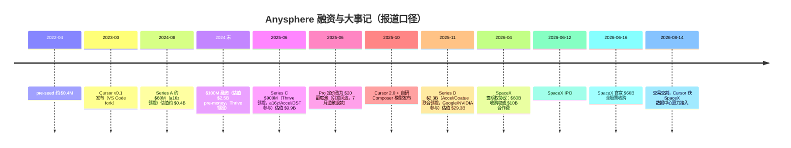

# 1. 背景：一家四年 600 亿美元的公司

## 1.1 起点：四位 MIT 本科生与"AI 编程"的判断

Anysphere 于 2022 年初由四位 MIT 本科生创立：**Michael Truell**（CEO）、**Sualeh Asif**（CPO）、**Arvid Lunnemark**、**Aman Sanger**（COO）【媒体报道：TechCrunch、TIME100 AI 简介等】。四人多为竞赛背景（Truell 为 USACO 决赛选手、Asif 曾代表巴基斯坦参加国际数学奥赛、Lunnemark 为国际信息学奥赛奖牌得主），早期曾探索面向 CAD/机械工程的 AI 工具，后转向编程场景【媒体报道】。2022 年 4 月拿到约 40 万美元 pre-seed，进入 Y Combinator 2023 冬季营【媒体报道】。

2023 年 3 月，Cursor 以 VS Code fork 的形态发布：不是插件，而是把 AI 能力嵌进编辑器内核的独立 IDE。这个选择的工程含义贯穿整个主题——它让 Cursor 能控制从按键事件到渲染管线的每一毫秒（[第 2 章](02-core-ideas)）。

四位创始人在 2024 年 10 月 Lex Fridman 播客 #447 中完整讲述了产品理念【一手访谈】：AI 编程的关键不是"更强的聊天机器人"，而是**消除所有低熵动作**——可预测的击键、样板代码、机械跳转，让程序员专注于意图。Tab 补全（下一步编辑预测）与 Agent（长程任务）是这一理念的两个极端。

## 1.2 增长曲线：ARR 口径（全部来自媒体报道，非审计数字）

| 时间 | ARR / 规模口径 | 来源等级 |
|---|---|---|
| 2025-01 | 约 $100M | Bloomberg 等报道 |
| 2025-04 中 | 约 $300M | Bloomberg 报道 |
| 2025-06 | 超 $500M（"每约两个月翻一倍"） | TechCrunch 引知情人士 |
| 2025-11 | 约 $1B 年化 | 报道（公司未发新闻稿） |
| 2026-02 | 超 $2B 年化 | Bloomberg 报道 |
| 2026-05/06 | 约 $4B 年化 | Forbes/TechCrunch 等报道 |

用户侧，2026 年 2 月公司口径经媒体转述称**付费用户突破 100 万**，付费团队 5 万+，财富 500 强客户占比约六成【媒体报道，未经审计】。作为对照：GitHub Copilot 公开口径约 2000 万用户（其中付费约 470 万）。

## 1.3 融资与终局时间线

三次关键的"拒绝与反杀"值得单独记录：

- **OpenAI 收购未果（2024-2025）**：TechCrunch 2025-04 报道，OpenAI 在转向 Windsurf 之前曾寻求收购 Anysphere，因创始团队坚持独立而未果。OpenAI 随后以约 $3B 洽购 Windsurf，该交易 2025 年 7 月崩塌，Google 以约 $2.4B 挖走其核心团队并授权部分技术，剩余资产由 Cognition 接手【媒体报道】。Windsurf 的崩塌与 Cursor 的独立形成鲜明对照，也是"AI 编程工具现金流不足以支撑模型成本"这一结构性问题的公开注脚。
- **SpaceX 期权协议（2026-04）**：TechCrunch 报道，Anysphere 原定 2026 年 4 月完成 $2B 融资（估值 $50B），SpaceX（已与 xAI 合并）在数小时前横插：给出 $60B 全股票收购期权，或支付 $10B 合作费；收购刻意安排在 SpaceX IPO（2026-06-12）之后以简化交易结构。Cursor 当时的考量被报道为：$2B 融资不足以支撑到现金流打平，而 SpaceX 的数据中心可提供算力。
- **交割（2026-08-14）**：TechCrunch 2026-08-15 报道交易正式完成，Cursor 官方强调获得 SpaceX 算力/基础设施接入。同期媒体报道 OpenAI 宣布将于 2026-11-12 终止对 Cursor 的模型供应【媒体报道，截至本主题知识截止未获双方一手公告，见第 8 章核实声明】。

创始人变动：Arvid Lunnemark 于 2025 年 10 月离开 Cursor 创立 Integrous Research【媒体报道】。

## 1.4 为什么值得写进 AI Infra 手册

Cursor 官方公开的技术材料密度远高于一般产品公司：Tab 的 online RL 博客（2025-09）、Fast Apply 博客（2024-06）、Composer 训练栈博客（2025-10）、Router 博客（2026）、Composer 2 技术报告（arXiv）、定价复盘博客（2025-07）。这些一手材料覆盖了本手册 LLMOps 篇的多个核心议题——推理延迟、投机解码、模型路由、RL 后训练、沙箱调度——但它们的语境是"产品公司如何消费模型"，恰好与模型公司视角（OpenAI/xAI/DeepSeek）互补。

## 1.5 资料可信度三级约定

本主题与 Perplexity、xAI 案例保持一致的三级标注：

- **【一手】**：Cursor 官方博客/文档/changelog、官方技术报告、官方 X 账号、Lex Fridman #447 播客原文。
- **【报道】**：Bloomberg/TechCrunch/CNBC/Fortune 等媒体的融资、收入、收购数字；一律注明媒体与时间。
- **【社区】**：逆向工程、抓包分析、第三方拆解（如 Engineer's Codex 的索引管线分析、GitHub 上的抓包项目）；只用于机制描述，不用于规模数字。

凡涉及 Cursor **内部**架构参数（服务器数量、集群规模、具体模型参数量等）而无一手或多源印证的，本主题一律不写，或以教学模型明示替代。
