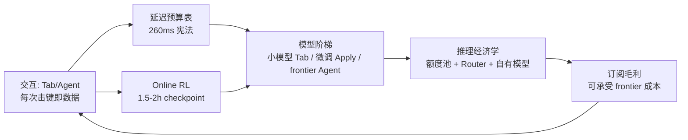

# 2. 核心思想：产品—基础设施协同

Cursor 的架构不是先有一堆模型再套一个壳，而是反过来：**交互形态决定延迟预算，延迟预算决定模型选型，模型选型倒逼基础设施**。本章提炼四条贯穿全主题的核心思想。

## 2.1 延迟预算即产品：Tab 的三段论

Tab 补全的产品定义只有一个硬指标：快到让用户愿意"等它"。创始团队在 Lex Fridman 播客中给出过清晰的方法论【一手访谈】：

1. **定预算**：补全必须在数百毫秒级内出现在屏幕上，否则用户自己已经敲完了，建议就成了干扰。
2. **拆阶段**：端到端延迟 = 客户端触发 + 上下文组装 + 网络 + 服务端排队 + prefill + 首 token 解码 + 渲染。每一阶段都要有数字、有 owner。
3. **按大头优化**：官方博客口径，2025 年 1 月 Tab 模型更新把服务端延迟从约 **475ms 压到 260ms**【一手：Cursor 官方博客，2025-01】。压降手段不是单点奇迹，而是组合：自研小模型、投机解码变体、KV 缓存复用、缓存预热（用户还在打字时就预测并预计算下一个建议）、multi-query/MLA 注意力缩小 KV 体积【一手访谈】。

[Mini Demo 场景 2](07-mini-demo) 把 260ms 拆成九段教学预算并验证"prefill 省 50ms 端到端下降 19.2%"这类敏感性——方法论的意义大于数字本身：**延迟预算表是这份产品的宪法，所有模型与infra决策都对表负责。**

## 2.2 任务分层与模型阶梯：没有"一个模型打天下"

Cursor 把"AI 编程"拆成延迟与质量要求截然不同的三类任务，各配不同的模型策略【一手：官方博客与访谈】：

| 任务层 | 延迟要求 | 模型策略 | 官方口径 |
|---|---|---|---|
| Tab 补全 | 端到端数百 ms | 自研小模型（稀疏 MoE），"pre-fill token hungry、生成少" | Lex #447；Fusion 更新把上下文 5,500 扩到 13,000 token |
| Apply（把编辑落盘） | 秒级 | 微调专用模型：整文件重写 + Speculative Edits，约 1000 tok/s | instant-apply 博客（Llama-3-70B 微调口径） |
| Chat / Agent | 秒到分钟级 | 第三方 frontier 模型 + 自研 Composer 系列，Router 调度 | Composer 博客、Router 博客 |

这个分层的工程含义深远：**延迟最苛刻的层恰恰用最小的模型**，因为小模型可以 serving 到极低 TTFT；质量要求最高的层用 frontier 模型，但通过 Router 与缓存把成本管住（[第 5 章](05-core-modules)）。三层之间由产品交互衔接，而不是由一个通用网关硬撑。

## 2.3 交互闭环即训练数据：4 亿次日请求是 Cursor 的真正资产

2025 年 9 月官方博客给出了一组关键数字【一手：cursor.com/blog/tab-rl】：

- Tab 每天服务 **4 亿+ 次请求**，每次触发都是一次带标注的样本——用户接受（accept）、拒绝（reject）、忽略（ignore）就是奖励信号。
- 奖励设计：目标接受率设为阈值（示例 25%），接受 +0.75、拒绝 −0.25、不展示 0，用策略梯度直接优化"展示与否 + 展示什么"。
- **on-policy 约束**：更新后的模型会让旧样本失效，因此 Cursor 用 1.5-2 小时把新 checkpoint 滚动上线、回收新鲜数据、继续训练。
- 效果：新默认 Tab 模型**少展示 21% 的建议、接受率提升 28%**。

这是"数据飞轮"最标准的生产形态：**RL 不是训练阶段的附加品，而是与 serving 同频的日常运维**。同样的思路后来扩展到 Composer（2026-03 官方博客"Improving Composer through real-time RL"，约 5 小时一个 checkpoint，编辑留存率 +2.28%、不满意追问 −3.13%、延迟 −10.3%【一手，数值以博客为准】）。

## 2.4 推理经济学：订阅制坐在变动的 token 成本上

Cursor 的收入模式是固定订阅（Pro $20/月起），成本大头却是按 token 计价的 frontier 模型 API——这是全行业最尖锐的毛利结构矛盾之一。Cursor 的三层对冲【一手 + 报道】：

1. **额度池而非请求数**：2025-06 起 Pro 含 $20 按 API 价计的额度，官方口径约等于 225 次 Sonnet 4 / 550 次 Gemini / 650 次 GPT-4.1 请求【一手：定价博客】——把"成本透明"做成产品语言。
2. **Router 降本**：Auto 模式用 classifier 按任务选模型，官方口径 cost per commit：Auto Intelligence $6.76、Balance $4.63，对照全量 Fable 5 $12.69、Opus 4.8 $7.34【一手：Router 博客】——约省 47%。
3. **自有模型替代**：Tab 与 Apply 自 2024 年起就是自有微调模型（不花 frontier API 钱），2025-10 起 Composer 系列切入 Agent 层，2026-03 Composer 2 技术报告给出 $0.50/M 输入、$2.50/M 输出的定价【一手：技术报告】——把最贵的层逐步换成自己的边际成本。

[Mini Demo 场景 5](07-mini-demo) 用教学模型复现盈亏平衡口径：轻度用户毛利率 55%，重度用户跌破水位后"靠长尾盈利用户对冲"。这套经济学在 2025-06 的定价风波中被用户用最激烈的方式教育过一次（[第 8 章](08-production-practice)）。

## 2.5 四支柱的合力

这个飞轮的关键在于每一环都可独立验证：延迟有官方数字、RL 有官方博客、经济学有定价页与 Router 博客。下一章把这套思想落成架构。
