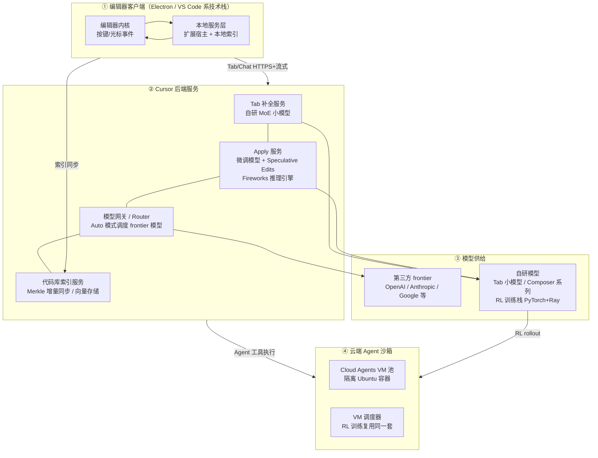

# 3. 架构设计：四层栈与证据分层

Cursor 官方从未发布过一张完整的架构图。本章的图是**依据一手材料（官方博客/文档）拼装的分层视图**，每个模块标注证据等级；图中不出现任何无出处的规模数字。

## 3.1 总体分层

## 3.2 ① 编辑器客户端：为什么是 fork 而不是插件

可确证事实：Cursor 早期基于 VS Code fork（官网与早期文档明确），2023-03 发布；客户端为桌面应用，带本地服务进程；Agent 模式下编辑器内嵌终端、diff 视图与"审查/接受"交互【一手：产品行为可观察 + 官方文档】。

工程含义【推断，基于一手访谈】：fork 让 Cursor 拥有三条插件给不了的能力——

- **按键到渲染的全链路控制**：Tab 的"预测显示"需要在编辑器画出一个幽灵文本层，延迟预算表里的"客户端渲染"段才有 owner。
- **跨文件上下文的本地组装**：当前文件、最近编辑、打开的标签页、诊断信息在本地即时可得，不必等远端。
- **交互即数据采集**：接受/拒绝的点击发生在客户端，这是 online RL 奖励信号的来源（[2.3](02-core-ideas)）。

社区长期跟踪的一个话题是 Cursor 与上游 VS Code 的关系【社区】：Cursor 定期同步上游，但同时维护自有扩展生态与 AI 功能内核。2026 年的公开材料中 Cursor 未宣布重写编辑器内核，本主题不采信"完全自研编辑器"的传闻。

## 3.3 ② 后端服务：五个可确证的模块

**Tab 补全服务【一手】**：自研稀疏 MoE 小模型；"pre-fill token hungry"——吞很长的上下文（Fusion 更新后 13,000 token 口径）、只生成少量 token；服务端延迟 475→260ms（2025-01 口径）；每天 4 亿+ 请求（2025-09 口径）；2025-09 起 online RL。

**Apply 服务【一手】**：把 Agent/Chat 产出的编辑快速落到文件。关键决策是**整文件重写而非 diff**：diff 要求模型输出行号（模型不擅长计数）且容易上下文漂移（官方博客明确给出这一理由）；配合 Speculative Edits——以现有文件为确定性草稿的投机解码——在 Fireworks 推理引擎 + 定制投机逻辑上做到约 1000 tok/s（约 3500 字符/s），对比口径：约 13x 于 Llama-3-70B 朴素推理、约 9x 于上一代 GPT-4 speculative 部署。早期 Apply 模型为 Llama-3-70B 微调（在合成数据管道上训练，种子数据来自 cmd-k 提示），官方博客亦承认部分场景下 Claude 3 Opus diff 版本仍是其最强 baseline。

**模型网关 / Router【一手】**：Auto 模式的调度器。官方描述为"一个在任意模型运行之前评估请求的 classifier"，训练数据 60 万+ 真实请求，经"数百万真实请求的在线 A/B"验证，优化目标为用户满意度（接受/纠正行为推断，AFC）与 keep rate（agent 生成代码在代码库中的长期留存比例）。三档：Intelligence / Balance / Cost。每周调度数亿次编程请求。缓存感知：切换模型会制造缓存 miss，训练与报告的节省已计入该项。

**代码库索引服务【一手 + 社区】**：见 [3.4](03-architecture)。早期为嵌入索引（Merkle 增量同步 + 远端向量库），2026 年官方文档转向本地"Instant Grep"索引与 Explore 子代理。这条演进路线本身是重要的一手事实。

**计费与额度服务【一手】**：$20 额度池、按 API 价折算、Auto 单独计量、企业版按席位 + 用量（[第 8 章](08-production-practice)）。

## 3.4 代码库索引：一条可见的演进线

Cursor 的代码库上下文机制有两个公开阶段，**本主题并列呈现，不合并**：

**阶段 A：嵌入索引（约 2023-2025）【一手文档 + 社区分析】**
- 本地构建文件 Merkle 树，与服务端比对，仅重传变化的文件（官方文档口径约 10 分钟周期）；
- 服务端切块、计算嵌入，向量 + 元数据（混淆路径、行号区间）存入远端向量库；社区分析指认为 Turbopuffer【社区，Cursor 未确认】；
- 路径混淆：客户端密钥加密路径段，git 仓库的密钥由近期 commit 哈希派生以便队友共享结构【一手安全文档】；
- 查询时只回传路径 + 行号，文件内容本地读取后拼进上下文（创始人论坛口径："你的代码不留在我们的数据库里"）；
- 社区抓包项目证实索引期间确有文件衍生数据上传（SyncMerkleSubtree / FastUpdateFile 类请求），但载荷是否明文无法判定【社区】。

**阶段 B：Instant Grep + Explore 子代理（2026 文档）【一手：cursor.com/docs】**
- "最快的找代码方式是精确匹配"：本地构建并查询索引，性能号称超过 ripgrep，支持正则；
- **明确声明不为搜索存储代码库嵌入**；Agent 通过 Explore 子代理在独立上下文里并行执行多次搜索，只回传相关发现；
- 隐私影响：Agent 打开匹配文件时其内容仍会进入模型请求（文档明示）。

演进含义【推断】：当 Agent 的搜索能力（多轮工具调用 + 并行子代理）足够强时，"预先算好的静态嵌入索引"被"按需的即时词法索引"替代——代价是更多推理调用，收益是零服务端存储与零增量同步成本。这与 [向量数据库与 Embedding 基础设施](/06-rag/vector-db/) 主题中的"向量检索何时值得"是同一场辩论的产品化版本。

## 3.5 ③ 模型供给：租与造的边界

**第三方 frontier 模型【一手 + 报道】**：Cursor 长期聚合 OpenAI、Anthropic、Google、xAI 等模型，按 API 价向 Pro 用户转售额度。这是"模型无关主义"路线——与 Perplexity 早期策略同源（见 [Perplexity 案例](/09-case-study/perplexity/)），但 Cursor 走得更远：它把"哪家用哪家"做成了 Router 产品。

**自研模型【一手】**：Tab 小模型（2024 年起，MoE）、Apply 微调模型（Llama-3-70B 微调口径）、Composer 系列（2025-10 起）。Composer 的训练栈官方披露较细：基于 PyTorch + Ray 的异步 RL 基础设施，MXFP8 MoE kernel，expert + hybrid sharded data parallelism，扩展到数千张 NVIDIA GPU；RL 训练需要"数十万个并发沙箱编码环境"，由从 Background Agents 改造而来的 VM 调度器支撑——**训练基础设施与产品基础设施共享同一条血脉**，这是 Cursor 架构里最值得记住的一笔。

## 3.6 ④ 云端 Agent 沙箱

官方文档口径【一手】：Background Agents（2025-05 上线，后更名 Cloud Agents）在 Cursor 管理的云端隔离 Ubuntu VM/容器中运行——克隆仓库、开分支、执行命令、提 PR；可从桌面端、网页、Slack、GitHub、Linear 或 API 发起；2026 年初增加"computer use"形态（每 agent 独立 VM、可开浏览器、录屏）。2026-09 发布 Self-Hosted Machines：agent 循环（推理/规划/编排）留在 Cursor，工具执行下沉到客户基础设施，worker 进程仅需出站 HTTPS 长连接；支持的执行端包括 AWS Lambda、Cloudflare Sandboxes、Daytona、E2B、Modal、Namespace、Vercel Sandbox 等【一手：Cursor 博客 + Cloudflare 2026-09-02 官方新闻稿】。

沙箱层与 ③ 的衔接点：Composer 的 RL rollout 与 Cloud Agents 共用 VM 调度器——产品负载与训练负载在同一套配额/隔离抽象上混布，这是 [Agent Runtime](/05-agent/agent-runtime/) 主题中"环境即基础设施"论断的实证。

## 3.7 架构图上的空白（明确不写的部分）

以下信息截至知识截止（2026-10-17）无一手或多源印证，本主题不提供任何数字：Tab 服务的 GPU 规模、索引服务的存储容量、模型网关的 QPS 拓扑、训练集群的精确卡数（官方仅称"数千张 NVIDIA GPU"）、各数据中心的地理位置。mini-demo 中所有此类数字均为**教学模型**。
