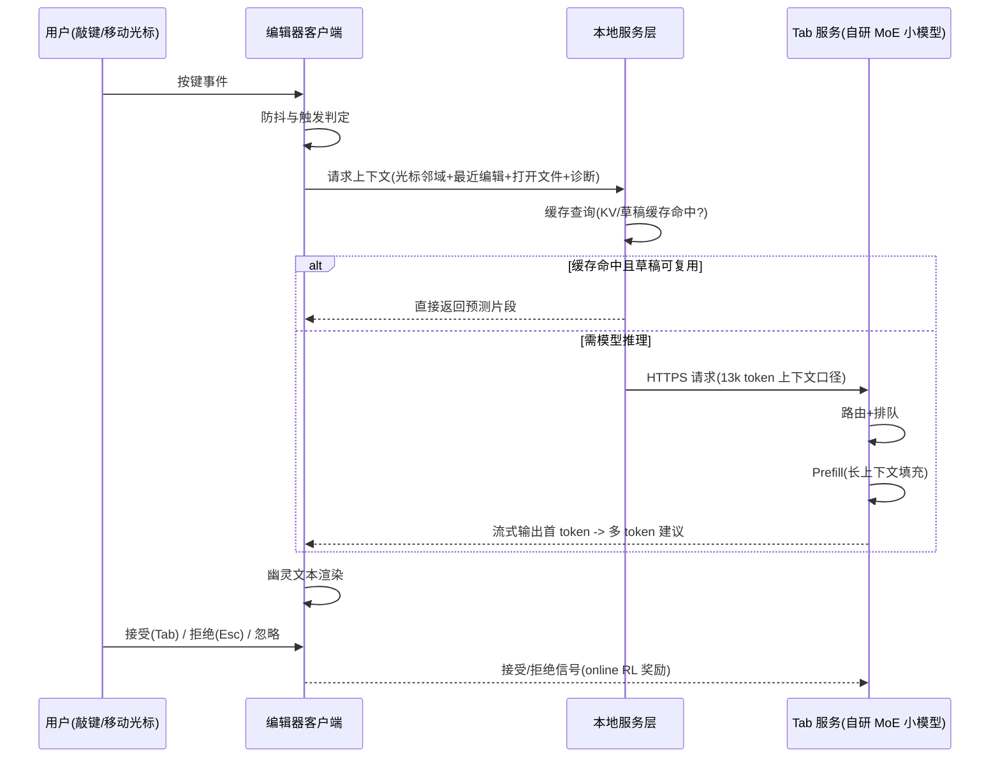
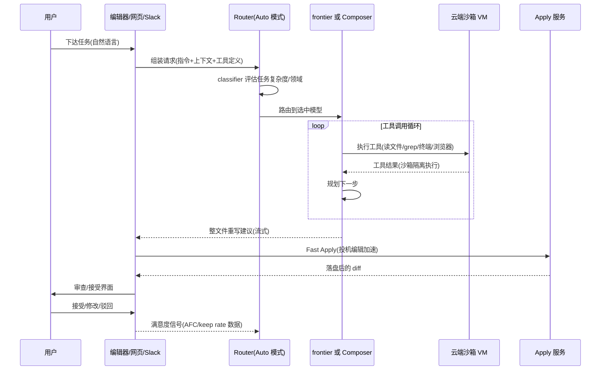

# 4. 工作流程：一次 Tab 与一次 Agent 请求的生命线

本章串起 [第 3 章](03-architecture) 的两条关键路径。所有延迟数字分两类：**有出处**（官方博客口径）与**教学模型**（本主题 Mini Demo 的合成预算，仅演示量级关系）。

## 4.1 一次 Tab 补全的端到端时序

**关键阶段说明：**

- **触发判定**：不是每个按键都请求。2025-09 online RL 之后，"展示什么、是否展示"本身被策略优化——新模型少展示 21% 建议、接受率反升 28%【一手】。这是把 Copilot 式"外置过滤器"内化进模型策略的路线选择。
- **上下文组装**：Tab 是"pre-fill token hungry"任务【一手访谈】——输入侧 13,000 token 量级（2025-01 Fusion 口径），输出只有几十 token。因此 prefill 占服务端延迟大头，mini-demo 的敏感性分析（[场景 2](07-mini-demo)）显示 prefill 省 50ms 端到端即降 19.2%。
- **缓存预热**：用户还在打字时预测下一个建议并预计算【一手访谈】——把串行等待变成并行投机。
- **奖励回传**：接受/拒绝/忽略回传服务端，进入 1.5-2 小时一轮的 RL 闭环（[5.6](05-core-modules)）。

## 4.2 Tab 延迟预算表（教学模型）

[Mini Demo 场景 2](07-mini-demo) 的合成预算，九段合计 260ms（对齐官方 2025-01 更新后口径；更新前同结构 475ms）：

| 阶段 | 教学预算 | 备注 |
|---|---|---|
| 按键防抖与本地触发 | 10 ms | 教学模型 |
| 上下文组装 | 25 ms | 光标邻域+最近编辑+打开文件 |
| 本地缓存查询 | 2 ms | KV/草稿缓存 |
| 网络往返 | 40 ms | TLS+RTT |
| 服务端排队与路由 | 5 ms | 教学模型 |
| Prefill | 130 ms | 长上下文填充，占大头 |
| 首 token 解码 | 30 ms | 自研小模型 |
| 客户端渲染与预测显示 | 10 ms | 幽灵文本 |
| 杂项 | 8 ms | 打点/序列化 |

端到端样本（n=10000，确定性抖动）：p50 261.8ms / p95 300.0ms / p99 319.0ms。方法论要点与 Perplexity 案例的 tail latency 哲学一致（见 [Perplexity 第 4 章](/09-case-study/perplexity/04-workflow)）：**补全是交互动作，p95 才是体验口径；预算表驱动优化顺序，永远先打贡献最大的阶段。**

## 4.3 一次 Agent 请求的端到端时序

**关键阶段说明：**

- **Router 决策**：在模型运行之前完成【一手】。classifier 特征包括查询、上下文、任务复杂度与领域；例行任务走便宜模型、UI 任务走设计判断强的模型、长程复杂问题走 frontier 推理模型。缓存感知：切模型会制造缓存 miss，报告的节省已扣除。
- **沙箱工具执行**：Agent 的每次文件/终端操作都在隔离 VM 中执行【一手文档】；Explore 子代理可在独立上下文里并行跑多路搜索，只回传结论——避免工具输出撑爆主上下文。
- **Fast Apply 落盘**：Agent 输出不是 diff 而是整文件重写【一手】；编辑器调用 Apply 服务，以旧文件为草稿做投机验证，约 1000 tok/s 口径。用户体验上"秒开"的 diff 视图，底层是一次加速过的全文重写。
- **质量度量回传**：官方 Router 博客披露两个在线指标——**AFC**（从接受/纠正行为推断的用户满意度）与 **keep rate**（生成代码的长期留存比例）。这让"模型好不好"从离线 benchmark 变成在线留存问题。

## 4.4 两条生命线的延迟量级对比

| 维度 | Tab | Agent |
|---|---|---|
| 端到端体验目标 | 数百 ms（官方口径 260ms 量级） | 秒到分钟（任务级） |
| 上下文 | 13k token 量级（pre-fill hungry） | 随工具循环增长，靠子代理隔离 |
| 解码量 | 几十 token | 数百到数万 token |
| 加速机制 | 缓存预热 + 投机解码 + 小模型 | Speculative Edits（Apply 落盘） |
| 成本结构 | 免费不限量（小模型摊薄） | 额度池计量（frontier API 价） |
| 数据价值 | RL 奖励信号（4 亿次/天） | AFC / keep rate 路由训练信号 |

产品设计的精妙之处：**免费层（Tab）恰好是数据最稠密、模型最便宜的层；付费层（Agent）恰好是成本最高、质量最敏感的层**。两条生命线共用同一套延迟哲学与数据回流管道。

下一章 [核心模块](05-core-modules) 逐模块展开设计与参数。
