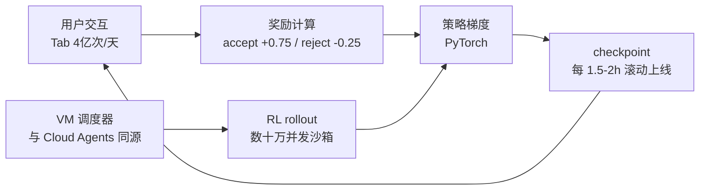

# 5. 核心模块

## 5.1 Tab 模型：为延迟而生的专用小模型

**选型逻辑【一手访谈：Lex #447】**：Tab 要求"incredibly low latency"，通用大模型做不到；且 Tab 是"pre-fill token hungry"——吞很长的上下文、只生成几个 token。创始团队明确说**稀疏 MoE 是"perfect fit"**：长上下文下 MoE 的推理成本远低于同质量稠密模型，是 Tab 质量突破的关键之一。

**推理侧加速【一手访谈】**：
- 投机解码变体（Speculative Edits 思想同源，见 [5.2](05-core-modules)）；
- KV 缓存复用：相邻两次请求上下文高度重叠，缓存直接复用；
- 缓存预热：预测用户下一步、提前计算；
- multi-query / MLA 注意力：缩小 KV 体积，降低 prefill 与缓存成本。

**在线 RL【一手：cursor.com/blog/tab-rl，2025-09】**：这是全主题最值得精读的一篇官方博客。
- 问题定义：接受率低 = 打扰用户；难点不是"模型知不知道"，而是"用户接下来想干嘛"——即使模型全知也无法确定用户意图，所以必须学**何时展示**。
- 对照方案：GitHub Copilot 用外置逻辑回归"contextual filter"（社区复现约 11 个特征、15% 阈值）；Cursor 选择把过滤内化进模型策略——用策略梯度同时优化"展示与否"与"展示什么"。
- 奖励：目标接受率 25% 时，接受 +0.75 / 拒绝 −0.25 / 不展示 0；期望奖励恰好在接受概率 25% 处过零，策略自然学会"高于阈值才展示"。实际奖励还考虑建议长度等。
- 训练循环：on-policy 要求样本必须来自被优化的策略 → 新 checkpoint 必须尽快上线回收新数据 → **1.5-2 小时滚动一个 checkpoint**。
- 结果：建议数 −21%，接受率 +28%。

## 5.2 Apply 模型与 Speculative Edits：把"落盘"从秒级压到亚秒

**为什么整文件重写**【一手：instant-apply 博客】：diff 格式强迫模型"用更少的 token 思考"、且要求输出行号——模型不擅长计数；社区经验（官方博客引用）确定性 diff 匹配大量失败。整文件重写是模型的原生分布，质量显著更稳。

**Speculative Edits 的核心洞察**【一手】：编辑场景下草稿 token 有强先验——**旧文件本身就是最好的草稿**。未改动区域不需要"生成"，只需成批"验证"；只有改动区域需要真正解码。于是整文件重写以接近"只生成改动部分"的成本完成，且输出在数学上等价于完整重写。这是把投机解码（draft model 提出、目标模型验证）的 draft 换成确定性算法的场景化改造。

**官方数字口径【一手】**：约 1000 tok/s（约 3500 字符/s）；约 13x 于 Llama-3-70B 朴素推理；约 9x 于上一代 GPT-4 speculative 部署；4-5x 于"次快模型"。基础设施为 Fireworks 推理引擎 + Cursor 定制投机逻辑。模型演进：DeepSeek Coder Instruct 微调起步 → Llama-3-70B 微调（官方称接近 Claude 3 Opus diff 版本，承认其仍为最强 baseline）。

[Mini Demo 场景 3](07-mini-demo) 的教学模型显示该机制的敏感性：2% 改动率时命中率 97.89%、加速比 15.85x；40% 改动率时跌到 59.50% / 1.54x——**投机收益与编辑的局部性成正比**，这也解释了为什么 Apply 服务对"大改需求"（重构整个文件）比"小改需求"体感更慢。

## 5.3 代码库索引：Merkle 增量 + 远端向量 + 路径混淆

机制细节与演进线已在 [3.4](03-architecture) 给出，这里补充工程权衡：

- **Merkle 树同步**：本地对每个文件算哈希建树，根哈希与服务端比对；任何文件变化都会改变根哈希。这借的是 Git 的思想（有社区读者在 Engineer's Codex 评论区点破："not reinventing the wheel"）——增量同步的正确性由哈希链保证，带宽只花在变化的文件上【一手文档 + 社区】。
- **服务端无代码明文**：只存嵌入向量 + 混淆路径 + 行号区间；查询回传路径/行号、客户端本地读文件【一手安全文档】。创始人论坛口径："None of your code is stored in our databases." 抓包社区项目证实索引期有文件衍生数据上传但无法判定是否明文【社区】——**隐私承诺以架构设计背书，但验证依赖信任而非可审计性**。
- **2026 年的转向**：官方文档改推本地 Instant Grep（号称快于 ripgrep、支持正则）+ Explore 子代理，并明确"不为搜索存储代码库嵌入"。索引从"预先计算的静态资产"变成"按需的本地计算"——服务端存储与同步成本归零，代价是 Agent 搜索消耗更多推理 token（由 Router 管成本）。这条演进在 [向量数据库与 Embedding 基础设施](/06-rag/vector-db/) 的语境里值得反复咀嚼：当 agent 会自己找代码时，预建向量索引的价值坍缩为"首查延迟"。

[Mini Demo 场景 1](07-mini-demo) 复现了这条管道的教学版：切块 → 哈希词袋嵌入 → Merkle 增量同步（二次同步只重嵌改动文件）→ 混淆路径 + 向量检索。

## 5.4 Router：把多模型调度做成产品

官方披露【一手：Router 博客】：
- 形态：请求前置 classifier，60 万+ 真实请求训练，数百万在线 A/B 验证；
- 目标：不是离线 benchmark 分数，而是 **AFC**（用户满意度，从接受/纠正推断）与 **keep rate**（生成代码留存比例）；
- 三档模式：Intelligence（frontier 质量、约省 47% 成本 vs 全量 Fable 5）、Balance、Cost；
- 官方 cost per commit：Intelligence $6.76 / Balance $4.63 / Fable 5 $12.69 / Opus 4.8 $7.34；
- 缓存感知：模型切换制造缓存 miss，节省数字已扣除；管理端可按团队灰度、设定默认与黑白名单。

与 [LLM Gateway](/04-llmops/llm-gateway/) 主题的对照：传统网关解决"统一接入与治理"，Cursor Router 解决"在质量—成本前沿上按请求选点"，并且**用产品内生的行为数据（接受/留存）训练调度器**——网关从运维设施变成了学习系统。

## 5.5 云端沙箱与 VM 调度器：一套设施，两种负载

- 产品侧：Cloud Agents 在隔离 Ubuntu VM 中克隆仓库、执行、交 PR；多入口（IDE/网页/Slack/GitHub/Linear/API）；2026 年加 computer use（独立 VM + 浏览器 + 录屏）【一手文档】。
- 训练侧：Composer 的 RL 需要"数十万个并发沙箱编码环境"，官方明确说 VM 调度器是从 Background Agents 团队的基础设施**重写**而来【一手：Composer 博客】。
- 下沉侧：Self-Hosted Machines（2026-09）把工具执行放到客户基础设施，worker 只需出站 HTTPS；支持 AWS Lambda、Cloudflare Sandboxes、Daytona、E2B、Modal、Namespace、Vercel Sandbox 等执行端【一手：Cursor 博客 + Cloudflare 新闻稿】。

[Mini Demo 场景 4](07-mini-demo) 演示配额硬约束、bin-packing 与空闲回收：教学负载下 5 个 agent 在 32 核宿主机上 2 个排队、平均 CPU 利用率 20.31%——真实系统会靠 auto-scaling 池摊平，但配额语义（隔离下限、TTL 回收、超额排队）是一致的。

## 5.6 训练闭环：与 serving 同频的 RL 机器

把 5.1 的 Tab 循环与 Composer 训练栈并置【一手：tab-rl / composer / self-summarization 等博客】：

两条回路共享同一套基础设施哲学：**环境（沙箱）是稀缺资源，策略是流动资产，上线延迟是训练吞吐的上限**。Cursor 官方把这套能力总结为"near real-time RL"并在 Composer 上复用（约 5 小时一个 checkpoint；编辑留存 +2.28%、不满意追问 −3.13%、延迟 −10.3%【一手，数值以博客为准】）。
