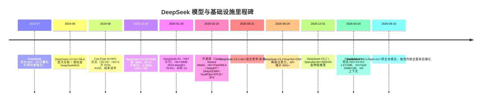

# 1. 背景：为什么研究 DeepSeek

## 1.1 一家量化基金公司的超算

DeepSeek 的前身是**幻方量化（High-Flyer Quant）**——2015 年成立的量化对冲基金。2016 年起幻方探索用 AI 做量化交易、2019 年公开宣布全面使用 AI 策略，并自建了名为 **fire-Flyer（萤火）** 的 GPU 集群；2021 年建成的 **fire-Flyer 二代**搭载了 **1 万张 PCIe 版 NVIDIA A100**，是彼时中国最大的私有 AI 算力集群之一。2023 年 7 月，幻方把 AI 研究部门独立为 DeepSeek。

这段历史解释了 DeepSeek 与四大海外实验室的根本不同：**它从一开始就是"用自有算力做研究"的成本敏感型组织**。买卡的钱来自交易利润，没有云业务可以摊薄成本，也没有理由为品牌溢价付费。2024 年 8 月发布的 **Fire-Flyer AI-HPC 论文**（arXiv:2408.14158，发表于 SC'24）把这套成本哲学写成了系统论文：

- 1 万张 **PCIe A100**（而非 DGX 整机）自建集群，通过软硬件协同设计达到 **接近 DGX-A100 的性能水平，成本约为一半，能耗降低 40%**；
- 核心组件全部自研：**HFReduce**（RDMA allreduce，快于 NCCL）、**HaiScale**（并行训练框架，计算通信重叠）、**3FS**（Fire-Flyer File System）、**HAI-Platform**（集群平台），配套**计算存储一体化网络**（两层 fat-tree 同时跑计算流与存储流）；
- 论文标题直接点题：**A Cost-Effective Software-Hardware Co-Design**——"成本有效的软硬件协同设计"，这是理解 DeepSeek 一切后续工作的钥匙。

## 1.2 出口管制：在"残血版"GPU 上做前沿研究

DeepSeek 的硬件环境一直是**受限版 NVIDIA GPU**，这正是理解其技术选择的背景板：

| 时间 | 事件 | 影响 |
|---|---|---|
| 2022-10 | 美国首轮对华 AI 芯片出口管制 | A100/H100 禁售，NVIDIA 推出降规格 **A800/H800**（算力基本不变，NVLink 带宽大幅削减） |
| 2023-10-17 | 管制升级 | A800/H800 也被禁，NVIDIA 再推 **H20**（算力大幅削减但保留高显存带宽与互联） |
| 2024-12 | DeepSeek-V3 发布 | 训练基于 **2048 张 H800**（每节点 8 卡 NVLink，节点间 IB） |
| 2025 全年 | H20 在许可与禁售间反复 | DeepSeek 以推理部署与工程优化应对；昇腾等国产芯片适配开始 |
| 2026 | DeepEP/DeepGEMM/FlashMLA 相继发布 **Ascend 950** 版本 | 从"单一路线依赖"转向"多硬件后端"（见 [第 8 章](08-production-practice)） |

一个关键的反差：**H800 相对 H100 被砍掉的是互联带宽（NVLink），不是算力**。这直接塑造了 V3 的技术路线——算力要榨干（FP8），通信要藏住（DualPipe、节点受限路由、计算通信重叠）。DeepSeek 在 ISCA'25 论文（arXiv:2505.09343）中把这些经验总结为面向硬件厂商的设计建议（见 [第 2 章](02-core-ideas)）。

## 1.3 从 V2 到 V4：跃迁时间线

这张时间线有三个转折点值得记住：

1. **V2→V3（2024-05 → 2024-12）：从算法创新到系统工程。** V2 已经把 MLA 和细粒度 MoE 的架构牌打出去了，但让 V3 封神的是基础设施账：557.6 万美元、训练全程零回滚、每 1T tokens 仅需 180K H800 GPU 小时（2048 卡上 3.7 天）。
2. **V3→R1（2024-12 → 2025-01）：从训练工程到 RL 工程。** R1 用纯 RL 让推理能力涌现（R1-Zero 的 AIME 从 15.6% 涨到 77.9%），MIT 许可开源，在 2025-01-27 前后引发全球范围的"DeepSeek 时刻"——这一天英伟达股价下跌约 17%，"算力即霸权"的叙事第一次被公开地系统性质疑。
3. **V3.1→V4（2025-08 → 2026-04）：从效率叙事回到规模叙事。** 当效率优势确立后，DeepSeek 开始把省下的钱换成规模：V3.2 的 DSA 把长上下文成本打下来，V4 直接把上下文推到 1M、参数推到 1.6T（V4-Pro）——"用工程换算力"不是不堆算力，而是**每瓦、每美元、每比特带宽都花在刀刃上**。

## 1.4 研究主线

后续章节围绕五条主线展开，它们对应 DeepSeek 最具辨识度、也最值得工程借鉴的设计决策：

1. **算法—系统协同设计**（[第 2 章](02-core-ideas)，[第 5 章](05-core-modules)）：MLA、FP8、DualPipe、细粒度 EP 不是四个独立优化，而是一套互相咬合的设计——任何一个单独看都会误判。
2. **用工程换算力**（[第 2 章](02-core-ideas)，[第 4 章](04-training-and-inference)）：557.6 万美元的训练账、545% 的理论推理利润率、错峰定价——成本工程本身就是战略。
3. **全链路开源**（[第 6 章](06-source-analysis)，[第 8 章](08-production-practice)）：权重 MIT + 训练/通信/内核/存储全开源，是技术品牌、招聘杠杆与生态位的组合拳。
4. **受限硬件下的设计哲学**（[第 5 章](05-core-modules)，[第 8 章](08-production-practice)）：从 H800 的残血 NVLink 到 H20 的残血算力，再到 2026 年的 Ascend 多后端，"为约束而设计"的方法论。
5. **推理成本工程**（[第 8 章](08-production-practice)）：PD 分离、冗余专家、FP8 KV、DSA——把"服务一个 token 的成本"当成一等公民指标。

下一章 [核心思想](02-core-ideas) 将把这五条主线展开为可对照的设计原则。
