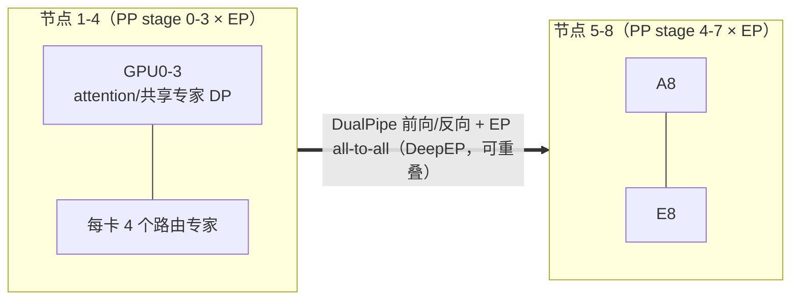

# 3. 架构设计：训练与推理系统全景

## 3.1 一张图看全局

```mermaid
flowchart TB
    subgraph Data["数据层"]
        RAW[原始语料 / RL 环境] --> SP[smallpond 数据处理<br/>DuckDB + 3FS]
        SP --> FS[(3FS Fire-Flyer FS<br/>CRAQ 强一致 / 6.6 TiB/s 读)]
    end

    subgraph Train["训练层（HAI-LLM，2048×H800 = 256 节点×8 卡）"]
        DL[Dataloader<br/>3FS 随机读，免预取] --> GPU
        subgraph GPU["单节点 8×H800：NVLink/NVSwitch 全互联"]
            direction LR
            subgraph Parallel["并行拓扑：PP16 × EP64(跨8节点) × ZeRO-1 DP32"]
                DP0["DualPipe 双向流水线<br/>气泡 (PP/2-1)(F+B-3W)"]
                EP0[细粒度 EP：256 专家 / top-8<br/>节点受限路由 M≤4]
                FP0[FP8 混合精度<br/>DeepGEMM 内核]
            end
        end
        DEP[DeepEP<br/>跨节点 all-to-all<br/>计算通信重叠] --- GPU
        CKPT[Checkpoint → 3FS<br/>高吞吐并行写] --- FS
    end

    subgraph Serve["推理层（PD 分离部署）"]
        PREF[Prefill 最小单元：4 节点/32 GPU<br/>每卡 8+1 冗余专家] --> DEC[Decode 节点<br/>EP 并行 + FP8 KV]
        DEC --> API[DeepSeek API<br/>错峰定价]
        KV[(3FS KVCache<br/>40+ GiB/s/客户端)]
    end

    FS --> DL
    Train --> Serve
```

这张图里有四条值得单独展开的数据通路：**训练数据通路**（3FS 随机读）、**权重同步通路**（DeepEP all-to-all）、**checkpoint 通路**（并行写 3FS）、**推理 KV 通路**（3FS KVCache 卸载）。下面分层拆解。

## 3.2 集群层：2048 张 H800 的两级互联

V3 训练集群的官方描述（技术报告 §3.1）：

- **2048 张 NVIDIA H800 GPU**，每节点 8 卡，共 256 节点；
- **节点内**：NVLink + NVSwitch 全互联（H800 的 NVLink 为合规被削减版，每卡约 400 GB/s 量级）；
- **节点间**：InfiniBand（IB，每卡 400 Gb/s ≈ 50 GB/s 量级）。

这就是著名的**两级带宽模型**：节点内带宽约为节点间的 8 倍。V3 的整个并行设计就是围绕这个 8 倍展开的——EP 组（64 卡）恰好等于 8 个节点，节点受限路由（每个 token 的 8 个专家最多分布在 4 个节点）把约 5/8 的通信量压在 NVLink 上。Mini Demo 的 [场景 3](07-mini-demo) 量化了这个账：dispatch 939.5 MB/GPU 中约 587 MB 走 NVLink、352 MB 走 IB。

对照其他案例的集群形态：

| 案例 | 芯片 | 节点内互联 | 节点间互联 | 拓扑哲学 |
|---|---|---|---|---|
| **DeepSeek** | H800（合规阉割版 H100） | NVLink ~400 GB/s/卡 | IB 400 Gb/s | 两级模型，路由为带宽服务 |
| Google（见 [Google 案例](/09-case-study/google/)） | TPU v4/Ironwood | ICI 3D-torus + OCS 光路 | DC-GN/Jupiter | 可重配光拓扑，torus 降 AllReduce 延迟 |
| Meta（见 [Meta 案例](/09-case-study/meta/)） | H100 整机柜 | NVLink/NVSwitch | RoCE fat-tree | 通用 GPU + 标准以太网演进 |
| OpenAI（见 [OpenAI 案例](/09-case-study/openai/)） | H100/GB200 | NVLink/NVSwitch | InfiniBand | 万卡级 scale-up 域 + 通用网络 |

DeepSeek 的特殊性在于：**别人的 scale-up 域（NVLink 域）被政策砍了一刀，于是用路由算法把逻辑拓扑重新缝合成"准 scale-up"**——这是软件对硬件约束的结构化回应。

## 3.3 训练框架层：HAI-LLM 与"不用 TP"的并行拓扑

V3 的训练框架是自研的 **HAI-LLM**（继承了 fire-Flyer 时代 HaiScale 的血统），官方定位是"efficient and lightweight"。并行配置（技术报告 §3.2）：

- **16 路流水线并行（PP16）**，配合 DualPipe 双向调度；
- **64 路专家并行（EP64）**，跨 8 个节点； attention 与共享专家走数据并行；
- **ZeRO-1 数据并行**（优化器状态分片）；
- **不用张量并行（TP）**——这是整个架构最大胆的决策。

不用 TP 的账在 [第 2 章](02-core-ideas) 已经推演过：TP 的 allreduce 是每层的同步税，而 EP 的 all-to-all 可以被 DualPipe 藏进计算。前提是**显存要装得下**——这正是 MLA 的功劳：注意力 KV 不再是显存大户，MoE 参数被 EP64 切到每卡 4 个路由专家，于是 PP16 × EP64 的组合在没有 TP 的情况下装下了 671B 参数（每卡约 10B 参数 + 激活 + 优化器状态分片）。



（实际 PP16 × EP64 的完整映射为 16 个 PP stage × 8 节点 EP 组 × 32 路 DP；上图取局部示意。）

## 3.4 存储层：3FS 的分离式架构

**3FS（Fire-Flyer File System）** 2025-02-28 随开源周第五天公开，设计目标是"榨干现代 SSD 与 RDMA 网络的带宽"。关键数字（3FS 仓库 README）：

- **峰值读吞吐 6.6 TiB/s**：180 个存储节点（每节点 2×200 Gbps IB + 16×14 TiB NVMe SSD）、500+ 客户端压测得出，且**背景中有训练流量在跑**；
- **GraySort**：25 存储节点 + 50 计算节点，110.5 TiB 数据 30 分 14 秒排完，平均 3.66 TiB/min（smallpond 框架）；
- **KVCache 读**：单客户端节点峰值 40+ GiB/s。

架构三原则（对应 [存储系统](/01-foundation/storage-systems/) 主题的经典权衡）：

1. **分离式架构（disaggregated）**：存储节点与计算节点独立扩展，应用"无需感知局部性"地访问任意存储节点，数千块 SSD 与数百台存储机的带宽被聚合成一个池；
2. **强一致读**：**CRAQ（Chain Replication with Apportioned Queries）** 链式复制——写沿链走保证强一致，读可由链上多节点分摊（apportioned），这是它能同时提供强一致与高读吞吐的关键；
3. **无状态元数据 + 文件接口**：元数据放在事务型 KV 存储（FoundationDB）上，对应用暴露标准 POSIX 文件语义——dataloader 直接随机读训练样本，**不需要 prefetch/shuffle 缓存层**。

对训练与推理的两类负载，3FS 各解一个痛点：训练侧是高吞吐并行 checkpoint 写与随机读 dataloading；推理侧是 **KVCache 卸载**——用 SSD 池替代 DRAM 缓存，容量大一个数量级、成本更低，配合 GC 回收无效块（README 附 GC IOPS 曲线）。

## 3.5 推理服务层：PD 分离与冗余专家

V3/R1 的在线推理架构（技术报告 §3.4 + 开源周 Day-6 概览）：

- **预填充（Prefill）与解码（Decode）分离部署**——两者资源画像完全不同（prefill 计算密集、decode 带宽/显存密集），分离后各自扩缩容（对照 [vLLM](/04-llmops/vllm/) 主题的 PD 分离讨论）；
- **Prefill 最小部署单元 = 4 节点/32 GPU**：每卡承载 8 个路由专家 **外加 1 个冗余专家**（9 个），冗余专家吸收路由不均导致的尾部延迟（没有它，最忙的专家决定整批延迟）；
- **计算通信重叠**：prefill 阶段同时处理两个计算量相近的 micro-batch，把一个 batch 的 attention/MoE 与另一个的 all-to-all/TP 通信重叠——训练侧 DualPipe 的思想在推理侧的复用；
- **Decode 侧**：EP 并行 + FP8 KV cache + FlashMLA 内核（MLA 的推理专用 kernel）。

官方披露的生产数字（开源周 Day-6，H800 节点口径）：**73.7K 输入 tokens/s + 14.8K 输出 tokens/s 每节点**，理论成本利润率 545%。配套的**错峰定价**（见 [第 8 章](08-production-practice)）把夜间闲置算力变成价格武器。

## 3.6 分层架构总表

| 层 | 组件 | 关键数字 | 对应章节 |
|---|---|---|---|
| 集群 | 256 节点 × 8 H800，NVLink + IB | 2048 卡；NVLink≈8×IB | §3.2 |
| 并行 | PP16 × EP64 × ZeRO-1 DP32，无 TP | 气泡 (PP/2-1)(F+B-3W) | §3.3 |
| 数值 | FP8 E4M3 + 细粒度缩放 + FP32 提升累加 | 训练损失误差 低于 0.25%（vs BF16） | [第 5 章](05-core-modules) |
| 通信 | DeepEP（NVLink+RDMA，SM 可控） | dispatch/combine 全重叠 | [第 5 章](05-core-modules) |
| 存储 | 3FS + smallpond | 6.6 TiB/s；CRAQ 强一致 | §3.4 |
| 推理 | PD 分离 + 冗余专家 + FlashMLA | 73.7K/14.8K tokens/s/节点 | §3.5 |

下一章 [训练与推理工作流程](04-training-and-inference) 将沿着"一个 token 的一生"走完训练与推理的完整链路。
