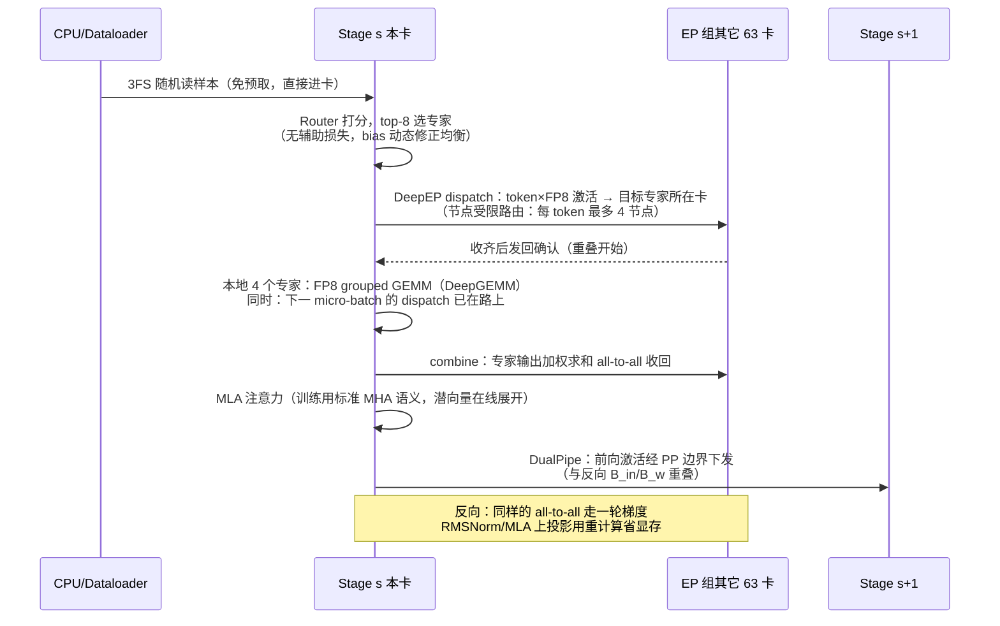
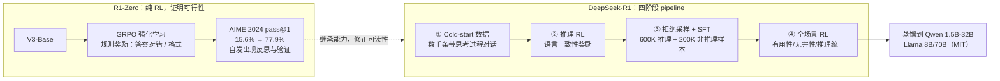
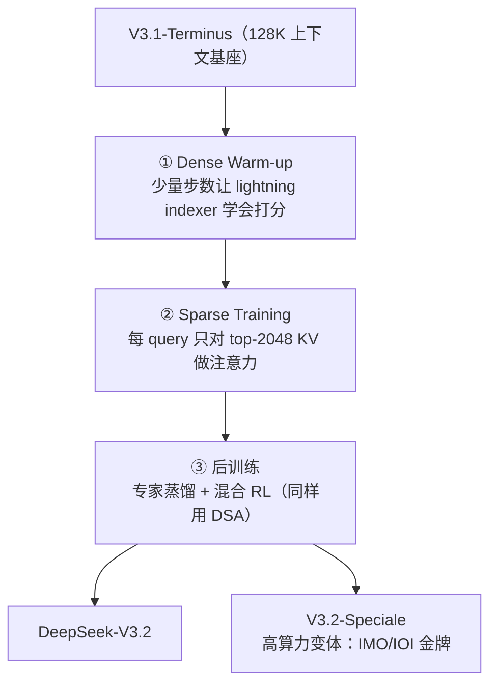
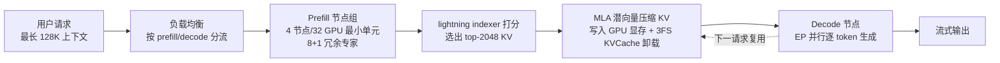

# 4. 训练与推理工作流程

## 4.1 一次 V3 训练的完整链路

把 3.6 节的架构展开成时序。一个 micro-batch 的前向在 EP 组（8 节点 × 8 卡）内的旅程：

几个容易忽略但决定成败的细节：

1. **Router 在 dispatch 之前**——均衡性（aux-loss-free 的 bias 项）决定了 all-to-all 的尾部延迟，是"通信账"的第一推动力。
2. **FP8 出现在两个位置**：激活以 FP8 量化后进 DeepGEMM（前向 1x128 行分组、反向 128x1 列分组），DeepEP 还支持 FP8 dispatch 直接传输量化后的激活。
3. **重计算策略**：只重计算 RMSNorm 与 MLA 上投影这类"廉价且吃显存"的算子，大规模重计算（full recompute）会吃掉 FP8 省下的算力，不划算——这是"Extremely Memory Saving with Minimal Overhead"一节的取舍。
4. **EMA 放 CPU**：指数滑动平均参数（评估用）不占 GPU 显存。
5. **每个 optimizer step 结束**：梯度经 ZeRO-1 分片聚合，checkpoint 高吞吐并行写入 3FS。

训练的宏观账（技术报告 Table 1 + §4）：

| 项目 | 数字 |
|---|---|
| 预训练数据 | 14.8T 高质量多语 tokens |
| 上下文扩展 | 两阶段：32K → 128K（119K GPU 小时） |
| 单 1T tokens 成本 | 180K H800 GPU 小时 ≈ 2048 卡 × 3.7 天 |
| 预训练总时长 | 不到两个月（2664K GPU 小时） |
| 后训练 | 5K GPU 小时（SFT + RL） |
| 数值稳定性 | 全程零不可恢复 loss spike、零回滚 |

## 4.2 R1 的训练流程：让推理能力涌现

R1（arXiv:2501.12948）展示的是**第二类工程**：不是把训练算力压下来，而是把 RL 的工程量做上去。

关键机制与数字：

- **GRPO（Group Relative Policy Optimization）**：PPO 的变体，去掉 value model，用一组采样结果的相对排名估计优势——省下一个 critic 模型的训练与显存开销；
- **R1-Zero 的涌现曲线**：纯 RL 过程中 AIME 2024 pass@1 从 15.6% 一路涨到 77.9%，并自发出现"延长思考时间、自我验证"的行为——这是"推理是 RL 的自然产物"这一论点的实证；
- **R1 的代价与修正**：R1-Zero 有可读性差、语言混杂问题，四阶段 pipeline 用少量 cold-start 数据修正风格而不损伤推理能力；
- **最终成绩**：AIME 2024 pass@1 **79.8%**（OpenAI-o1-1217 为 79.2%）、MATH-500 **97.3%**、SWE-bench Verified **49.2%**、Codeforces 评分 **2029**（超越 96.3% 的人类选手）；
- **开放策略**：R1 及蒸馏系列全部 **MIT 许可**——这是"DeepSeek 时刻"的直接引爆点之一。

## 4.3 V3.2 的稀疏注意力训练流程

V3.2（arXiv:2512.02556，及其实验先行版 V3.2-Exp）引入了 **DSA（DeepSeek Sparse Attention）**，训练流程值得一提，因为它展示了"架构改动如何以最小代价嫁接到已训练好的模型上"：

已验证的关键数字：

- **稀疏训练**：每 query 从 128K 上下文中选 **2048** 个 KV；15000 步 × 每步 480 条 128K 序列 = **943.7B tokens**，学习率 7.3e-6；
- **机制**：**lightning indexer** 用低维潜向量做类 MQA 打分（仍是 O(L²) 但维度极低），主注意力只对 top-K 选中项计算，复杂度从 O(L²) 降到 **O(L·k)**（k=2048 时全量的 1/64）； indexer 的训练损失与主模型解耦（只拿索引损失优化）；
- **质量对齐**：公开 benchmark 上与 V3.1-Terminus 基本持平（MMLU-Pro 85.0 vs 85.0，AIME 2025 89.3 vs 88.4）——这是"细粒度稀疏几乎无损"的实证；
- **后训练**：沿用 V3.2-Exp 的 pipeline（专家蒸馏 + 混合 RL），并扩展到 **大规模 agentic 任务合成**：1800+ 个合成环境、85000 条复杂提示，把"推理融入工具调用"；后训练总算力被刻意提高到预训练的 **10% 以上**；
- **Speciale**：高算力变体在 IMO 2025 与 IOI 2025 达到金牌水平，推理能力与 Gemini-3.0-Pro 同级、超越 GPT-5。

## 4.4 推理工作流程：从请求到 token

以一次 chat 请求为例（V3.2 时代，PD 分离 + DSA）：

要点：

- **Prefill 是吞吐战场**：两个 micro-batch 交叉，attention/MoE 计算与 all-to-all 通信重叠（训练侧 DualPipe 思想的推理版）；冗余专家吸收路由热点；
- **Decode 是带宽战场**：MLA 把每 token 每层 KV 压到 1.12 KiB（对照 MHA 64 KiB），DSA 又把"要读的历史 KV"压到 1/64 以内——两个乘法叠加，长上下文解码的显存带宽压力比"朴素 MHA + 稠密注意力"低三个数量级；
- **KVCache 三层存储**：GPU 显存（热）→ 3FS SSD 池（温，40+ GiB/s 单客户端）→ 淘汰。对多轮对话与 agentic 长轨迹，命中温层就是成本差一个数量级的事；
- **错峰调度**：API 层用峰谷定价（2025-02 起 75% 折扣窗口；2026-08 起改为峰谷半价）把可延迟负载赶到夜间，把"闲置容量"变成收入（见 [第 8 章](08-production-practice)）。

## 4.5 工作流程中的四次"账本核对"

把四节串起来，DeepSeek 的每个流程节点都对应一本可核对的账：

| 流程节点 | 账本 | 关键数字 |
|---|---|---|
| 数据进卡 | 3FS 随机读带宽账 | 6.6 TiB/s 聚合读，dataloader 免预取 |
| 专家计算 | FP8 精度账 | 端到端损失误差 低于 0.25%（vs BF16，附录 B） |
| 跨卡搬运 | all-to-all 通信账 | 每 token 229 KB（BF16 dispatch+combine），计算通信比 ~140× |
| 流水线推进 | DualPipe 气泡账 | (PP/2-1)(F+B-3W)，PP=16 时较 1F1B 缩减 62.7% |
| 权重落盘 | checkpoint 吞吐账 | 高吞吐并行写 3FS |
| 推理服务 | 每 token 成本账 | 73.7K/14.8K tokens/s/节点，理论利润率 545% |

其中 all-to-all 通信账与 DualPipe 气泡账可以在 [Mini Demo](07-mini-demo) 里亲手复算——这也是下一章 [核心模块](05-core-modules) 逐模块展开这些机制的原因。
