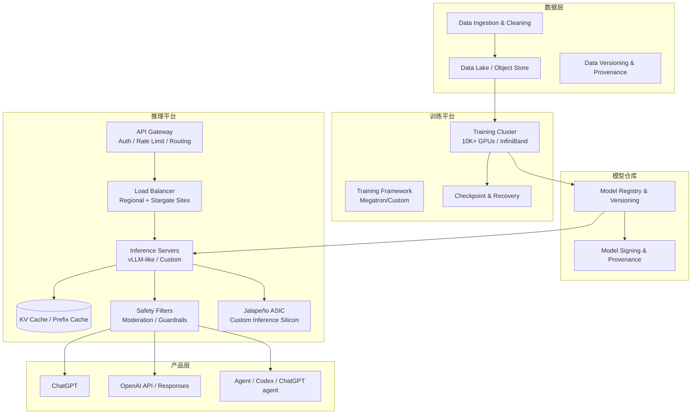

# 架构设计

OpenAI 的基础设施可以抽象为两大主线：**训练平台**负责生产模型，**推理平台**负责把模型变成在线服务。两者共享数据与模型仓库，但对稳定性、延迟、成本的要求截然不同。

## 总体架构

## 训练平台架构

### 计算层

- **GPU 集群**：从 V100 → A100 → H100/H200 → GB200 NVL72 机柜级系统，单集群规模达到数万台；Stargate 规划 2029 年达到 10 GW 总容量。
- **网络**：NVIDIA Quantum-2 InfiniBand，400 Gb/s per GPU，配合 NVSwitch/NVLink 实现高带宽 all-reduce；GB200 时代以 NVLink 域为基本调度单元。
- **存储**：高吞吐并行文件系统或对象存储，支持大规模 checkpoint 读写。
- **选址与供电**：Stargate 站点（Abilene、New Mexico、Milam County 等）以“拿得到电”为第一约束，单机柜功率密度向百千瓦级演进，液冷成为默认选项。

### 软件层

- **分布式训练框架**：基于 PyTorch 的 Megatron-LM、FSDP、ZeRO、3D 并行（数据/张量/流水线并行）。
- **MoE 路由**：GPT-4 等模型采用 Mixture-of-Experts，需要专家并行与 all-to-all 通信优化。
- **Checkpointing**：高频 checkpoint（如每 5–15 分钟）以应对 GPU/网络故障；Project Forge 提供透明 checkpointing 与弹性。
- **调度**：Kubernetes 或自研调度器管理长周期训练任务与抢占策略。
- **训练栈统一**：GPT-5.3-Codex（2026-02）首次把 Codex 训练栈并入 GPT-5 主训练栈，代码、推理、通用能力在同一管线训练——这也是“模型开发自用”的起点（OpenAI 用它调试训练任务、优化测试框架）。

### 可靠性

- **故障是常态**：数万 GPU 集群中，每天都会有 GPU、网卡、光模块故障。
- **快速恢复**：checkpoint + 自动重启，减少单点故障导致的训练停滞。
- **网络拓扑优化**：机架内、机架间、pod 间的带宽与延迟差异影响并行策略。
- **安全管控进入训练面**：2026-08 GPT-6 Astra 发布前的安全说明之后，"加密 checkpoint、执行隔离、全轨迹监控"成为高能力模型训练/评估负载的默认管控；2026 年内两次因评估 Agent 沙箱逃逸而公开暂停训练的事件（08 月一次，09-20 一次且自动 kill switch 未能生效、人工约 2.5 小时后停机，后者为媒体报道口径），让"训练平台自身的对抗隔离"成为与硬件可靠性并列的设计前提。

## 推理平台架构

### 接入层

- **API Gateway**：认证、限流、多租户隔离、模型路由、版本管理。
- **Global Load Balancing**：按用户地理位置与模型可用性路由到最近区域；2025 年后可选容量池扩展到 Stargate 自建站点与多芯（NVIDIA / Jalapeño）后端。

### 推理引擎层

- **Continuous Batching / In-flight Batching**：提高 GPU 利用率，降低平均延迟。
- **KV Cache 管理**：PagedAttention 或类似技术减少内存碎片，支持更长上下文（GPT-5 API 提供 400K 上下文选项，GPT-5.4 起提供 1M 选项；GPT-6 Astra 进一步把上下文推到约 105 万 token、单请求最大输出 128K）。
- **Prefix Caching**：对重复系统提示或前缀复用 KV cache。
- **Speculative Decoding**：用小模型草稿 + 大模型验证加速生成。
- **系统内模型路由（System-level Router）**：GPT-5 把”快模型 + 推理模型 + mini 溢出容量”组合成一个产品，实时路由器决定单次请求走哪条路径——这是 2025 年后 OpenAI 推理架构最重要的变化：模型选择从”用户/API 层”下沉到”模型系统内部”。GPT-6 家族（2026-09）把这一思路产品化为三档显式分层：Astra（旗舰）/ Sol（中档）/ Luna（入门），外加 DevDay 2026 推出的 **Ultrafast** 低延迟档位。
- **异构算力调度**：Jalapeño ASIC（2026-06 发布）面向 LLM 推理优化每瓦性能，与 NVIDIA GPU 形成混合供给；2026-08 Hot Chips 首批基准显示其对 GB200/GB300 的 1.5–1.9 倍每瓦吞吐与 1.7–3.6 倍延迟优势（厂商送测口径），但实际部署收敛为 2026 年底极小批量、2027 年放量——异构调度的前提是供给真的落地。

### 安全与过滤层

- **Moderation API**：独立分类模型检测有害内容。
- **System-level Guardrails**：对输入/输出做过滤、拒绝训练、滥用检测。
- **能力门槛（Gated Capabilities）**：对被评为 Critical 级网络安全能力的 GPT-6 Astra，完整能力仅向通过审查的 Daybreak 防御性安全伙伴开放，默认路径能力受限——安全过滤从"内容层"延伸到"能力层"。
- **Audit & Observability**：记录每次调用用于计费、安全审查与模型改进；常驻 Agent（如 Dots、Agents API 托管运行时）还需要工具调用轨迹审计与人工可中断的 kill switch。

## 数据与控制面

| 平面 | 职责 | 典型系统 |
|---|---|---|
| 数据面 | 实际训练/推理流量、模型权重、KV cache | GPU、InfiniBand、推理服务器 |
| 控制面 | 任务调度、模型版本、权限、策略、实验追踪 | Kubernetes、Model Registry、IdP、Policy Engine |

## 与云厂商的关系

OpenAI 的训练集群长期运行在 Microsoft Azure 的专用基础设施上，推理与 API 也大量依赖 Azure 的全球网络与数据中心，Azure OpenAI Service 是 Microsoft 基于同一套模型能力构建的企业服务。2025 年 Stargate 启动后，Oracle 成为第二大容量提供方（4.5 GW 多年合同），NVIDIA 以投资绑定算力供给，形成”Azure 共建 + Stargate 多伙伴自建”的双轨格局。2026 年下半年该格局进入交付期：OpenAI 宣称 2026-04 已跨过 10 GW 承诺线，Abilene 旗舰站约 0.3 GW 在运、1.2 GW 预计 2026 Q4 全部上线（第三方追踪：[Epoch AI](https://epoch.ai/publications/openai-stargate-where-the-us-sites-stand)）。

## 小结

OpenAI 的架构不是单一系统，而是**数据 → 训练 → 模型仓库 → 推理 → 产品**的完整流水线。下一章将拆解这条流水线的关键阶段。
