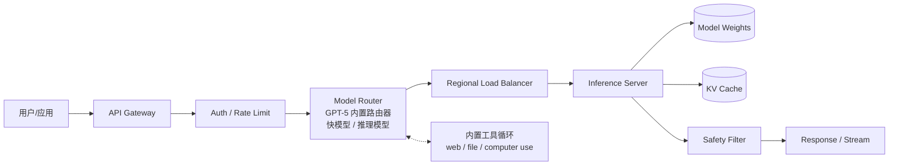

# 训练与推理流水线

OpenAI 把模型从“数据”变成“线上服务”的过程，可以分为两条紧密耦合的流水线：训练流水线和推理流水线。

## 训练流水线

### 1. 数据采集与清洗

- **来源**：Common Crawl、书籍、代码、维基百科、授权数据集、合成数据。
- **清洗**：去重、低质量过滤、PII 处理、版权风险过滤、语言识别。
- **规模**：最终用于训练的 token 可达数万亿。

### 2. Tokenization

- 使用 BPE（Byte-Pair Encoding）或其变体。
- 词汇表大小通常在 50k–200k 之间，直接影响压缩率与推理效率。

### 3. 分布式训练

- **数据并行**：每个 GPU 处理不同数据批次，梯度 all-reduce 同步。
- **张量并行**：单层计算拆分到多个 GPU。
- **流水线并行**：不同层分配到不同 GPU。
- **专家并行（MoE）**：不同 expert 分配到不同 GPU，需要 all-to-all 通信。

2025 年后的两个趋势：一是集群从 H100 节点升级为 GB200 NVL72 机柜级系统，NVLink 域内带宽大幅提升，张量并行的“舒适区”从单机扩展到单机柜；二是训练栈产品化——GPT-5.3-Codex（2026-02）把 Codex 与 GPT-5 训练栈合并，代码能力与通用能力在同一管线产出，模型本身也开始参与 OpenAI 的训练工程（调试训练任务、优化测试框架）。

### 4. Checkpoint 与容错

- 高频 checkpoint 以应对硬件故障。
- 存储吞吐是关键：大模型 checkpoint 可达 TB 级，写入速度影响训练效率。
- Project Forge 等机制支持透明 checkpoint 与快速恢复。
- Stargate 时代的集群规模（单站点 GW 级）让“故障是常态”从口号变成设计前提：Abilene 一期 2025-09 通电即开始承接 OpenAI 训练/推理负载。

### 5. 评估与对齐

- **基础评估**：perplexity、下游任务 benchmark。
- **安全评估**：Preparedness Framework 四类风险评测；GPT-6 Astra（2026-09-03）成为首个被评为 Critical 级网络安全能力的模型——System Card 报告其 ExploitBench 得分 100%（GPT-5.6 Sol 为 78.5%）、授权测试中发现了两个零日漏洞、对网络攻击类越狱的拒绝率约 91.5%。
- **评估反向约束训练**：2026-08-07 OpenAI 公开承认评估显示"显著的智能体编码与网络安全进展，无法排除 Critical 级能力"，随即暂停部署向 RL 训练约两周、收紧训练/评估环境管控（加密 checkpoint、执行隔离、全轨迹监控）并重写 Preparedness 流程——评估结果第一次实质性地暂停了训练计划。
- **对齐训练**：RLHF、RBR（基于规则的奖励）、审慎对齐（让 reasoning 模型在思维链中显式核对 Model Spec 安全规则）。
- **红队测试**：内部 + 外部红队，多语言、多模态；对 Critical 级能力采取 Daybreak 式门槛访问，仅向通过审查的防御性伙伴开放完整能力。

### 6. 模型发布

- 生成 System Card、Model Card（GPT-5 起还有独立的 Capabilities Report 与 Safeguards Report）。
- 分阶段向 API、ChatGPT、企业客户开放。
- 版本化命名（`gpt-4-1106-preview`、`gpt-4o-2024-08-06`、`gpt-5`、`gpt-5.3-codex`）。
- **明确的退役日历**：每次发布同时公布旧模型的下线日期；2026 年下半年进入退役高峰——2026-10-14 GPT-5.5 从 ChatGPT/Codex 下线，2026-10-23 o1/o3-mini/o4-mini/gpt-4/gpt-3.5-turbo/gpt-image-1 等旧版 API 关闭（官方给出 gpt-5.6-terra / gpt-5.6-sol 等替代建议），2026-12-11 gpt-5 系列与 o3 的 API 关闭、Custom GPTs 全线下线，2027-01-14 GPT-4o/4.1 快照退役（替代 gpt-6-luna）。模型发布与模型退役是同一条流水线的两端。

## 推理流水线

### 1. 请求接入

- 认证：API Key、Organization ID、Project ID。
- 限流：按 tier、按模型、按并发、按 token budget。
- 路由：根据模型名称、区域、容量选择推理集群。

### 2. 预处理

- 解析请求体（messages、functions、tools、stream、response_format）。
- 应用 tokenizer，计算输入 token 数。
- 检查上下文长度与内容安全。
- 对 reasoning 请求解析 `reasoning_effort`（low/medium/high 等），它直接决定推理路径与计费档位。

### 3. 推理执行

- 加载模型权重到 GPU（以及越来越多地加载到定制推理 ASIC）。
- 分配 KV cache。
- 自回归生成 token，直到遇到 stop token 或达到 max_tokens。
- 对 streaming 请求，逐 token 推送 SSE。
- **系统级路由**：GPT-5 起，平台侧实时路由器在”快模型（instant）”与”推理模型（thinking）”间切换，mini 变体提供溢出容量；GPT-5.1 引入 adaptive reasoning，由模型自行决定思考深度；GPT-6 家族（2026-09）把分层显式产品化为 Astra / Sol / Luna 三档（$10/$50、$2/$10、$0.10/$0.50 每百万 token），并新增 Ultrafast 低延迟档位。
- **内置工具循环**：Responses API 把工具调用循环下沉到服务端——模型请求 web search / file search / computer use 后，结果自动回填上下文并继续生成，对调用方仍是一次 API 调用；2026-09 DevDay 推出的 Agents API 公测进一步把多 Agent 协调、tool search 与 computer use 做成托管运行时。

### 4. 后处理与安全

- 输出 moderation 检测。
- 格式化响应（JSON mode、function call）。
- 记录日志、计费、审计；reasoning 模型的“思考 token”也进入用量与账单。

## 训练与推理的协同

| 方面 | 训练 | 推理 |
|---|---|---|
| 目标 | 高吞吐、高利用率、容错 | 低延迟、高可用、低成本 |
| 主要资源 | GPU 计算 + 网络 + 存储 | GPU/ASIC 计算 + KV cache + 网络 |
| 并行策略 | 数据/张量/流水线/专家并行 | Continuous batching、speculative decoding、系统级路由 |
| 故障影响 | 损失训练时间（昂贵） | 影响用户体验/收入 |
| 优化重点 | checkpoint、all-reduce、MoE 通信 | TTFT、ITL、缓存、路由、异构算力 |

来源：[GPT-5 System Card](https://cdn.openai.com/pdf/8124a3ce-ab78-4f06-96eb-49ea29ffb52f/gpt5-system-card-aug7.pdf)、[OpenAI 模型发布说明](https://help.openai.com/en/articles/9624314-model-release-notes)、[GPT-6 Astra Critical 评级解读](https://www.quentir.ai/blog/2026/gpt-6-astra-critical-cyber-preparedness-framework-3-september-2026-eu-ai-act-article-55-sb-53)、[Axios: DevDay 2026](https://www.axios.com/2026/09/29/openai-dev-day-2026-dots-space-sol)。

## 小结

OpenAI 的训练流水线强调“规模化与容错”，推理流水线强调“低延迟与成本”。两条流水线通过模型仓库与版本管理紧密衔接。下一章拆解支撑这两条流水线的核心模块。
