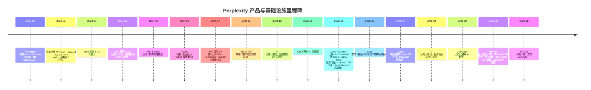

# 1. 背景：为什么研究 Perplexity

## 1.1 创始团队：一个"约 8 人"的早期公司

Perplexity AI 于 2022 年 12 月在旧金山成立。与五大训练型实验室不同，它的创始团队是典型的**产品与检索背景**组合，而非大规模训练背景：

| 创始人 | 角色 | 此前背景（公开简历口径） |
|---|---|---|
| Aravind Srinivas | CEO | UC Berkeley 博士，博士期间先后在 OpenAI、Google、DeepMind 实习；毕业后在 OpenAI 任研究科学家，参与扩散模型与 DALL-E 2 相关研究 |
| Denis Yarats | CTO | 纽约大学博士，Meta AI（FAIR）研究科学家，研究方向为对话系统与强化学习 |
| Johnny Ho | CSO | 曾在 Quora 负责排名与基础设施 |
| Andy Konwinski | 联合创始人 | Databricks 联合创始人之一，早期以联合创始人兼投资人身份参与 |

Aravind 在多次访谈中反复提到的一个数字是"8"：**2023 年初产品上线时全公司大约只有 8 个人**（访谈口径）。这个起点决定了它早期的工程文化——没有条件训练基础模型，必须把每一分钱花在离用户最近的环节上。这也解释了为什么它的基础设施故事几乎全部围绕**推理与检索**，而不是训练。

## 1.2 产品演进时间线

这张时间线有三个转折点值得记住：

1. **2023：用产品定义新品类。** 当所有人都在卷聊天机器人时，Perplexity 选择了"提问 → 直接给带来源的答案"。引用（citation）不是装饰，而是答案引擎相对聊天机器人与相对传统搜索的信任机制。
2. **2024-11：从租模型到"租 + 自研轻量模型"并行。** Sonar API 的发布标志它开始经营自己的模型资产——但注意，是**后训练**（post-training）而非预训练：基座是 Llama，优化目标是低延迟 RAG 推理。
3. **2026：基础设施叙事大爆发。** 一年内连发 Photon（检索引擎）、CobbleDB（KV 存储）、SPACE（Agent 沙箱开源）三篇深度工程博客，配合 Agent API 取代 Sonar API——公司自我定位从"答案引擎"升级为"Agent 基础设施提供商"。

## 1.3 规模与融资（全部为报道口径，非官方披露）

Perplexity 是私营公司，不披露财务数据。以下数字全部来自 TechCrunch、Reuters、FT、The Information 等媒体报道与 CEO 公开发言，**存在口径差异，仅作量级参考**：

| 时间 | 事件 | 来源性质 |
|---|---|---|
| 2023-08 | 融资 3440 万美元（a16z 领投） | 报道 |
| 2024-01 | 融资 7360 万美元，报道估值 5.2 亿美元（IVP 领投） | 报道 |
| 2024-06 | 融资约 2.5 亿美元，报道估值 30 亿美元（NVIDIA、贝索斯等参投） | 报道 |
| 2024-12 | 融资 5 亿美元，报道估值 90 亿美元（IVP 领投） | 报道（TechCrunch 确认交割） |
| 2025-05/06 | Accel 领投约 5 亿美元，报道估值 140 亿美元；7 月扩展 1 亿美元、报道估值 180 亿 | 报道 |
| 2025-09 | 融资 2 亿美元，报道估值 200 亿美元 | 报道 |
| 2026-01 | 新一轮报道估值约 226 亿美元 | 报道 |
| 2026-08 | 报道 NVIDIA 正洽谈以 300 亿美元+ 估值投资（未证实交割） | 报道 |

用户量与收入（同样为报道/公开发言口径）：

- **查询量**：2025-05 CEO 公开发言约 7.8 亿次/月（约合平均 300 QPS）；2025-11 CEO 发帖称周查询量达 1 亿次（约合平均 165 QPS，峰值更高）；2026 年的"月 10–15 亿次"为三方估算，非官方口径。
- **收入（年化）**：2025-03 约 1 亿美元 → 2025-09 约 2 亿美元 → 2026-03 约 4.5 亿美元（FT 报道）→ 2026-08 超 7.5 亿美元（Reuters/The Information 报道）。
- **人数**：从 2023 年初约 8 人增长到 2026 年约 1000–1500 人（三方估算，口径不一）。

把查询量和收入放在一起看，可以得到一个有趣的量级感：以 2025 年中 7.8 亿次查询/月、年化收入约 1–2 亿美元粗算，**单次查询的直接收入贡献在千分之一美元量级**——这就是"推理经济学"必须回答的问题：每一千次查询的推理成本必须远低于这个数，商业模式才成立。[第 2 章](02-core-ideas) 会把这个账算细。

## 1.4 为什么研究 Perplexity

对 AI 基础设施工程师而言，Perplexity 案例的独特价值在于：

1. **它是"纯推理侧"优化的完整样本。** 当行业注意力被百万卡训练集群占据时，Perplexity 示范了推理经济学（routing、缓存、流式、检索分层）如何支撑一个数亿美元年收入的产品。
2. **它的 2026 年工程博客密度罕见。** Photon、CobbleDB、SPACE 三篇一手博客给出了检索引擎、KV 存储、Agent 沙箱三个子系统的真实设计参数（延迟、成本、机器数），是生产级搜索基建的稀缺公开材料。
3. **它是研究"模型无关主义"风险与收益的活样本**：同时接入 GPT/Claude/Gemini/Grok 和自研 Sonar，供应商既是伙伴又是竞争者。

## 1.5 资料来源与可信度约定

本主题严格执行三级标注：

- **【一手】**：Perplexity 官方博客（perplexity.ai/hub/blog）、官方文档（docs.perplexity.ai）、Cerebras/Crusoe/AWS 官方公告与案例材料、官方开源仓库。
- **【访谈】**：Aravind Srinivas 与团队的长访谈（如 Lex Fridman Podcast #434 等）——视为一手转述，但注意受访者立场。
- **【报道】**：TechCrunch、Reuters、FT、The Information、VentureBeat、Wired 等媒体报道——标注来源，存在误差与立场。
- **未公开**：凡涉及具体 QPS 峰值、GPU 数量、集群拓扑、缓存命中率内部数字、收入结构拆分等，本主题一律标注"未公开"，并以 Mini Demo 的教学模型代替，**绝不编造架构细节**。

下一章 [核心思想](02-core-ideas) 将展开推理经济学的三大支柱。
