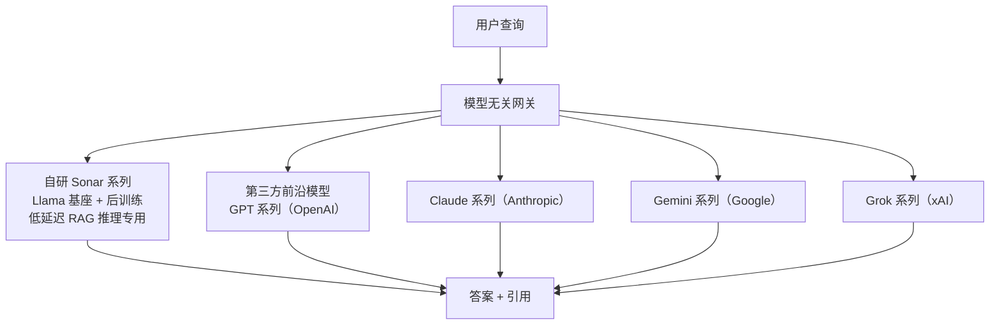
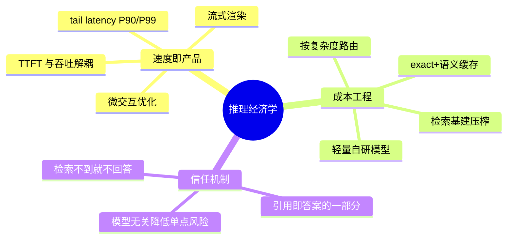

# 2. 核心思想：推理经济学

如果说训练型实验室的战略核心是"每一美元能买到多少 FLOPs 的训练"，Perplexity 的战略核心则是**"每一美元能买到多少次高质量的答案"**。Aravind Srinivas 把这个思想表达得很直白：我们不在乎模型权重是不是自己的，用户只想要一个又快、又准、可读性好的答案【访谈】。本章把这套思想拆成三根支柱。

## 2.1 推理经济学：单次查询的成本公式

一次答案引擎查询的总成本可以写成：

```text
单次查询成本 = 检索成本
            + TTFT × 推理算力占用单价      （首 token 前的预填充）
            + 输出 token 数 × 每 token 单价 （解码）
            + 缓存命中时的近零成本摊销
```

这套公式里藏着三个杠杆，Perplexity 把每一个都做到了产品级：

1. **检索成本必须接近零。** 搜索是每一次查询的前置，传统上是大头。Perplexity 的答案是把检索基建全部自建并持续压榨：Photon 把检索内部阶段 p99 从约 800 ms 压到 65 ms、省 20% 机器【一手：Photon 博客】；CobbleDB 把热存储 batch read 中位数从 31.4 ms 降到 5.6 ms【一手：CobbleDB 博客】。
2. **生成侧"按复杂度路由"。** 不是所有查询都值得最贵模型。闲聊式事实查询给小快灵模型（Sonar 档），需要多步推理的查询才给 Reasoning 档。[Mini Demo 场景 1](07-mini-demo) 定量显示：在 1000 条混合复杂度查询流上，阈值路由比"全走大模型"**便宜 10 倍以上，平均质量反而更高**（0.7121 vs 0.6426，教学模型）。
3. **缓存把重复查询的成本打到近零。** 答案引擎的查询流有明显头部效应（热门事件、重复问题）。exact + 语义缓存的命中率每提高一个百分点，都直接变成毛利率。[Mini Demo 场景 2](07-mini-demo) 演示了 99% 命中率下成本节省的数量级。

反过来，单次查询的收入上限也锁死了成本预算：[第 1 章](01-background) 粗算的千分之一美元量级意味着——**答案引擎天然是延迟与成本的双重敏感型负载**。这和"单次会话可以聊很久"的聊天机器人有本质不同：搜索用户期望亚秒级响应，慢了用户就回 Google。

## 2.2 速度即产品：tail latency 哲学

Aravind 在 Lex Fridman 访谈中明确说，Perplexity 继承了 Google 的 "The Tail at Scale" 思想：**对系统的每一层（搜索层、LLM 层）都追踪 P90/P99 延迟，而不只看均值**【访谈】。他还给过一个诚实的对照：Google 对简单导航类查询的响应约 300–400 毫秒，Perplexity 还做不到，大约在 1 秒量级【访谈】——承认差距，正是 tail latency 文化的体现。

速度哲学的三个工程落点：

- **TTFT 与吞吐是两个独立指标。** 访谈原话：LLM serving 看"time to first token"和吞吐两件事【访谈】。TTFT 决定用户多快看到第一个字，吞吐决定整段答案多快读完。流式渲染把二者解耦：用户感知延迟 ≈ TTFT + 读前几十个 token 的时间，与答案总长几乎无关。[Mini Demo 场景 3](07-mini-demo) 显示：400 token 的答案在 1200 tok/s 档，流式把"读到前 100 token"的感知时间从 0.48 s 压到 0.23 s（2.07 倍），且 **TTFT 占感知延迟的 64%**——优化 TTFT 的边际收益远大于优化吞吐。
- **速度来自"自推理"。** 访谈中说自托管的 Sonar 比直接用 Claude/GPT-4o 更快，"因为我们自己很擅长推理它"，并提到与 NVIDIA 合作 TensorRT-LLM、必要时自写 kernel【访谈】。Cerebras 合作（约 1200 tok/s 的官方口径）则是把"自推理"推到专用硬件上的版本【一手：Cerebras 公告】。
- **速度的极限是感知而非物理。** Aravind 提到在飞机 Wi-Fi 上测试产品、盯着光标就绪、自动滚动等微交互细节【访谈】。基础设施的终点是用户感觉到的快。

## 2.3 模型无关主义 + 轻量自研

Perplexity 的模型策略是三层结构：



- **不预训练，只后训练。** Sonar 的做法是拿 Llama 3 系列基座，后训练目标是"摘要、引用、保持上下文"【访谈】——全部是推理 RAG 场景的技能点，而不是通用能力。2025-02 发布的 Cerebras 版 Sonar 基于 Llama 3.3 70B【一手：Cerebras 公告】。
- **模型是耗材，体验是资产。** 当用户可以在 Pro 档里切换 GPT-4o、Claude、Gemini、Sonar 时，单个模型的相对强弱就被产品层吸收了。Aravind 称这是 "model-agnostic viewpoint"【访谈】。
- **但保留自研兜底。** 完全依赖第三方意味着成本与可用性都受制于人。Sonar 系列 + Cerebras/Crusoe/GPU 自推理 capacity 就是对冲：第三方模型涨价或降质时，有退路。2026 年 Sonar API 退役、Agent API 接管后，自有模型与第三方模型仍在同一编排器（Orchestrator）后调度【一手：docs.perplexity.ai】。
- **开源作为技术品牌。** r1-1776（DeepSeek-R1 后训练去审查版本，MIT 许可）与 SPACE 的开源，是以极小成本换取开发者心智与招聘杠杆的操作（详见 [第 6 章](06-source-analysis)）。

## 2.4 与相邻路线的对照

| 维度 | Perplexity | OpenAI | DeepSeek | xAI |
|---|---|---|---|---|
| 核心资产 | 索引 + 推理优化 + 产品速度 | 基础模型 + 算力 | 算法—系统协同的训练效率 | 超大规模训练集群 |
| 训练投入 | 仅后训练 | 巨额预训练 | 巨额预训练（但极省） | 巨额预训练 |
| 延迟指标 | TTFT / tail latency 是产品指标 | 产品指标（但不公开细节） | 推理成本公开（545% 理论利润率） | 几乎不公开 |
| 模型策略 | 模型无关 + 轻量自研 | 全自研闭源 | 全自研开源 | 全自研闭源 |
| 公开深度 | 2026 年三篇基建博客 | 系统卡 + 少数工程博客 | 论文级（MLA/FP8/3FS 全开源） | 几乎没有 |

这张表说明：**Perplexity 与 DeepSeek 其实是推理经济学的两个极端**——DeepSeek 从训练侧把每 token 成本打到理论下限，Perplexity 从应用侧把每答案成本打到商业可行；两者在 [Mini Demo](/09-case-study/deepseek/07-mini-demo) 的"推理利润率"与本文的"路由 + 缓存"模型里用的是同一套数学。

## 2.5 三大支柱的相互作用



三根支柱互相咬合：没有引用机制，RAG 的答案不敢用，速度再快也没用；没有速度，用户回 Google，索引与模型都失去意义；没有成本工程，规模越大亏得越多。**推理经济学不是单点优化，而是一套约束下的全局最优化**——这正是 [第 4 章](04-workflow) 一次查询生命线的组织方式。

下一章 [架构设计](03-architecture) 给出有出处的架构分层图，并明确标注哪些是推断。
