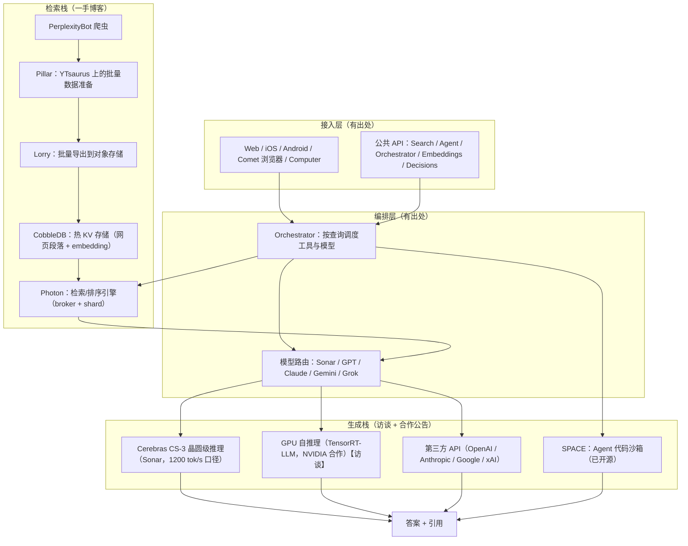

# 3. 架构设计：从公开信息拼出的全景

本章遵循一个严格原则：**有出处的部分给出出处，推断的部分明确标注"推断"，未公开的部分直接说未公开**。Perplexity 没有发布过整体架构图，以下分层由官方博客、文档、访谈与合作伙伴公告交叉拼合而成。

## 3.1 总体分层

四个分层的信息来源与可信度：

| 分层 | 可信度 | 依据 |
|---|---|---|
| 接入层 | 高 | 官方产品页与文档 |
| 编排层 | 高 | docs.perplexity.ai 的 Orchestrator / Agent API / model fallback 文档 |
| 检索栈 | 高 | Photon / CobbleDB 官方工程博客（2026-09） |
| 生成栈 | 中 | Cerebras/Crusoe 公告为一手，GPU 自推理细节来自访谈转述，具体容量未公开 |

## 3.2 检索栈：2026 年博客揭示的三级流水线

这是 Perplexity 公开材料中信息密度最高的部分，几乎全部由两篇一手博客支撑。

**数据准备层（Pillar → Lorry）。** Photon 博客描述了"Pillar（发布层）"把抓取数据准备成 YTsaurus 表（YTsaurus 是 Yandex 开源的分布式存储/计算平台）；CobbleDB 博客进一步给出三级命名：**Pillar**（YTsaurus/HDD 上的持久状态）→ **Lorry**（批量导出到 S3 对象存储）→ **CobbleDB**（在线热存储）。全量网页索引的构建在"个位数小时"内完成【一手：Photon 博客】。

**在线检索层（Photon）。** 查询路径：搜索服务 → 负载均衡 → Photon broker（选分片组、监控超时、必要时重发）→ shard 节点（检索 + 初排 + 二段精排）→ broker 合并候选、取回文档字段、返回给生成侧。工程要点【一手：Photon 博客】：

- 倒排索引按 posting list 长度选编码：短表内联、长表切块（稀疏用有序偏移数组 + 跳跃查找，稠密用 bitmap）；热表在磁盘上同地存放；
- 遍历采用 WAND 式剪枝：driving list 出候选、probe list 打分，上界剪枝；
- 每文档记录（Docblob）用 Elias-Fano 编码，只解码命中词块的局部；
- RAM 仍是最紧约束，因此用 io_uring 批量异步读、无锁缓存（版本检查 + 重试）、CLOCK 驱逐、CPU 预取；
- 构建与查询分离：索引构建不影响在线流量；新版本先下流量、加载、用真实查询回放预热缓存、通过就绪检查后回切，全量发布约 30 分钟，高时效垂直领域文档入库延迟"个位数分钟"。

实测口径【一手】：检索内部阶段 p99 从约 800 ms 降到约 65 ms；**少用约 20% 等效机器、每文档多存 2.5 倍数据**；若改用 mlock 常驻内存方案需要约 4.6 倍内存。Fast Search 预设单次搜索调用 160 ms（p50）/ 230 ms（p95）。

**热存储层（CobbleDB）。** 替换 DynamoDB 的自研 KV 存储【一手：CobbleDB 博客】：约 4 万行 Rust，基于 RocksDB + 本地 NVMe + 内存缓存；无状态查询路由器 → 分区（每分区 3 副本）→ 数据节点 RocksDB MultiGet。关键设计：hedged reads（副本慢就并行再问另一个）、可用区亲和路由、放弃事务与强一致（搜索负载不需要）。batch read 中位数 31.4 ms → 5.6 ms（降 82%），p99 123 ms → 24.2 ms；预计比 DynamoDB 便宜 20% 以上（部分报道口径称年化节省可达 1 亿美元——注意该数字为推算而非官方披露）。博客同时披露了一个组织事实：**CobbleDB 由 2 名工程师 + 数百个 AI 编码代理在约 2 个月内建成**，但架构决策与生产变更完全由工程师掌控。

## 3.3 生成栈：多云、多硬件、多供应商

生成侧的公开事实拼图：

- **Cerebras**：2025-02 官宣，Sonar（Llama 3.3 70B 基座）跑在 CS-3 晶圆级引擎上，官方口径约 1200 token/s，先在 Pro 档开放【一手：Cerebras 公告】。
- **GPU 自推理**：访谈口径为与 NVIDIA 合作 TensorRT-LLM、必要时自写 kernel；Crusoe 官宣多年期合作，提到 GB300 NVL72 + InfiniBand 的生产级推理部署【一手：Crusoe 公告】。**GPU 数量、集群拓扑未公开。**
- **第三方 API**：OpenAI、Anthropic、Google、xAI 的模型通过统一网关接入（2024-12 起与 OpenAI 的合作有广泛报道；接入清单见官方文档与产品内的模型选择器）。
- **云底座**：一切上云，且公开口径为 AWS（访谈：全栈在 AWS；AWS 官方案例材料提到 SageMaker HyperPod、Bedrock 多模型接入与 Trainium 试验——注意 AWS 案例材料带有营销性质，参数如"训练快 40%"应谨慎引用）。

**推断（明确标注）**：生成栈的合理形态是"按模型分池、按延迟档位做容量规划"——Sonar 这类自研模型走专属容量（Cerebras + 自租 GPU），第三方模型走 API + 可能的部分批量折扣合约；Orchestrator 在之上做健康检查、fallback 与成本感知路由（model fallback 功能已在官方文档中公开）。具体调度算法未公开。

## 3.4 Agent 栈：SPACE 沙箱

2026-02 上线的 Computer 产品需要安全执行 Agent 生成的代码，其底座 SPACE 于 2026-10 开源【一手：SPACE 博客】：

- 每个沙箱跑在独立小虚拟机中（VM 级隔离），中央控制平面管理创建/暂停/恢复/删除；
- 默认不信任沙箱：网络访问与平台凭证由沙箱外管理，Agent 不接触明文凭证；
- 状态快照存"变更"而非整环境拷贝，因此创建、恢复、分支都便宜；支持暂停（等人审）→ 恢复、分叉对比方案；
- 生产数据：每天数百万次沙箱创建，创建速度比前一家商业供应商快 3–5 倍；对抗测试中 108 次 VM 逃逸尝试全部失败（作者也披露了修复过的网络侧绕过并通报同行厂商）；
- 部署伙伴包括 Akamai、Crusoe、CoreWeave。

## 3.5 架构设计的三个取舍

1. **自建 vs 托管的边界划在"差异化"上**：检索与热存储是答案质量的根，必须自建（Photon/CobbleDB）；沙箱是 Agent 安全的根，也转向自建（SPACE 替换商业供应商）。而基础模型、通用 KV 之外的存储、通用云计算，一律外购——CobbleDB 只覆盖 DynamoDB 替换的那一部分热路径。
2. **构建/查询分离是检索栈的骨架**：Photon 的索引构建节点与查询节点分离、CobbleDB 的 Pillar/Lorry/在线分层，本质同一件事——**离线吞吐与在线延迟永远不能互相拖累**。
3. **索引数据量决定存储形态**：每文档要存 2.5 倍数据（更多字段服务排序质量），RAM 先爆——于是有了 Elias-Fano、bitmap、io_uring、CLOCK 这一整套"用 CPU 与编码换内存"的经典取舍。

下一章 [工作流程](04-workflow) 跟随一次查询穿过这些层。
