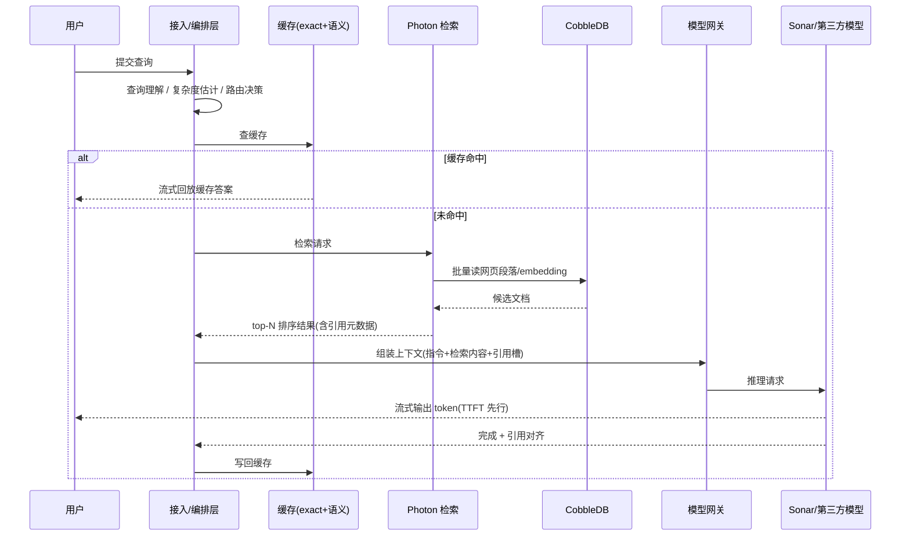

# 4. 工作流程：一次查询的生命线

本章把 [第 3 章](03-architecture) 的分层串成一条时间线：从用户敲下回车，到第一个词元出现在屏幕上。所有延迟数字分两类：**有出处**（来自官方博客/公告）与**教学模型**（来自本主题 Mini Demo 的合成预算，用于演示量级关系，不代表 Perplexity 内部数字）。

## 4.1 端到端时序

## 4.2 阶段拆解

**① 查询理解与路由（毫秒级）。** 决定这次查询走哪条路径：简单事实查询 → 快档模型；多步分析 → Pro/Reasoning 档；涉及代码执行/文件操作 → 挂 SPACE 沙箱。Aravind 访谈中提到混合排序信号（BM25、向量、域名权威度、时效性）按查询类别加权【访谈】——查询分类不仅影响选模型，还影响检索策略。[Mini Demo `routing.py`] 用"满足质量下限的最便宜档"近似这一决策。

**② 缓存查询。** exact 缓存（规范化查询串）+ 语义缓存（相似问法）。缓存命中直接跳过检索与生成，是答案引擎毛利率的最大单一杠杆之一。本层为**推断**：缓存存在性可由其商业模型与行业惯例推断，但 Perplexity 未公开缓存命中率与层级设计。

**③ 检索召回（Photon，65 ms p99 口径）。** broker 选分片组、shard 并行做 WAND 式倒排遍历 + 字段加权打分、broker 合并。教学预算取 65 ms（Photon p99 公开口径）。Fast Search 预设下，单次搜索调用公开口径为 160 ms p50 / 230 ms p95【一手】。

**④ 热存储读（CobbleDB，5.6 ms p50 口径）。** 段落、字段、embedding 的批量 MultiGet；hedged reads 吸收慢副本。教学预算取 5.6 ms（CobbleDB p50 公开口径）。

**⑤ 重排与上下文组装（教学模型）。** 检索返回的 top-N（例如 24）做二段精排后截到 top-5 进上下文。Perplexity 公开口径强调"检索不到就不回答"的引用纪律【访谈】：模型不许说检索内容之外的话，检索资源不足时明确告知用户。上下文组装还要处理引用槽位（每个论断对应来源段落）——这是答案引擎相对普通 RAG 的关键差异。

**⑥ 流式生成（TTFT + 解码）。** 教学预算：Sonar 档 TTFT 150 ms、1200 tok/s（Cerebras 官方口径的数量级）。第三方模型路径的 TTFT 取决于供应商。流式输出意味着阶段⑦与⑥在用户感知中重叠（见下）。

**⑦ 引用渲染与后处理。** 边生成边对齐引用编号；完成后做敏感词与安全检查、写入缓存。由于流式渲染，用户感知延迟 ≈ TTFT + 读前几十个 token 的时间，**不是全部阶段之和**——这是把 [第 2 章](02-core-ideas) tail latency 哲学落到工程上的关键。

## 4.3 延迟预算表（教学模型）

[Mini Demo 场景 5](07-mini-demo) 的合成预算，全部阶段之和 550 ms：

| 阶段 | 教学预算 | 口径 |
|---|---|---|
| 查询理解与路由 | 5 ms | 教学模型 |
| 缓存查询 | 2 ms | 教学模型 |
| 检索召回 | 65 ms | Photon p99 公开口径 |
| 重排（top-24） | 48 ms | 教学模型 |
| 首次生成 TTFT | 150 ms | 教学模型（Sonar 档量级） |
| 流式解码 300 token | 250 ms | 1200 tok/s 官方口径换算 |
| 引用渲染与后处理 | 30 ms | 教学模型 |

对照组：2026 年官方 Fast Search 口径 160 ms p50 / 230 ms p95【一手】——检索层单独就要求百毫秒以内，任何比它慢的环节（例如一个 300 ms TTFT 的模型）都会立刻成为端到端瓶颈。**检索快而生成慢时，优化生成；生成快而检索慢时，优化检索——瓶颈永远跟着 p99 走，不跟着均值走。**

## 4.4 Deep Research 的多轮分支

Deep Research（2025-02 上线）是同一生命线的循环版：把复杂问题拆成子查询，每个子查询走 4.2 的完整链路，中间结果作为后续检索的上下文，最后汇总成长报告。官方 API 对 Sonar Deep Research 的计费直接暴露了它的成本结构——**按 citation token、reasoning token 与 search query 次数三项分别计费**【一手：docs.perplexity.ai 定价页】：搜索调用被当成一等计费单位，说明多轮检索是该产品最主要的成本驱动。这也是"搜索是推理的一部分"这一命题在商业模式上的直接体现。

## 4.5 失败与降级路径

- **检索为空 →** 明确告知"没有足够的检索资源给出好答案"，而不是让模型自由发挥【访谈】——宁可答不了，不可编。
- **第三方模型超时/降质 →** 官方文档公开的 model fallback 机制自动切换备选模型【一手】；自研 Sonar 的存在本身也是 fallback 的一种形态。
- **慢副本/慢分片 →** Photon broker 超时监控 + 重发；CobbleDB hedged reads；YTsaurus 层的分区容错【一手】。
- **Agent 代码执行 →** SPACE 沙箱隔离 + 快照恢复，逃逸对抗测试公开【一手】。

下一章 [核心模块](05-core-modules) 逐模块展开设计与参数。
