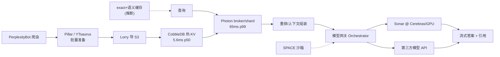

# 5. 核心模块

本章逐个拆解答案引擎的核心模块。除特别标注外，参数均来自 2026 年的官方一手博客与文档。模块间的数据流如下（一手部分实线，推断部分虚线）：

## 5.1 Photon：自研检索/排序引擎

**动机**【一手：Photon 博客】：改造自一个开源引擎的方案在三件事上撞墙——规模上涨后 RAM 装不下（成本）、数据集超 RAM 后缺 mlock 导致 page fault（p99 约 800 ms）、磁盘索引合并期间 p99 飙到 1.2 s 并持续 10–15 分钟、新集群部署要一周以上且恢复慢（同步期间部分应答损害答案质量）。

**架构**：broker/shard 拓扑。broker 选择分片组、转发、监控超时、失败重发；每个 shard 完成"检索 → 初排 → 二段精排"；broker 合并候选、取回关键字段返回。索引构建由 Pillar（YTsaurus 表）→ indexer 并行构建 → 对象存储 → 滚动发布（一组一组下流量、加载、真实查询回放预热、就绪检查后回切）。

**三个关键机制**：

| 机制 | 解决的问题 | 效果 |
|---|---|---|
| 按长度自适应编码的倒排（inline / 偏移数组 / bitmap）+ 文档按"有用度信号"排序 | posting list 长度差异大、热表访问局部性差 | 每文档多存 2.5 倍数据仍少用 20% 机器 |
| WAND 式遍历 + 上界剪枝 + driving/probe 双角色 | 多词查询打分贵 | 剪枝先于精确打分 |
| io_uring 批量异步读 + 无锁缓存 + CLOCK 驱逐 + 预取 | RAM 不够、磁盘等待阻塞 | p99 800 ms → 65 ms；mlock 方案需 4.6 倍内存 |

**发布数字**：全量索引构建"个位数小时"；新数据副本发布约 30 分钟且无重索引；高时效垂直领域文档入库"个位数分钟"。Fast Search 预设 160 ms p50 / 230 ms p95；六个 Agentic 基准上 fast 预设以约 68% 更低的成本达到与默认预设基本相当的聚合得分（64.3% @ $59.73 vs 64.0% @ $187.60）——官方同时诚实地标注了质量折损（相关性 DCG 2.45 → 2.21）。

## 5.2 CobbleDB：热 KV 存储

**定位**：替换 DynamoDB 的热路径存储，存放预切分的网页段落与向量 embedding，服务 AI 搜索查询【一手】。

| 属性 | 设计 | 理由 |
|---|---|---|
| 实现 | 约 4 万行 Rust，RocksDB + 本地 NVMe + 内存缓存 | 贴近硬件、控制尾延迟 |
| 拓扑 | 无状态路由器 → 分区（3 副本）→ RocksDB MultiGet | 路由器可水平扩 |
| 读路径 | hedged reads + 可用区亲和路由 | 吸收慢副本与跨区延迟 |
| 一致性 | 无事务、最终一致 | 搜索负载不需要强一致 |
| 数据分级 | Pillar（YTsaurus/HDD 持久态）→ Lorry（批量导 S3）→ CobbleDB（热服务） | 成本/延迟分层 |

**数字**：batch read 中位数 31.4 → 5.60 ms（约 5 倍 / 82% 降幅），p99 123 → 24.2 ms；预计成本比 DynamoDB 低 20% 以上（注意：对比非严格 A/B——DynamoDB 数字为切换前测量，CobbleDB 为切换后测量，博客与方法学 caveat 并存）。"年化省 1 亿美元"的说法见诸报道，非官方口径，谨慎引用。

**组织事实**：2 名工程师 + 数百 AI 编码代理、约 2 个月建成；代理负责测试/修复/监控/文档，架构与生产控制全程在人类工程师手中。这是"AI 代理辅助基建开发"最早的生产级公开案例之一。

## 5.3 Sonar 模型族：轻量自研的服务面

| 模型 | 定位 | 基座与训练 | 关键公开口径 |
|---|---|---|---|
| Sonar | 低延迟在线答案 | Llama 3 系 + 后训练（摘要/引用/上下文保持）【访谈】 | Cerebras CS-3 上约 1200 tok/s【一手公告】；2025-02 起 Pro 可用 |
| Sonar Pro | 高质量 RAG 推理 | 同上路线，长上下文（发布时主打 200k） | 发布时官方口径 SimpleQA 大幅领先 GPT-4o search preview（原帖已不可访问，经多方转引） |
| Sonar Reasoning Pro | 多步推理搜索 | 官方未完整披露基座 | docs 计费 $2/$8 每百万 token |
| Sonar Deep Research | 深度研究报告 | 多轮检索 + 长推理 | 按 citation/reasoning token 与 search 次数计费，暴露其成本结构 |

现行 Sonar API 定价【一手：docs.perplexity.ai】：sonar $1/$1、sonar-pro $3/$15、sonar-reasoning-pro $2/$8（每百万输入/输出 token），三档另按搜索上下文规模收每千次请求费（$5–$14）。注意时间线：**2026-09-27 起 Sonar API 端点退役**，客户迁移至 Agent API；官方基准显示 Agent presets 在 BrowseComp 等任务上以远低于 Deep Research 的成本达到更高得分【一手：docs】。这标志着产品形态从"模型 API"升级为"带工具的 Agent API"。

**服务面**：Cerebras 晶圆级推理（独家官宣）+ GPU 自推理（TensorRT-LLM，NVIDIA 合作）【访谈】+ Crusoe GB300 NVL72 多年期合作【一手公告】。具体容量与流量分配比例未公开。

## 5.4 缓存层（推断 + 教学模型）

Perplexity 未公开缓存设计。合理的生产形态（行业惯例 + 本主题 Mini Demo 的教学模型 `caching.py`）：

- **exact 缓存**：规范化后的查询串 → 答案。头部查询（热门事件、重复问题）直接命中，成本近零。
- **语义缓存**：相似问法（"vllm 原理是什么" vs "vllm 的原理是什么"）经 embedding 相似度命中，需配 TTL 防陈旧答案。
- **注意答案引擎缓存的特殊性**：新闻类查询时效敏感，TTL 必须按查询类别分级——这与 [RAG 主题](/06-rag/)中"缓存与新鲜度的矛盾"是同一件事。Photon 的"高时效垂直领域个位数分钟入库"与 CobbleDB 的最终一致设计，都是为这层服务的。

教学演示（[Mini Demo 场景 2](07-mini-demo)）：600 条含 40% 精确重复 + 20% 同义改写的查询流，exact 命中率 69%、语义命中率 30%、总命中率 99%，成本节省 99%（教学参数，刻意构造的高重复负载）。

## 5.5 SPACE：Agent 执行沙箱

见 [3.4](03-architecture)。补充运维面【一手：SPACE 博客】：每天数百万次沙箱创建；创建比商业供应商快 3–5 倍；快照存"变更"使创建/恢复/分支都便宜；108 次对抗逃逸尝试全部失败，已披露并修复网络侧绕过、通报同行厂商；VM 级隔离 + 沙箱外凭证管理；部署伙伴 Akamai / Crusoe / CoreWeave。

## 5.6 PerplexityBot 与索引管线

- **抓取**：自建爬虫 PerplexityBot【访谈】。早期依赖 Bing 索引 API，随规模扩大转向自建索引（访谈口径，多个场合提及）——爬虫、清洗、去重、时效跟踪是"域名知识密集"的活，也是回应"wrapper 论"的核心证据。
- **入库三级**：Pillar（YTsaurus 批量准备，全量索引构建个位数小时）→ Lorry（导 S3）→ CobbleDB（热服务）【一手】。
- **发布**：索引版本滚动发布、真实查询回放预热，约 30 分钟全量切换【一手：Photon 博客】。
- **争议面**：抓取合规性是 Perplexity 最大的外部风险（见 [第 8 章](08-production-practice)）——Wired 2024 年调查称其无视 robots.txt 并用 AWS IP 与伪装 UA 绕过封禁【报道】。

## 5.7 模型网关与 Orchestrator

2026 年的公开 API 形态【一手：docs.perplexity.ai】：**Orchestrator**（带工具的模型网关，OpenAI 兼容）、**Agent API**（复用 agent、后台模式、会话状态、skills、MCP 连接器）、**Search API**（Fast Search 预设）、**Embeddings**（标准 + 上下文感知两种）、**Decisions**（决策记录 API）。文档公开的能力包括：模型 fallback、预设档位（fast/low/high/xhigh，成本-质量显式权衡）、搜索过滤器（域名、时效、语言）——网关层的工程哲学是**把"用哪个模型、花多少钱、要多少质量"变成显式可调的产品参数**，而不是隐藏的 infra 决策。

下一章 [生态与实现分析](06-source-analysis) 盘点它的开源策略并与四大案例对照。
