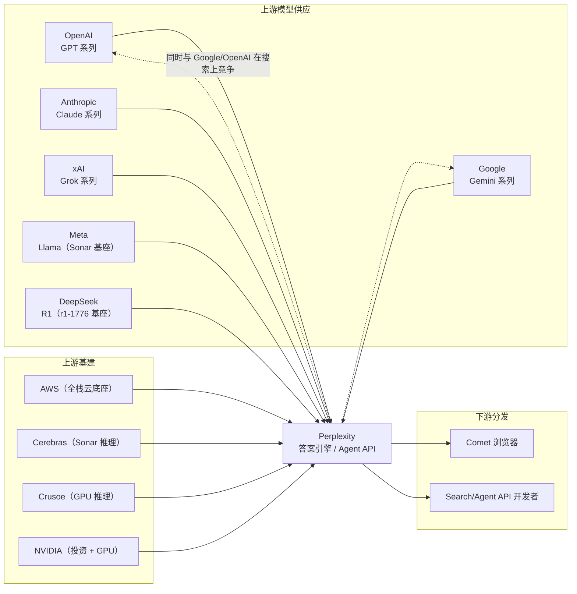

# 6. 生态与实现分析

## 6.1 为什么 Perplexity 几乎不开源模型、却在 2026 年密集开源基建

Perplexity 没有预训练框架可开源，也不做权重开放（唯一的例外是 r1-1776）。但它的开源动作在 2025–2026 年明显加速，且全部指向**基建与安全工具**而非模型。这是"开源作为技术品牌"策略的清晰样本：模型是商品，工程信誉才是招聘与客户获取的资产。

## 6.2 开源盘点

| 项目 | 时间 | 内容 | 来源性质 |
|---|---|---|---|
| r1-1776 | 2025-02-18 | 基于 DeepSeek-R1 671B 的后训练版本：构建约 4 万条多语言 prompt 数据集，由人工专家标注约 300 个敏感主题，用改编的 NVIDIA NeMo 2.0 框架后训练，去除自我审查同时基本保持推理/数学能力；MIT 许可，权重发布于 Hugging Face，并经 Sonar API 提供 | 一手公告 + HF 仓库 |
| SPACE | 2026-10-15 | Computer 产品背后的沙箱平台完整开源（见 [5.5](05-core-modules)） | 一手公告 |
| BrowseSafe | 2026 | Web 浏览安全工具，SPACE 博客中作为"已发布的 Agent 安全工具"提及 | 一手提及，细节见仓库 |
| Numbat | 2026 | 带量纲意识的计算/单位工具（Agent 防算错数） | 一手提及 |
| Bumblebee | 2026 | Agent 安全工具链组件 | 一手提及 |

补充：Perplexity 也是 transformers.js 等开源项目的公开赞助方之一（社区记载，官方未维护完整赞助清单）——金额与范围不可考，属于边缘信息，不应夸大。

**r1-1776 值得单独说两句**：它是本手册两个案例主题的直接交叉点——DeepSeek 提供基座（R1 的 MIT 开放权重使这成为可能），Perplexity 提供后训练与工程化发行。这个案例同时证明了两件事：开放权重生态的乘数效应（DeepSeek 的训练投入被第三方二次变现），以及后训练作为差异化资产的轻量性（不需要碰预训练）。

## 6.3 与四大案例的路线对比

| 维度 | Perplexity | OpenAI | Google | DeepSeek | xAI |
|---|---|---|---|---|---|
| 权重开放 | 仅 r1-1776 | 无 | Gemma 系 | 全量 MIT | 无 |
| 训练栈开源 | 无（无训练栈） | 无 | JAX/TPU 部分 | 训练/通信/存储全开源 | 无 |
| 推理/基建开源 | SPACE 等安全工具 | 无 | vLLM 等周边 | FlashMLA/DeepEP/3FS | 无 |
| 论文文化 | 工程博客（2026 起） | 系统卡 | NSDI/TPU 论文 | arXiv 论文级 | 无 |
| 核心开放动机 | 技术品牌 + Agent 生态 | —— | 生态标准 + 学术传统 | 生态位 + 招聘 + 地缘对冲 | —— |

三个观察：

1. **开源密度与训练投入负相关在这里失效了。** DeepSeek 与 Perplexity 一个重训练、一个零预训练，却都在基建层开源——开源对象都是"不构成模型竞争力的部分"，这说明开源决策是**竞争边界管理**，而非情怀或单一文化。
2. **Perplexity 的开源是"安全侧"开源。** SPACE/BrowseSafe/Numbat 全部围绕 Agent 安全——在 Agent 产品扩张期，安全可信度直接是商业化前置条件（企业客户敢不敢用 Computer）。
3. **2026 年工程博客的披露密度是个转折点。** 在 Photon/CobbleDB/SPACE 之前，外界对 Perplexity 基建的认知停留在"AWS + 租模型"；三篇博客之后，它成为生产级 AI 搜索基建最透明的公开样本之一。披露本身成了竞争力。

## 6.4 生态位：供应商、伙伴与竞争对手的三重奏

这张图的每一根箭头都可能反转：OpenAI 既是供应商又是 ChatGPT Search 的直接竞争者；Google 既是 Gemini 供应商又是被挑战的搜索霸主（据报道还参与其融资与云服务合作）；NVIDIA 既是 GPU 来源又据报道洽谈入股。**模型无关主义的代价是每个供应商关系都是竞争合作（coopetition）**——这要求网关层的可替换性（见 [5.7](05-core-modules)）不仅是技术架构，更是商业架构。

## 6.5 对工程师的启示

- 读一手工程博客比读拆解文章高效十倍：Photon/CobbleDB/SPACE 三篇博客合计给了延迟、机器数、编码选型、发布流程、组织方式五类硬信息——这在闭源公司里极罕见。
- "不训模型"不等于"没有模型工程"：Sonar 的后训练、Cerebras 移植、TensorRT-LLM 合作证明推理侧的模型工程同样深。
- 自建决策的边界（差异化层自建、商品层外购）可以直接抄（见 [9. 最佳实践](09-best-practices)）。

下一章 [Mini Demo](07-mini-demo) 把推理经济学变成可运行的数字。
