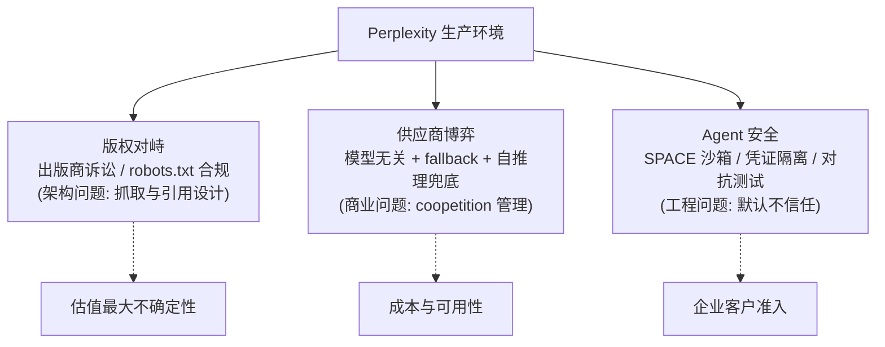

# 8. 企业生产实践

Perplexity 的生产实践主题是：一家把"读取整个互联网"当原料的公司，如何同时处理版权对峙、供应商博弈与 Agent 安全三摊事。本章数字除标注外均为报道口径。

## 8.1 版权对峙：答案引擎的原罪与应对

答案引擎的商业模式建立在"抓取并复述公开网页"上，这使它从第一天起就站在出版业的对立面。公开时间线（均为报道口径）：

| 时间 | 事件 |
|---|---|
| 2024-06 | Forbes 公开指责 Perplexity 的 Pages 功能近乎逐字复刻其独家报道且署名不足 |
| 2024-06 | Wired 发布调查（"Perplexity Is a Bullshit Machine"），称其爬虫无视 robots.txt，使用 AWS 上的未披露 IP 与伪装 User-Agent 绕过 Condé Nast 系站点的封禁 |
| 2024-07-30 | 推出 Publishers Program：内容被引用时分给出版商"两位数百分比"的广告/订阅收入（首批含 TIME、Der Spiegel、Fortune、Automattic 等）；Dow Jones 公开表示该安排不足 |
| 2024-10 | 收到纽约时报 cease-and-desist（Reuters 报道） |
| 2025-06 | BBC 威胁就内容抓取采取法律行动（Reuters 报道） |
| 2025 年 | Dow Jones / New York Post、纽约时报、大英百科与 Merriam-Webster 相继提起诉讼 |
| 2025-11 | Amazon 指控 Comet 的 Agent 访问用户私有账户并提起诉讼，案件进入联邦上诉程序 |

基础设施工程师从这场对峙中该学到的是：**抓取合规性不是法务问题，是架构问题**。机器人协议遵守策略、IP/UA 管理、引用对齐粒度、robots.txt 变更监控、按出版商分级的抓取配额，全部都会落进爬虫与索引管线的设计里。Perplexity 的应对是双轨——技术上把索引与引用做扎实（引用即审计日志），商业上用分成计划换一部分合法性；但诉讼未决意味着这块成本会持续存在，且是估值的最大不确定性之一。

## 8.2 供应商风险管理：模型无关主义的实战

2024-12 与 OpenAI 的合作（Perplexity 接入 OpenAI 最新模型，据报道含收入分享安排）曾被视为标志性事件；但此后 OpenAI 自己推出 ChatGPT Search（2024-10 上线），供应商一夜之间变成头号竞争者。Perplexity 的对冲组合：

- **自研兜底**：Sonar 系列 + 自推理容量（Cerebras/Crusoe/GPU），第三方断供或涨价时至少快问答路径不依赖外人。
- **多供应商并行**：同一网关后挂 OpenAI/Anthropic/Google/xAI，官方文档公开 model fallback——任何一个供应商的故障或降质都可被路由层吸收。
- **反向投资关系**：NVIDIA 是股东也是 GPU/网络来源；据报道 Google 参与融资并提供云服务合作；2026-08 报道 NVIDIA 洽谈以 300 亿美元+ 估值继续加码（未证实）。供应商投资客户，是这个行业锁单与对冲并行的独特形态。

**未公开**：各模型流量占比、与供应商的合同条款与价格。任何给出确切占比的说法都应视为猜测。

## 8.3 多云与多硬件布局

公开拼图：AWS 为全栈云底座【访谈 + AWS 案例材料】；Cerebras 承载 Sonar 的晶圆级推理【一手】；Crusoe 多年期 GPU 推理合作（GB300 NVL72 + InfiniBand）【一手】；SPACE 的部署伙伴另含 Akamai 与 CoreWeave【一手】。**推断**：推理容量按"延迟档位 × 模型池"分片规划——快档（Sonar）跑在专用硬件上保 TTFT，重档（Deep Research 类）可用更便宜的批量容量。训练侧公开动作为零（唯一训练相关公开材料是 AWS 案例材料中提到 SageMaker HyperPod 与 Trainium"试验"——注意该材料有营销属性，不能当作严肃的训练基础设施证据）。

## 8.4 Agent 安全的生产化

Computer（2026-02）把 Perplexity 从"读网页"推进到"代用户操作"（邮箱、日历、代码执行），攻击面指数级扩大。其工程应对 SPACE 已在 [5.5](05-core-modules) 详述，生产实践侧值得强调三点【一手：SPACE 博客 + "How we engineer safer agents"（2026-09-29）】：

1. **逃逸对抗成为常规流程**：108 次对抗逃逸尝试全部失败、网络侧绕过修复后复测、主动向其他沙箱厂商披露同类弱点——把红队结果公开化是建立企业信任的直接手段。
2. **凭证不出沙箱**：平台持有的凭证由沙箱外管理，Agent 只能到达被授权的服务——纵深防御落在架构层而不是提示词层。
3. **可审计的状态模型**：暂停/恢复/分支使"Agent 做到哪一步、在哪一步等人类确认"成为一等公民状态，长任务才能进生产。

## 8.5 商业化与基础设施的互相塑造

收入结构（报道口径）：Pro 订阅 $20/月、Max $200/月、API 按量、Comet 内置分发（含购物/联盟场景）、广告与出版商分成在探索中。基础设施对商业化的反向塑造清晰可见：

- **订阅分层 = 推理成本分层**：Max 档位（200 美元/月）早期独占 Comet，本质是把最贵的 Agent 工作量（浏览器 Agent）与最高付费意愿绑定。
- **API 定价暴露成本结构**：Deep Research 按 search 次数计费（[4.4](04-workflow)）、Sonar 按上下文档位收请求费——定价表就是成本模型的公开版本。
- **速度即留存**：Aravind 反复强调在飞机 Wi-Fi 上测试产品【访谈】——搜索产品的流失是秒级的，延迟优化直接等于收入增长。

## 8.6 对照：Google 的 AI 化与 OpenAI 的搜索化

作为竞争坐标（公开产品事实）：Google 用 AI Overviews + Gemini 把生成式答案塞进既有搜索（优势：索引、分发与广告盘；包袱：商业模式 cannibalization），OpenAI 用 ChatGPT Search 给聊天机器人加搜索（优势：会话入口；包袱：引用质量与传统 SEO 生态）。Perplexity 的位置是"AI 原生的独立入口"——没有旧广告盘要保护，也没有会话产品要迁就，它的全部基建（Photon/CobbleDB/SPACE）都只为"最快给出可信答案"服务。这场三方竞争的终局取决于两件事：版权诉讼的边界，以及 Agent 形态是否成为新的搜索入口——两个变量都不在 Perplexity 完全掌控之中。

下一章 [最佳实践](09-best-practices) 把可复用经验整理成清单。
