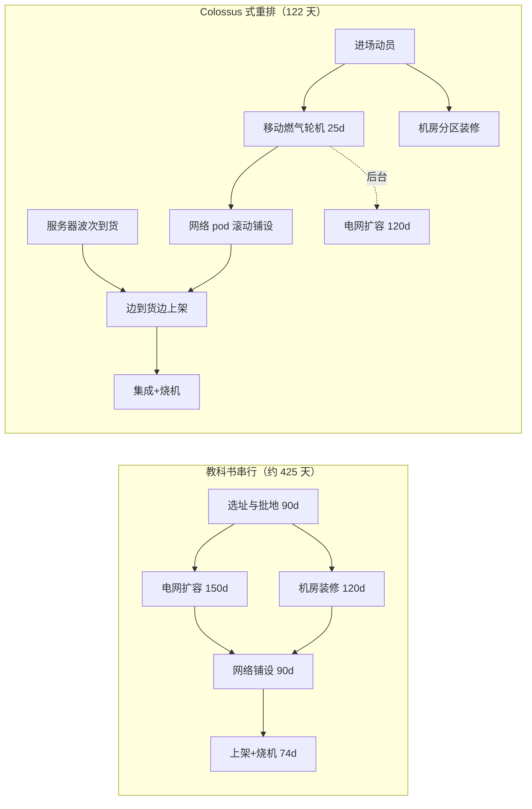
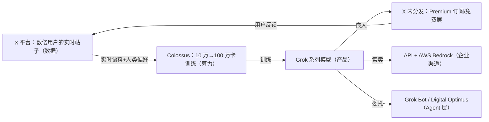

# 2. 核心思想

xAI 的基础设施没有论文，但有非常清晰的三条思想主线。它们互相咬合：**速度**让 xAI 在别人建成之前就用上 10 万卡；**单集群**让这 10 万卡的算力不打折扣；**垂直整合**让训练出来的模型立刻变成产品与用户。本章逐条展开，每条都给出支持证据与反面教训。

## 2.1 思想一：速度即战略

**主张：在算力即护城河的时代，训练集群晚上线一天，落后就累积一天。因此基础设施工程的第一优化目标是 wall-clock time，不是成本、不是能效、不是合规完备度。**

### 证据：122 天与 19 天

NVIDIA 官方新闻稿（2024-10-28）确认的三个数字是整个思想的地基：

- **122 天**：从动工到 10 万卡液冷集群建成，对比行业通常的"数月到数年"；
- **19 天**：从第一批机柜进厂到开始训练——服务器到货不是等集群全建好才开机，而是"边建设、边上架、边训练"；
- **约 92 天**：随后把集群翻倍到 20 万卡（H100 + H200），第二期的建设速度比第一期还快。

### 机制：速度来自关键路径重排，不来自单点加速

很多人把 122 天理解成"执行力强"。[Mini Demo](07-mini-demo) 场景 1 用排程模拟拆解了真正的原因：教科书串行流程（选址 → 电网扩容 → 机房装修 → 网络铺设 → 服务器进场 → 上架 → 烧机）关键路径约 **425 天**；Colossus 的做法是**重排依赖**：

- 用**移动燃气轮机**在 30 天内提供临时供电，让"电网扩容"从关键路径上彻底移除（变成后台任务）；
- **网络按 pod 滚动交付**（5 个网络 pod 并行铺设），不等机房全部装修完；
- **服务器边到货边上架**，10 个交付波次两两并行。

模拟结果：集群就绪压到 **122 天**，压缩 3.48 倍，而关键路径变成"临时供电 → 网络 pod → 机柜上架 → 集成 → 烧机"。**注意：没有任何单个环节的工期被压缩一半，压缩全部来自并行化与依赖重排**——这是所有排期优化里最反直觉、最可复用的教训。



### 反面教训

速度不是免费的。把监管事项系统性后置，换来的是 [第 8 章](08-production-practice) 详述的一系列代价：未许可燃气轮机的《清洁空气法》诉讼、DOJ 介入、被迫承诺 2027 年拆除临时轮机。**速度即战略成立的前提是：合规债务的利率低于时间价值的利率**——xAI 赌它成立，这个赌注至今未完全兑付。

## 2.2 思想二：单集群极限规模（single training domain）

**主张：前沿模型训练是带宽饥渴的同步计算。把 N 张卡放进同一个园区、同一个无损 fabric 域里同步训练，通信效率永远优于跨园区方案；模型越大，优势越大。**

### 通信数学：为什么"模型越大，单园区越值"

同步数据并行每一步都要 AllReduce 梯度。跨园区做层次化 AllReduce 的额外代价（跨园区段）为：

```
惩罚 = 梯度消息字节数 / DCI 带宽 + 2 × 跨园区 RTT
```

关键在于第一项：**分子是梯度大小，随模型大小线性增长；分母 DCI 带宽是固定资产**。所以模型越大、跨园区越痛。用 [Mini Demo](07-mini-demo) 场景 3 的默认参数（10 万卡、DCI 1.6 Tbps、跨园区 RTT 5 ms）：

| 梯度消息 | 单集群 AllReduce | 双园区 | 吞吐损失（假设计算 20 s/步） |
|---|---|---|---|
| 256 GB | 5.45 s | 5.64 s | 0.7% |
| 1 TB | 9.79 s | 10.52 s | 2.5% |
| 4 TB | 27.15 s | 30.05 s | 6.2% |
| 16 TB | 96.59 s | 108.17 s | 9.9% |

16 TB 梯度对应的是万亿参数级模型的全量数据并行。0.7% → 9.9% 的吞吐损失，乘以几个月的训练周期，就是"模型晚几周发布"的真金白银。**xAI 的结论是：既然模型会越来越大，那从第一天起就把所有卡放在同一个园区。**

### 工程含义

单训练域把三个设计决策锁死在一起：

1. **选址半径**：10 万卡 × 约 100 MW 的设施负载（100k × 700 W × 1.2 开销 × 1.2 PUE，见 [Mini Demo](07-mini-demo) 场景 2）必须落在一个电网上——这决定了"抢电网容量"成为比"抢 GPU"更硬的约束。
2. **网络 fabric 必须园区内无损**：这就是 Spectrum-X 的赌注（见 2.3）。
3. **故障域与供电绑定**：单园区意味着单点——一次电网波动、一场诉讼导致的停机令，影响的是全部训练任务。Google 用 NSDI'24 的"双路径恢复"对冲（见 [Google 案例](/09-case-study/google/)），xAI 公开资料里**没有对应的可靠性工程披露**——这是黑盒，也是风险。

对照：OpenAI 的 Stargate 走"多园区、园区间异步/稀疏同步"路线，Google 用 ICI + OCS 在单 Pod 内做可靠性，Meta 用多个中等集群 + 跨集群调度。xAI 是五家里唯一把"单园区同步"推到极致并公开下注的。

## 2.3 思想三：数据—模型—分发垂直整合

**主张：模型公司最大的浪费是"模型练好了，没人用"。xAI 用 X 把数据、分发、变现三件事打包，形成别家买不到的飞轮。**



三个层次的整合：

1. **数据整合**：X 的实时数据流是"其它实验室用钱买不到"的训练信号——新闻时效、公众情绪、多轮争论结构。Grok 的品牌定位（"rebellious、少审查"）本质上是把 X 的语料风格变成产品卖点。
2. **分发整合**：Grok 从第一天就长在 X 里（2023-11 先向 Premium+ 用户开放，2024-11 开放免费层）；2025-03 xAI 直接收购 X，把"渠道成本"降为零。截至 2026 年，分发矩阵扩展为：X 订阅捆绑（据报道 X Premium 与 Grok、Grok Bot、甚至 Cursor 打包成 8/30/100/200 美元四档）、独立 grok.com 与 App、AWS Bedrock 企业渠道（Grok 4.3/4.6/4.7 已上架，AWS 官方博客确认）。
3. **场景整合**：特斯拉（自动驾驶/Optimus）、SpaceX（Starlink 运营）是另外两个模型落地场景。2026-03 官宣的 "Digital Optimus / Macrohard" 联合项目（Reuters 报道）：Grok 作为 System 2 负责高层推理与规划，特斯拉的端侧系统作为 System 1 处理最近约 5 秒的屏幕与键鼠实时流——一个"操作系统级 Agent"的软硬件分工。

### 边界：哪些是特斯拉的，哪些是 xAI 的

这是最常见的混淆点，必须划清：

| 资产 | 归属 | 说明 |
|---|---|---|
| Colossus 1/2 | **xAI** | 孟菲斯/南黑文（Southaven），H100/H200/GB200/GB300 |
| Dojo（D1/D2 芯片与训练集群） | **特斯拉** | 据报道 2025 年 8 月马斯克叫停了 Dojo 主项目，转向 NVIDIA 路线 |
| Cortex（得州超级工厂旁，约 5 万卡 H100 起步，Cortex 2.0 据报道约 250 MW） | **特斯拉** | 训练 FSD 与 Optimus 模型 |
| AI5/AI6 车载与机器人芯片 | **特斯拉** | 规划中的下一代推理芯片 |
| X 数据与分发 | **xAI（2025-03 起）** | 原 Twitter 资产 |

协同方式是商业协议（据报道：特斯拉 2026 年 1 月达成向 xAI 投资 20 亿美元的协议，2025 年 11 月股东投票曾未通过、2026 年 1 月重新达成；Grok 与特斯拉 FSD 的模型授权/收入分成细节为**未公开**），而不是资产混同。

## 2.4 三条思想的交互与代价

三条思想叠加出的 xAI 风格：**先占住"算力×数据×分发"的乘法，再用工程速度把它们同时推大**。这在 2024–2025 年让 Grok 从"有钱人的聊天玩具"变成前沿模型竞争者（Grok-3/4 的基准成绩），但三条思想也各自累积债务：

- 速度的债 → 合规诉讼与 2027 拆机承诺；
- 单集群的债 → 电力天花板与故障域集中；
- 整合的债 → 关联交易质疑（特斯拉股东诉讼）、创始团队对"过度承诺"的失望（FT 报道口径）。

[第 8 章](08-production-practice) 逐笔对账。[第 3 章](03-architecture) 先给出 Colossus 的完整架构。

## 小结

- **速度即战略**：122 天 = 关键路径重排（燃气轮机除电、滚动交付），不是单点加速；代价是合规债务。
- **单集群极限规模**：跨园区惩罚 ∝ 模型大小 ÷ DCI 带宽，模型越大单园区越值；代价是电力天花板与单点故障域。
- **垂直整合**：X 的数据与分发是别家买不到的飞轮；与特斯拉/SpaceX 的协同靠商业协议而非资产混同，边界要划清。
