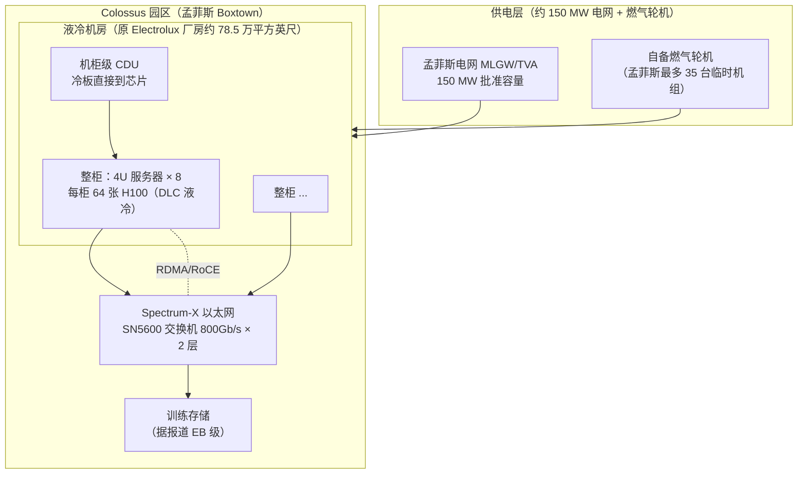
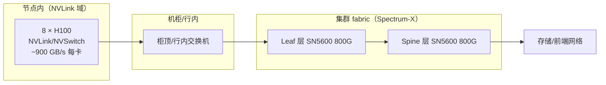

# 3. 架构设计

Colossus 的架构可以用一句话概括：**在孟菲斯一个园区里，把 10 万张 H100 连同供电、散热、网络当成一台机器来造**。本章按供电 → 机房/散热 → 网络 → 服务器/存储四层展开，每层给出"有出处的数字"与"推算/未证实的数字"的明确区分。

## 3.1 总体架构

## 3.2 供电层：电网 + 燃气轮机的双轨制

供电是 Colossus 架构里**最有故事的一层**，也是"速度即战略"思想最直白的落地：

- **电网容量**：首期获得孟菲斯 Light, Gas and Water（MLGW）与田纳西河谷管理局（TVA）批准的 **150 MW**；2026 年 2 月第二个 150 MW 获批，合计 300 MW（电力公司口径，报道确认）。
- **燃气轮机**：扩容 20 万卡后电网不够，xAI 自备工业燃气轮机——孟菲斯园区最多运行 **35 台临时机组**（当地媒体与监管文件）。这些机组的许可问题直接引发 [第 8 章](08-production-practice) 的环保诉讼。
- **电力账**（[Mini Demo](07-mini-demo) 场景 2 的模型，参数：H100 700 W、IT 开销系数 1.2、液冷 PUE 1.2）：

| 集群规模 | IT 负载 | 设施负载（PUE 1.2） | 与 150 MW 电网的关系 |
|---|---|---|---|
| 10 万卡 H100 | 84 MW | **100.8 MW** | 电网够用，余量约 49 MW |
| 20 万卡 H100+H200 | 168 MW | **201.6 MW** | 超出 51.6 MW，必须上轮机或等扩容 |

模拟显示：如果"纯等电网扩容"（假设第 180 天到位），20 万卡需求有 180 天缺口；而"第 45 天起 35 台 × 10 MW 燃气轮机"能把缺口压缩到 45 天——**这就是 35 台轮机存在的工程理由**（注意：它同时制造了合规债务，第 8 章对账）。

- **Colossus 2 的供电口径**：南黑文（Southaven） 项目被官方称为"世界首个吉瓦级 AI 训练集群"；密西西比州 MDEQ 2026-03-11 批准 41 台永久燃气轮机（约 1.2 GW）；Reuters 报道实际运行了 59 台未许可轮机；长期规划供电逼近 2 GW（含电网扩容）。作为对照：美国一座大型核电站的装机容量约 1 GW。

## 3.3 机房与散热：液冷是唯一选项

- **选址**：原 Electrolux 冰箱工厂，约 78.5 万平方英尺（约 7.3 万平方米），Boxtown 社区，孟菲斯。选它的原因：现成重工业厂房 + 高容量电网接入点 + 政治支持（孟菲斯急需投资）。代价：紧邻居民区，排放与噪音投诉伴随至今（xAI 后来建了约 700 万美元的隔音墙，媒体报道）。
- **整柜设计**（Supermicro 官方案例）：**4U Universal GPU 服务器 × 8 台 HGX H100，每柜 64 张 GPU**，直接到芯片液冷（DLC），机柜内置 CDU 循环泵；Supermicro 称其为"世界最大液冷 AI 集群"。
- **为什么必须液冷**（[Mini Demo](07-mini-demo) 场景 5 的密度模型）：

| 方案 | 每柜功率上限（教学模型） | 10 万卡 H100 需机柜数 | 相对机房面积 |
|---|---|---|---|
| 风冷 | 约 35 kW/柜 | 3,125 柜 | 基准（约 2.2 倍） |
| DLC 液冷 | 约 130 kW/柜 | 1,389 柜 | 约 44% |

单柜 64 × 700 W ≈ 45 kW，已经突破风冷的实用上限；而 GB200 NVL72 整柜约 86–120 kW，**没有液冷根本无法存在**。这也是为什么 Colossus 2（GB300 为主）从一开始就只有液冷一个选项。

## 3.4 网络层：Spectrum-X 以太网赌注

这是 Colossus 架构里**最有技术争议、也最有教科书价值**的一层。NVIDIA 官方新闻稿（2024-10-28）给出的确认事实：

- Colossus 的 RDMA 网络采用 **NVIDIA Spectrum-X 以太网平台**，而非 InfiniBand；
- 核心交换机 **Spectrum SN5600**（Spectrum-4 ASIC），端口速率 **800 Gb/s**；网卡为 **BlueField-3 SuperNIC**；
- Grok 训练期间实测：**全部三层 fabric 零应用延迟劣化、零丢包，持续 95% 数据吞吐**；NVIDIA 同时给出对照口径"传统以太网只有约 60% 吞吐"。

### 为什么这个选择值得大书特书

AI 训练网络的主流假设一直是"无损 InfiniBand"：RoCE（RDMA over Converged Ethernet）在通用以太网上因丢包与 PFC 队头阻塞而饱受诟病（Google Falcon 论文的核心动机，见 [计算机网络](/01-foundation/computer-networks/) 与 [Google 案例](/09-case-study/google/)）。xAI 是第一个把这个假设公开掀桌的超大集群买家，理由是：

1. **Spectrum-X 把 InfiniBand 的看家能力搬上了以太网**：自适应路由、逐流拥塞控制（避免 PFC 风暴）、AI fabric 可视化、多租户性能隔离——NVIDIA 原话是"此前为 InfiniBand 独有"。
2. **供应链与成本**：以太网交换机生态（多供应商、白盒可选）比 IB 的单一供应商体系更有弹性；以太网运维人才也更好招。
3. **规模上限**：10 万卡 × 400 Gb/s 注入带宽 = 40 Pb/s 级 fabric，以太网的成熟生态更容易铺到这个规模。

[Mini Demo](07-mini-demo) 场景 4 量化了效率假设的含义：1 TB 梯度消息、10 万卡时，95% 效率 fabric 的 AllReduce 约 9.79 s（假设计算 20 s/步，MFU 0.671）；若效率只有 60%，耗时涨到 13.16 s（MFU 0.603）——**fabric 效率每掉 10 个点，端到端吞吐掉约 5–10%，四个月训练就是数周延迟**。xAI 赌 Spectrum-X 能把以太网做到 IB 级别的 95%，官方实测口径是它赌赢了。

## 3.5 服务器与存储层

- **节点形态**：4U 8 卡 HGX H100（SXM，NVLink/NVSwitch 全互联）；后续扩展加入 H200（同功耗、141 GB HBM3e）与 GB200 NVL72（72 卡 NVLink 域，单机柜）。
- **聚合能力**（二手汇总口径，标注为**未完全证实**）：Colossus 整体聚合显存带宽约 194 PB/s、训练存储超过 1 EB（媒体按配置推算）。xAI 从未官方确认，引用请保留"据报道"限定。
- **训练栈**：xAI 未公开训练框架。从 Grok-1 开源物料（权重 + 极简推理示例，无训练代码）与招聘信息看，其栈围绕大规模 GPU 集群的定制训练代码（Python/JAX 系与 CUDA 内核混合的说法见诸报道，**未证实**）。这一层是 Colossus 架构的最大黑盒，[第 5 章](05-core-modules) 会做"黑盒分析"。

## 3.6 单园区架构的固有约束

把 10 万卡装进一个园区，等于把以下约束锁死：

1. **电力天花板 = 集群天花板**：园区可获取的电力（电网 + 轮机 + 未来可能的核电协议）决定集群规模，而不是 GPU 采购量。
2. **故障域集中**：电网波动、供水中断、诉讼导致的停机令，影响所有训练任务；xAI 无公开的跨园区灾备方案。
3. **扩展只能是"贴建"**：Colossus 2 的做法是在孟菲斯都会区再拿地（怀特海文 + 南黑文）——"单园区"逐步变成"单都会区集群联邦"，这是单训练域思想在物理极限下的自然演化。

## 小结

- Colossus 是"一台机器"的架构：150 MW 电网 + 35 台燃气轮机供电，DLC 液冷整柜（64 卡/柜），Spectrum-X 800G 以太网 fabric，10 万卡单一 RoCE 域。
- 供电层的"电网 + 轮机双轨制"是速度思想的物理化身；网络层的 Spectrum-X 是对"AI 必须 IB"假设的公开反驳。
- 所有超出 NVIDIA/Supermicro 官方口径的数字（194 PB/s、1 EB、GB300 占比）都标注为二手或未证实。
