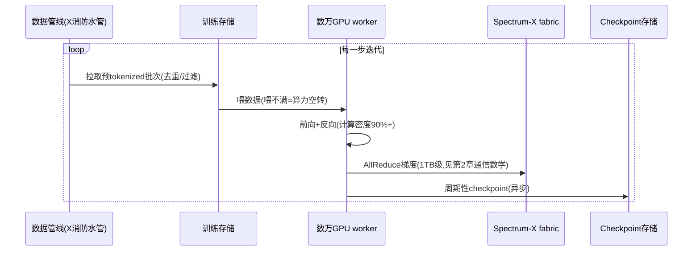

# 4. 建设与训练工作流程

本章回答两个问题：**Colossus 是怎么在 122 天内上线的（建设流程）**，以及**集群上线后，一次 Grok 训练迭代如何组织（训练流程）**。前者有大量公开素材，后者因 xAI 不开源而只能做"黑盒 + 行业通行实践"的重建——两类内容严格分开标注。

## 4.1 选址：一切从电开始

超集群选址的第一性约束是电力，不是地价、不是网络时延。Colossus 选孟菲斯的具体原因（综合当地报道与马斯克公开表态）：

1. **电网余量**：TVA 体系当时有约 150 MW 的可批容量——在 2024 年的美国，这是"立即可用"的稀缺资源；
2. **现成重工业厂房**：原 Electrolux 工厂约 78.5 万平方英尺、层高与承重满足整柜部署，省去 18 个月的新建周期；
3. **政治与经济环境**：孟菲斯欢迎投资、审批快（速度快），且用工成本低；
4. **物流**：孟菲斯是美国航空货运枢纽（FedEx 总部），10 万卡服务器（约 1.2 万台 8 卡服务器、数千吨设备）的到货运输有先天优势。

对比教训：OpenAI Stargate 首期选 Abilene（得州，建新园区，2023 年启动、2024 年底才首批上线）；xAI 用"现成厂房 + 现成电网"把选址到上线的路径压掉两年。**选址决策决定了 80% 的工期。**

## 4.2 建设排程：122 天的关键路径解剖

把 Colossus 的建设拆成任务图（[Mini Demo](07-mini-demo) 场景 1 的完整模型见 `mini-demo/xai_case_mini/build.py`）：

```mermaid
gantt
    dateFormat X
    axisFormat 第%S天
    section 供电
    进场动员                    :a1, 0, 5d
    移动燃气轮机(临时供电)      :crit, a2, after a1, 25d
    电网扩容(后台)              :a3, after a1, 120d
    section 机房与网络
    机房分区装修                :a4, after a1, 40d
    网络pod0铺设                :crit, a5, after a2, 12d
    网络pod1-4(滚动)            :a6, after a2, 12d
    section 服务器
    交付波次0/1                 :a7, after a1, 8d
    交付波次2-9(两两并行)       :a8, after a7, 64d
    上架 rack0                  :crit, a9, after a5 a7, 4d
    上架 rack1-9(单班组滚动)    :crit, a10, after a9, 36d
    section 训练
    首批训练开始                :milestone, m1, after a9, 15d
    集群集成                    :crit, a11, after a10, 21d
    烧机burn-in                 :crit, a12, after a11, 19d
    集群就绪(第122天)           :milestone, m2, after a12, 0d
```

模拟结果与 NVIDIA 官方口径对照：

| 指标 | 教科书串行流程 | Colossus 式重排 | NVIDIA 官方口径 |
|---|---|---|---|
| 集群就绪 | 425 天 | **122 天** | **122 天** |
| 首次训练 | 425 天（烧机后） | 第 61 天 | 首批机柜上架后 19 天 |
| 关键路径 | 电网扩容 → 网络 → 上架 | 临时供电 → 网络 pod → 上架 → 集成 → 烧机 | — |
| 压缩倍数 | — | **3.48×** | — |

三个可复用的排程原则：

1. **把"批准"移出关键路径**：燃气轮机让供电在 30 天内自给，电网扩容变成后台任务（第 125 天才完工，完全不挡 122 天的集群就绪）。凡是"等审批"的环节，都值得问一句：能不能先上一个合规性较弱但功能等价的临时方案？
2. **滚动交付代替一次交付**：网络分 5 个 pod、服务器分 10 个波次，铺好一个 pod 就上架一个 pod——第一片可用算力在第 46 天就出现，而不是第 122 天。
3. **尽早开始训练**：首批训练在第 61 天开始（此时仅约 10% 算力上线），小集群上先跑小规模实验、验证数据管线与训练代码——这也是 NVIDIA 口径"19 天开始训练"的工程含义：**训练不是集群就绪后的庆典，而是建设期的一部分。**

## 4.3 一次 Grok 训练迭代的工作流程（重建）

> **标注**：xAI 未公开训练流程，本节按"万卡级集群行业通行实践 + 马斯克公开只言片语"重建，每个环节标注确定性等级。

| 环节 | 通行实践 | xAI 的公开线索 | 确定性 |
|---|---|---|---|
| 数据摄取 | X 全量帖子流 → 去重/过滤/tokenize → 训练存储 | Grok 的官方卖点即"实时了解世界"；2025 年后 X 数据全部内部化 | 高（产品行为可验证） |
| 并行策略 | 万亿参数级：张量并行 + 流水线并行 + 数据并行混合 | 未公开。Grok-3 起为 MoE（开源情报与官方只言片语） | 低 |
| 精度方案 | BF16 主干 + FP8 部分算子（2024 后标配） | 未公开 | 低 |
| checkpoint | 异步、分层（热/温/冷），RTO 目标分钟级 | 未公开；10 万卡 MTBF 意味着每天至少数次节点故障，checkpoint 必须高频 | 中（推断） |
| 故障处理 | 热备节点替换 + 快速重启 | 未公开；NVIDIA 口径"零丢包、零延迟劣化"说明网络层故障已被吸收 | 中 |
| 训练时长 | 前沿模型一次 run：数周–数月 | Grok-3（2025-02）：马斯克称算力为 Grok-2 的 10 倍；Epoch AI 估算 Grok-4 单次训练约 3.1 亿 kWh（第三方估算，**非官方**） | 低 |

万卡集群的两个铁律在这个流程里体现得淋漓尽致：**喂不饱算力就是亏钱**（数据管线的吞吐必须大于 GPU 消耗数据的峰值），以及**同步训练的可用率是乘积**（10 万卡里任何一张卡挂掉都会停步，MTBF 随规模线性恶化——这正是 Google 把 99.98% 可用率写成 NSDI 论文的原因，而 xAI 没有对应的公开工程披露，见 [第 8 章](08-production-practice)）。

## 4.4 Colossus 2：同一套流程的百万卡复制

Colossus 2 的建设是 Colossus 1 方法论的放大版，也是"单园区思想在物理极限下的演化"：

1. **都会区联邦而非单园区**：孟菲斯怀特海文（约 186 英亩、百万平方英尺仓库、2026-03 获批 6.59 亿美元建设许可）+ 密西西比州南黑文（Southaven）（2026-01 官宣、投资超 200 亿美元、2 月即投入运行）。物理上变成"一都会区两园区"，据报道两园区间有高带宽互联。
2. **供电直奔吉瓦**：MDEQ 批准 41 台永久轮机（约 1.2 GW）+ 电网扩容，长期口径逼近 2 GW。
3. **硬件换代**：GB200（Colossus 2 首期）→ GB300（2026 年内的扩容批次）；报道称 2026-09 已部署约 55 万卡、目标远超 100 万（**未证实**，单一来源为主）。
4. **同样的合规剧本**：先运行、后补许可——Reuters 报道 Colossus 2 运行了 59 台未许可轮机（申报 41 台），环保组织诉讼与 DOJ 介入如约而至（[第 8 章](08-production-practice)）。

## 小结

- 选址决定 80% 工期：现成厂房 + 现成电网余量 + 货运枢纽，孟菲斯三样全占。
- 122 天 = 关键路径重排（燃气轮机除电、滚动交付、训练前置），不是单点加速——[Mini Demo](07-mini-demo) 场景 1 以 3.48 倍压缩复现了这一机制。
- 训练流程是黑盒，但万卡铁律（喂不满即亏钱、可用率乘积）决定了它的形态。
- Colossus 2 把同一套打法放大到吉瓦级，代价是合规债务同步放大。
