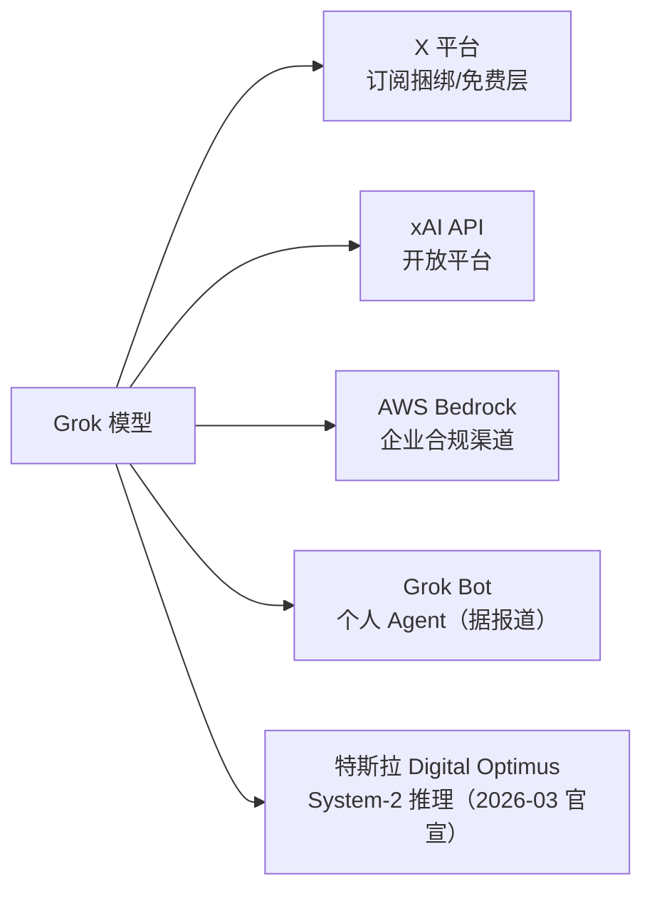

# 5. 核心模块

本章逐个解剖 Colossus 的核心模块。xAI 的技术披露极少，因此每个模块按"已确认事实 → 设计权衡 → 黑盒与未知"三段式展开。

## 5.1 供电系统：双轨制供电与"电力即瓶颈"

**已确认**：电网 150 MW（MLGW/TVA，2024）→ 300 MW（2026-02 获批第二个 150 MW）；自备燃气轮机（孟菲斯最多 35 台临时机组；南黑文（Southaven） 41 台永久机组获批、报道实运行 59 台）。

**设计权衡**：

| 供电来源 | 交付速度 | 单位成本 | 合规风险 | 角色 |
|---|---|---|---|---|
| 电网扩容 | 月–年（审批） | 低 | 低 | 基载（base load） |
| 自备燃气轮机 | 周（到货即装） | 高（燃料+维护） | 高（空气许可） | 抢跑（bridge） |
| 电网长协/核电PPA | 年 | 极低 | 低 | 长期方向（据报道在谈） |

**工程要点**：训练负载是**可调度负载**——功率曲线可以随供电能力爬坡（[Mini Demo](07-mini-demo) 场景 2 的缺口时间线就是在算"每提前一天供电，多上线多少卡"）。xAI 的打法本质是把"供电爬坡"变成"集群爬坡"：来多少电，开多少卡。

**黑盒**：电力调度细节（轮机与电网的切换逻辑、N+1 冗余、UPS 配置）无公开资料。

## 5.2 散热模块：DLC 液冷闭环

**已确认**：Supermicro 4U 8 卡 HGX H100 服务器，每柜 8 台 = 64 卡；直接到芯片液冷 + 机柜内 CDU；Supermicro 称 Colossus 为"世界最大液冷 AI 集群"。

**设计权衡**（[Mini Demo](07-mini-demo) 场景 5）：液冷相对风冷是双重收益——机柜密度提升约 2.2 倍（每柜 72 vs 32 卡）+ PUE 从约 1.4 降到约 1.2（10 万卡集群年省电约 14.7 万 MWh）。液冷的代价是**水与运维**：冷却液分配管路的泄漏检测、水质管理、CDU 冗余——这些恰恰是新闻报道里 xAI 被邻居投诉的维度之一（用水与排放）。

**演化**：H100 整柜约 45 kW → GB200 NVL72 整柜 86–120 kW+ → 行业在试 250 kW+ 的"机柜级电源+液冷一体"形态。Colossus 2 以 GB300 为主，散热密度只增不减；单机柜功率超过 100 kW 后，风冷在任何配置下都不存在选项。

## 5.3 网络 fabric：Spectrum-X 的四个关键能力

**已确认**（NVIDIA 新闻稿）：Spectrum-X 平台 + SN5600（800Gb/s）+ BlueField-3 SuperNIC；Grok 训练实测 95% 持续吞吐、零丢包/零延迟劣化；对照口径"传统以太网约 60%"。

NVIDIA 宣称 Spectrum-X 提供了此前 InfiniBand 独有的四项能力，这是理解整个赌注的钥匙：

1. **自适应路由（Adaptive Routing）**：同一条流的报文可绕开拥塞路径，避免大象流互相撞死——传统 RoCE 的 PFC + 固定路径在这个规模下会产生队头阻塞级联。
2. **逐流拥塞控制（Spectrum-4 ASIC 内置）**：在交换机芯片上直接做 AI 负载的拥塞管理，而不是靠端侧 CC 缓慢收敛——这是"95% vs 60%"数字的主要来源。
3. **AI fabric 可视化**：训练任务级的网络遥测（哪条流、哪个 NVMe、哪个集合通信在掉速）。
4. **性能隔离**：多训练任务共享 fabric 时互不干扰——对应 Colossus "单集群多任务"的运营现实。

**与 IB 的对照**：IB 的 UEC 阵营（Ultra Ethernet Consortium）正在把同样的能力标准化；xAI 的赌注如果成功，动摇的是 IB 在 AI 训练网络的垄断叙事；如果失败（比如超大规模下的长尾抖动失控），行业会回到 IB。截至 2026 年，NVIDIA 自己的表态（Spectrum-X 成为其 AI factory 参考架构的默认选项）说明赌注在赢。

**黑盒**：Colossus 的 fabric 拓扑细节（Clos 层数、无阻塞比、rail-optimized 布线）未公开；10 万卡 × 400 Gb/s 注入 = 40 Pb/s 级 fabric 的具体组网图不存在于公开资料。

## 5.4 训练栈：最大的黑盒

xAI 没有公开任何训练框架、并行库或内核代码。从公开物料能确认的边界：

- **Grok-1 开源物料**（2024-03，GitHub/Hugging Face）：314B 参数 MoE（8 个专家、每 token 激活 2 个，约 25% 权重活跃）；仅放权重与极简推理示例，无训练代码；Apache 2.0。
- **PromptIDE**（2023-11）：xAI 放出的 Grok 提示工程 IDE（Python SDK + 逐 token 分析），后来停止维护下线——是 xAI 工具链仅有的公开窗口。
- **招聘与技术演讲线索**：大规模训练系统、CUDA/内核优化、JAX 系等关键词见诸报道，但无法交叉验证，标注为**未证实**。

**可推断的部分**（标注为推断）：一个 10 万卡 MoE 训练栈至少需要——3D 并行运行时（TP/PP/DP + 专家并行）、MoE 感知的路由/均衡、FP8 计算图、高频异步 checkpoint、机故障自动剔除与弹性重启。这些组件 Google（Pathways/XLA）、Meta（PyTorch + RSC 经验）都有公开实现或论文，xAI 大概率走了自研 + 现成组件混合的路线，但具体选型无据可查。

这个黑盒本身就是案例的一部分：**它意味着 xAI 的"快"无法被同行完整审计**，也让它的基础设施故事只能靠供应商与媒体侧写。

## 5.5 数据管线：X 消防水管

**已确认（产品行为层面）**：Grok 的官方定位是"基于 X 实时数据、了解当下世界"；2025-03 xAI 收购 X 后，X 全部数据内部化，且马斯克公开表示 X 上的公开/互动数据用于 Grok 训练（有用户协议层面的争议，欧洲国家曾就 GDPR 合规质询 X）。

**工程含义**：

- **摄取**：X 帖子流（文本 + 图片 + 视频）→ 多模态处理管线 → 去重/质量过滤 → tokenize → 训练存储。峰值吞吐要喂饱 10 万卡（见 4.3 的铁律）。
- **时效性**：这是 xAI 独有的数据优势——新闻事件发生后分钟级的语料进入训练/上下文；Grok 的"实时搜索回答"产品功能就是这条管线的直接变现。
- **人类偏好数据**：X 的互动信号（点赞/转发/长回复）天然是偏好数据矿；Grok 的"少审查"风格部分来自对这些信号的直接学习，也带来 [第 8 章](08-production-practice) 的治理争议。

## 5.6 分发层：从 X 订阅到 AWS Bedrock

**已确认**：X 内分发（2023-11 Premium+ 首发 → 2024-11 免费层 → 2026 年据报道与 Grok Bot、Cursor 等打包成 8/30/100/200 美元四档订阅）；独立 grok.com 与 App；开放 API；AWS Bedrock 企业渠道（Grok 4.3 于 2026-06 上架、4.6 与 4.7 随后——AWS 官方博客确认）。

**设计权衡**：X 自有渠道提供用户与数据闭环，但变现单价低；AWS Bedrock 让 Grok 进入企业合规市场（IAM、VPC、Guardrails），代价是渠道抽成与对 AWS 的依赖——对一家自己建有百万卡集群的公司，把推理放到 AWS 上卖，本身就是"训练自建、推理多渠道"的运营哲学。

## 小结

- 供电模块：可调度负载 + 双轨制（电网基载 / 轮机抢跑），爬坡对齐。
- 散热模块：液冷是密度与 PUE 的双重必选项，代价是水与运维。
- 网络模块：Spectrum-X 的四项能力（自适应路由、芯片级拥塞控制、可视化、隔离）是"以太网训前沿模型"的全部支点。
- 训练栈：全黑盒；Grok-1 只开源权重、PromptIDE 已下线，可审计性极低。
- 数据与分发：X 数据闭环是飞轮；Bedrock 是对冲与增量市场。
