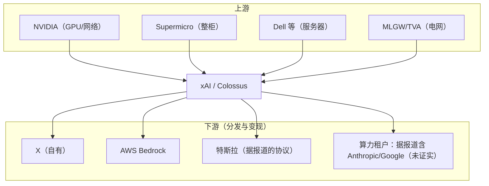

# 6. 源码与生态分析

xAI 没有公开的"源码"可分析——这是它与 Google（JAX/XLA/MaxText 全开）、Meta（Llama + PyTorch 生态）最大的不同。本章做三件事：五家路线对比、xAI 开源盘点（仅有的两样）、以及"为什么 xAI 不开源"的分析。

## 6.1 五大基础设施路线对比

| 维度 | xAI | OpenAI | Anthropic | Meta | Google |
|---|---|---|---|---|---|
| 加速硬件 | NVIDIA H100/H200/GB200/GB300 | NVIDIA（+ 定制硅传闻） | NVIDIA GPU（曾租 Google TPU） | NVIDIA GPU + OCP 自研 MTIA | 自研 TPU（v4→8t/8i） |
| 集群形态 | **单一训练域**（孟菲斯都会区 10 万→100 万卡） | 多园区 Stargate（阿比林首期等） | 多区域租用 + 自有 | 多个中型集群 + Grand Teton 机柜 | Pod 级 3D-torus + OCS，单控制器 |
| 训练网络 | **Spectrum-X 以太网（RoCE）** | IB + 定制（据报 Orion） | IB / 租用 fabric | RoCE（Wedge/Minipack 自研交换机） | ICI + OCS 光路 + Falcon |
| 可靠性工程 | **无公开披露（黑盒）** | 无论文，行业传闻多 | 无论文 | SDC/静默损坏治理公开 | **NSDI'24 双路径恢复 / 99.98%** |
| 软件开源 | 仅 Grok-1 权重 + PromptIDE（已下线） | 几乎全闭 | 几乎全闭 | 权重开放 + 生态开源 | **全栈开源（JAX/XLA/MaxText）** |
| 技术披露方式 | 官方公告 + 供应商案例 + 马斯克发言 | 博客 + 演讲 | 系统卡片 + 论文（安全向） | 论文 + OCP 规范 | **论文（NSDI/ISCA）+ 架构文档** |
| 数据优势 | **X 实时数据** | 合作数据 + 用户数据 | 人工标注/红队体系 | 社交数据（FB/IG） | Search/YouTube 全家桶 |
| 分发优势 | **X 数亿用户** | ChatGPT 第一品牌 | API 企业信任 | 开源渗透 | Gemini 全家桶 |

这张表读出三个结构性判断：

1. **xAI 与 Google 是光谱两端**：Google 把一切都写成论文（甚至可靠性工程），xAI 把一切都压成公告。前者换取学术与人才红利，后者换取速度与保密。Meta 居中（开放权重换生态）。
2. **xAI 与 OpenAI 的"像"与"不像"**：两家都是闭源 + NVIDIA 硬件，但集群哲学相反——OpenAI 用 Stargate 押注"多园区异步 + 超大 DCI"，xAI 用 Colossus 押注"单训练域同步"。2026 年的胜负还远未分晓，但 xAI 的通信数学（[第 2 章](02-core-ideas)）说明它的路线在模型变大时占便宜。
3. **xAI 与 DeepSeek 是效率光谱的两极**：DeepSeek 用算法/工程效率在有限算力上榨性能（MLA、FP8、专家并行），xAI 用资本与组织速度堆算力。前者每 FLOP 更聪明，后者每季度更多 FLOP（详见 [DeepSeek 案例](/09-case-study/deepseek/)）。

## 6.2 xAI 开源盘点

xAI 开源史只有两件值得一提的东西，且一件已死：

| 项目 | 时间 | 内容 | 现状 |
|---|---|---|---|
| Grok-1 权重 | 2024-03-17 | 314B MoE、8 选 2 专家、Apache 2.0；仅权重 + 极简推理示例，**无训练代码** | 可下载（Hugging Face / GitHub 种子） |
| PromptIDE | 2023-11 | Grok 提示工程 IDE：Python SDK、逐 token 分析、版本化 | **已停止维护并下线** |

对比 Meta 的 Llama（权重 + 完整推理代码 + 社区生态）与 Google 的 Gemma/MaxText，xAI 的"开源"更接近**一次性公关动作**而非生态战略：

- Grok-1 开源时值 314B 是当时最大的开放权重模型，但选的是"旧一代基座 + 无训练代码"——复现价值低，新闻价值高；
- 之后的 Grok-2/3/4 系列再未开放权重；2026 年 Musk 关于"Grok-4.x 考虑开源"的表态多次反转（公开表态记录可查），截至 2026-10 无实际开源动作。

## 6.3 黑盒的代价：第三方只能"侧写"

正因为 xAI 不开源、不发论文，外界对它的技术评估全部依赖间接证据：

- **Epoch AI 的能耗/成本估算**（Grok-4：约 4.9 亿美元算力成本、约 3.1 亿 kWh、约 14 万吨 CO2——第三方估算，方法学公开但输入为推测，**非官方数据**）；
- **NVIDIA/Supermicro 案例**：网络与整柜数字的权威来源，但只覆盖硬件层；
- **基准测试**：xAI 自报数字（Grok-3/4 发布时的高分）与第三方复测（LMSYS Arena 等）常有落差，引用时以第三方复测为准。

对工程读者的启示：**闭源路线的技术信誉要靠产品行为与第三方验证维持**——Grok 的"实时性"是产品行为可验证的，而"训练效率/MFU"在闭源下无法验证，这正是它在与 Google/Meta 的招聘竞争中需要支付溢价的原因之一（见 [第 8 章](08-production-practice) 人才流失）。

## 6.4 生态位：xAI 是谁的供应商、谁的客户

一个颇具戏剧性的生态事实：截至 2026 年，据报道 xAI 一方面与 Anthropic 是模型竞争的死敌，另一方面被报道将 Colossus 1 的算力租给 Anthropic（年租金约 50 亿美元的说法来自加密行情快讯类来源，**可信度低，标注为未证实**）；Google 也被报道租用了约 11 万卡。**在算力过剩周期，最大的对手也可能是最有钱的客户**——这是超集群商业模式的有趣注脚。

## 小结

- 五家路线对比：xAI = 闭源 + NVIDIA + 单训练域 + 零技术披露；与 Google（全栈开源+论文）构成光谱两端。
- xAI 的开源史 = Grok-1 权重（无训练代码）+ PromptIDE（已死），是公关动作而非生态战略。
- 闭源的代价：技术信誉只能靠产品行为与第三方估算维持，MFU/可靠性无法审计。
- 生态上 xAI 同时是 NVIDIA 的最大客户之一、X 的拥有者、AWS 的模型供应商、以及（据报道）竞争对手的算力房东。
