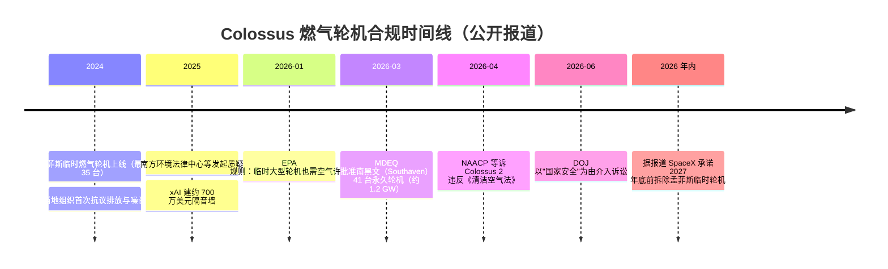

# 8. 企业生产实践：激进扩张的代价与对冲

xAI 几乎不公开可靠性数据——**"可靠性黑盒"本身就是它生产实践的一部分**。本章 therefore 从四个有公开记录的维度展开：环保合规、电网博弈、人才流失、治理与关联交易，最后看它的对冲动作（算力租赁）。这章的性质与前几章不同：它是"代价的账本"。

## 8.1 环保与合规：燃气轮机的诉讼链

"速度即战略"的第一笔债务开在空气里。公开记录的时间线（Reuters、当地媒体、法院文件）：

关键事实与口径：

- **Reuters 调查**（2026）：Colossus 2 实际运行 **59 台**未许可轮机，为对外披露数量（41 台）的近 1.5 倍——"先上车后补票"升级为"多上车少报票"。
- **EPA 2026-01 规则**堵上了"临时设备豁免"的口子：以后"临时"燃气轮机也必须先拿许可——xAI 用的套利窗口被制度性关闭。
- **DOJ 的"国家安全"介入**是这出戏最戏剧性的转折：超集群算力被定义为战略资产后，环保诉讼的胜算与公众舆论变得更加复杂。
- **代价的量级**：第三方估算（Epoch AI 方法学）Grok-4 单次训练约 14 万吨 CO2；Colossus 2 的 59 台轮机按满负荷估算年排放可达数十万吨级（估算值，非官方披露）。

对照组：Google 的 24/7 无碳能源与 PUE 1.09、微软的核电 PPA、Meta 的公开水电账本——**当对手把可持续性做成招聘与公关资产时，xAI 的排放黑账就成了双向负资产**。但也要公平地记录另一面：燃气轮机是被电网审批速度逼出来的（[第 7 章](07-mini-demo) 场景 2 的 180 天缺口），而 "DOJ 国家安全介入" 说明监管层面对"AI 算力要不要为环保让步"尚无定论。

## 8.2 电网博弈：从 150 MW 到吉瓦

供电扩张的公开节点：

- 2024：MLGW/TVA 批准 150 MW（当时 TVA 体系内罕见的大单）；
- 2026-02：第二个 150 MW 获批，合计 300 MW——足够支撑 Colossus 1 全量；
- 2026-03：南黑文 41 台永久轮机（约 1.2 GW）获批；
- 规划口径：Colossus 2 长期逼近 2 GW（二手汇总）。

电网博弈的要点不在数字，在**时序**：电网扩容的审批以"年"计，而 GPU 交付以"周"计。xAI 的应对是"轮机抢跑 + 电网基载"双轨制（[5.1 节](05-core-modules)），这套打法被后来的从业者广泛复制——2025 年后美国 AI 数据中心带动的燃气轮机订单激增，可以说有 Colossus 的示范效应。它的副作用是**把 AI 扩张的电力成本外部化给了当地社区**（电价、排放、用水），这也是环保争议的底层燃料。

## 8.3 人才流失：创始团队过半离开

这是 2026 年初 AI 行业最受关注的人事地震（Fortune、TechCrunch、Observer、DCD 密集报道）：

- **时间线**：Kosic（2024 中，→OpenAI）→ Szegedy（2025-02，→Morph Labs）→ **Babuschkin**（2025-08，Grok 的灵魂人物，创立 Babuschkin Ventures，后创立 River AI）→ **Greg Yang**（2026-01，健康原因退居顾问）→ **Tony Wu 与 Jimmy Ba 在 48 小时内先后离开**（2026-02）→ Pohlen、Guodong Zhang、Zihang Dai、Kroiss、Nordeen 随后（2026-03）。Fortune 2026-02-11 标题："xAI 创始团队已有一半离开"；有数据公司（Crustdata）追踪称一年内 25+ 高管离职、CFO 上任 6 个月即离开；"最终 11 人全部离开、仅剩马斯克"的说法存在但为**单一来源，未完全证实**。
- **公开归因**（FT 等报道口径）：对马斯克"不合理的技术里程碑承诺"的幻灭、产品层面的挫败（MacroHard 编码工具与 "Ani" 陪伴产品的表现）、Grok 内容治理引发的监管麻烦。
- **基础设施视角的解读**：创始团队里恰是训练系统与模型理论的核心人物（Babuschkin/Yang/Wu/Ba），他们的集体离开说明 **"速度文化"的折旧率极高**——用股权和使命感压缩工期，换来的忠诚也以工程周期为半衰期。对比 Google DeepMind 十年稳定的核心团队，这是 xAI 模式的隐性成本。

## 8.4 治理：关联交易、合并与"一个人的公司"

- **xAI 收购 X**（2025-03，约 330 亿美元全股票）：把数据/分发内部化，同时把 X 的债务与内容治理麻烦并入自己报表。
- **据报道 SpaceX 收购/合并 xAI**（2026 年初，服务于 SpaceX IPO 叙事；合并后实体一度被称 "SpaceXAI"，后续品牌口径混乱，**细节为单一来源，未完全证实**）。
- **特斯拉-xAI 关联交易**：2025-11 特斯拉股东投票未通过对 xAI 的投资提案（弃权票计为反对），2026-01 据报道重新达成 20 亿美元投资协议；围绕 Grok 与 FSD 的模型授权/收入分成存在多起股东诉讼。
- **治理模式**：马斯克同时控制 xAI、X、特斯拉、SpaceX（+ Neuralink、Boring），各公司间的数据、算力、人才流动由马斯克个人决策驱动——这种"一个人的控股集团"在速度上是优势，在**利益冲突与少数股东保护**上是持续的诉讼来源。

## 8.5 可靠性黑盒与对冲动作

**可靠性**：xAI 没有任何公开的可用率数字、故障复盘或 SRE 实践披露。可以确定的只有间接证据：Colossus 持续产出模型（Grok 3→4→4.x 节奏约每季度一版）说明其训练有效率在可接受范围；NVIDIA 口径的"零丢包、零延迟劣化"说明网络层没有成为瓶颈。但对照 [Google 案例](/09-case-study/google/) 的 NSDI'24 方法论（双路径恢复、99.98% 可用率、SDC 治理），xAI 的可靠性工程**完全不可审计**——单园区架构让这个黑盒的风险权重更高。

**对冲动作**（2026 年密集出现）：

| 动作 | 报道口径 | 可信度 |
|---|---|---|
| 据报道把 Colossus 1 大部分算力租给 Anthropic（年租金约 50 亿美元的说法） | 加密快讯类来源 | **低，未证实** |
| 据报道 Google 租用约 11 万卡 | 二手汇总 | 中低 |
| Grok 4.3/4.6/4.7 上架 AWS Bedrock | AWS 官方博客 | **高（官方）** |
| SpaceX 承诺 2027 年拆除孟菲斯临时轮机 | 当地媒体 | 中高 |

对冲逻辑不难读：**训练算力自用以抢时间，闲置/第二梯队算力变现以摊薄成本，推理分发借 AWS 渠道以降低获客成本**——这是一家"算力过剩焦虑症"患者的典型组合。

## 小结

- 环保账：59 台未许可轮机、NAACP 诉讼、DOJ 介入、2027 拆机承诺——"先上线后合规"的利率正在变高。
- 电网账：150→300 MW→吉瓦，轮机抢跑被全行业模仿，电力成本部分外部化给社区。
- 人才账：创始团队过半离开（含 Babuschkin/Yang/Wu/Ba），速度文化的折旧率极高。
- 治理账：xAI-X-SpaceX-特斯拉的关联交易与股东诉讼是持续成本。
- 对冲账：算力租赁 + Bedrock 渠道摊薄激进扩张的财务风险；可靠性依旧黑盒。
